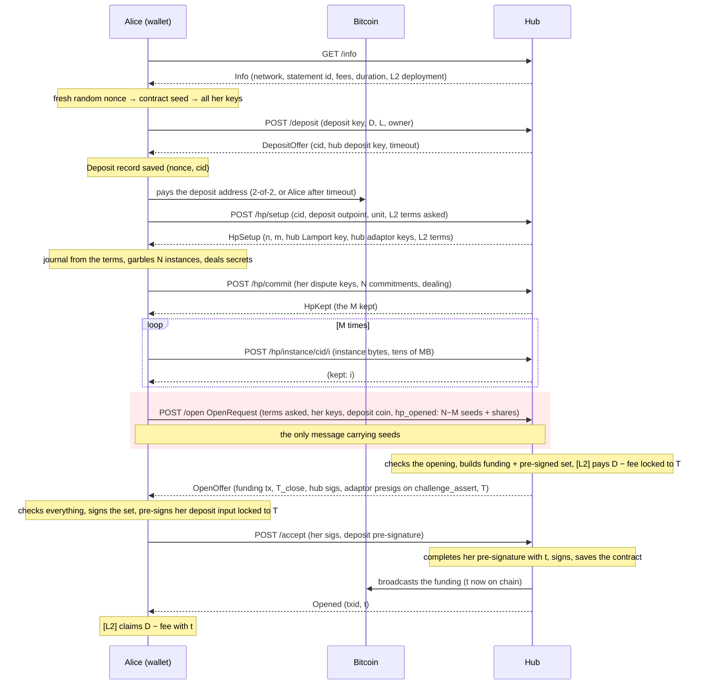

# A contract's opening, message by message

How a wallet (Alice) and a hub open a contract: every HTTP call, who sends
what, what each side checks and keeps, and where secrets leave the wallet.
From the code at master 6ad7f01. The sequence is lichen's (`crates/wallet/src/lib.rs`
`open_contract` and `open_with`, `crates/wallet/src/hp.rs` `hp_opening`; the
hub's routes in `crates/hub/src/lib.rs:411`, handlers in `lib.rs` and
`setup.rs`). An L2 (Lexit, glichen, vlichen) fills in only its hooks
(`WalletL2`, `HubL2`), marked **[L2]** below.

Sizes are for N = 78, M = 10 (every network but regtest, which keeps 2 of
4); π1 is 254 two-bit digits, each with 4 values.

## The whole exchange

## Step by step

### 1. `GET /info`

**Hub → Alice** (`Info`, `crates/proto/src/lib.rs:189`): its Bitcoin
network, its statement's id (the guest image, or the mock), `reserve_ppm`,
its fee (`fee_ppm`, or `pricing` by capital and time), `max_liquidity`,
`duration` (blocks from opening to `T_close`), its version and commit, and
**[L2]** `l2` (the deployment: keys a wallet must know, the guests).

**Alice checks** the network and statement id against her own, and makes
her quote from it (fee, cap, unit, what she'll be minted).

### 2. `POST /deposit`

Alice first draws the contract's **nonce**: 32 random bytes
(`lib.rs:379`). Her contract seed is `"{wallet key}/contract/{nonce}"`, and
every key of the contract derives from it (`ContractSecrets`).

**Alice → hub** (`DepositRequest`):

| field | what |
|---|---|
| `alice` | her key in the deposit's tree |
| `deposit`, `liquidity` | D and L she'll ask, so the hub can refuse before she pays |
| `owner` | her L2 key (the contract's owner) |

**Hub → Alice** (`DepositOffer`): `cid` (the contract's number), `hub` (its
key in the deposit's tree, from its seed and `cid`), `timeout` (the
refund's, in blocks).

**Alice checks** the timeout is the network's (`deposit_timeout`: 2,880 on
Mutinynet, 144 on signet and testnet4), then **saves a `Deposit` record**
(nonce, cid, hub key, timeout, payout) *before paying*, so the refund is
always possible.

**On Bitcoin:** she pays `D + r_A` plus the funding fee's share and her fee
budget to the deposit address: a NUMS-keyed tree with two leaves,
`deposit_open` (Alice and the hub: what the funding spends) and Alice
alone after `timeout` (her refund). The wallet waits for it to confirm.

### 3. `POST /hp/setup`

**Alice → hub** (`HpSetupRequest`): `cid`, `deposit` (the coin's
outpoint), `unit`, and **[L2]** `l2`, the statement's terms she asks
(`WalletL2::setup_terms`; Lexit: the deployment, a checkpoint, `from`,
`drift`).

**Hub checks** a deposit was asked for `cid`, the coin is to its address,
confirmed, unspent and not near its refund; **[L2]** checks and completes
the terms (`HubL2::setup_terms`, "the hub's own added").

**Hub → Alice** (`HpSetup`):

| field | what | size |
|---|---|---|
| `n`, `m` | the cut-and-choose: 78 instances, 10 kept | |
| `lamport` | the hub's one-time Lamport key for π1: 4 hashes a digit | 254 × 4 × 20 B ≈ 20 KB |
| `adaptor` | the hub's one-time adaptor keys: one a digit and value | 254 × 4 × 32 B ≈ 33 KB |
| `l2` | the statement's terms, as fixed | |

The hub **stores** this (`hp/<cid>.json`) and answers the same again.

**Alice checks** the setup is for her cid, unit and deposit; a Lamport and
adaptor key set per digit; `log2 C(n, m)` ≥ the network's minimum (about 40
bits for 78/10); **[L2]** the terms (`check_setup`; Lexit: `from` within 120
of Liquid's tip).

### 4. Alice garbles (local)

- **[L2]** her dispute keys (`alice_keys`) and the **journal**
  (`setup_journal`): the statement's public input. Lexit's is
  `cid ‖ D ‖ SHA256(deposit outpoint)`, `D` the hash of the contract's
  terms. The hub's Lamport and adaptor keys are not in it; they bind
  through the graph's scripts and pre-signatures.
- `hp_seed` = contract seed under `/hp`, hashed with the journal
  (`Garbler::new`), so another journal gives other secrets.
- **The dealing:** from `hp_seed`'s `"dealing"`, one polynomial `f_{j,β}`
  of degree N − M = 68 for each digit `j` and value `β` (1,016 of them).
  `f(0)` is the secret a challenge reveals; `f(i)` instance `i`'s share.
- **The instances:** instance `i`'s seed is `hp_seed`'s `"instance/i"`. It
  gives the witness encryption's `r`, `msg` (the hashlock preimage of
  `wrongly_challenged`) and the garbled circuit; the shares `f(i)` go into
  its input table; its ciphertext encrypts `msg` to the verifying key and
  journal. Its commitment hashes its parts, their lengths bound.

### 5. `POST /hp/commit`

**Alice → hub** (`HpCommit`):

| field | what | size |
|---|---|---|
| `cid` | | |
| `keys` | **[L2]** her dispute keys (so the journal) | |
| `commitments` | each instance's hash, hex | 78 × 32 B |
| `dealing` | Feldman commitments to every coefficient: `a_t·G` | 254 × 4 × 69 × 33 B ≈ 2.3 MB (4.6 MB hex) |

**Hub checks** N commitments, **[L2]** the keys (`check_keys`), the
dealing's encoding. If a commitment is stored already, it must be the same,
and the hub returns the kept set it chose then; otherwise it **chooses M at
random**, stores the commitment and the choice.

**Hub → Alice** (`HpKept`): `kept`, M instance numbers, increasing.

**Alice checks** M distinct numbers in `1..=N`.

### 6. `POST /hp/instance/<cid>/<i>`, once per kept instance

**Alice → hub:** the instance's bytes (tens of MB each; a few hundred MB in
all). This is the slow step.

**Hub checks** `i` is kept, the bytes parse as an instance of the circuit's
shape (`has_shape`), and hash to the commitment; it stores the file
and the instance's hashlock `hmsg`.

**Hub → Alice:** `{"kept": i}`. Alice keeps each kept instance's `hmsg`.

Nothing so far reveals a seed: a kept instance is garbled, its seed stays
with Alice.

### 7. `POST /open`: the opening request

**Alice → hub** (`OpenRequest`, `crates/proto/src/lib.rs:275`):

| field | what |
|---|---|
| `alice` | her contract public keys: funding, payment (her 2-of-2 leaves), delayed, payout script |
| `l2_address` | where the hub mints `D − fee` on the L2 |
| `deposit`, `liquidity`, `fee`, `reserve` | D, L, the hub's fee, her reserve `r_A` |
| `cid`, `deposit_coin` | the contract, her deposit (outpoint and output) |
| `fee_spk` | where the funding pays her fee budget |
| **`hp_opened`** | **for each of the N − M instances not kept: its number, seed and shares** (68 × 32.5 KB ≈ 2.2 MB; 4.4 MB hex) |

**This is the only message that carries seeds.**

**Hub checks:** liquidity ≤ its most; the fee ≥ its own; not open already;
no other offer pending for `cid` less than a minute old; the deposit coin
(as in step 3, and before its broadcast deadline: the first half of the
refund's timeout). Then the opening (`hp_open_keys`,
`lichen_babe::opening::check`): every kept instance uploaded; exactly the instances not
kept opened; their shares on the dealing's polynomials; each rebuilt from
its seed and shares to its commitment, for the statement's verifying key
and journal. **[L2]** its keys (`open_keys`).

**Hub builds:**
- `T_close` = height + `duration`; the terms (cap, unit); its reserve (its
  share of the cap, at least what a lost dispute's floors take);
- the funding transaction: Alice's deposit coin and the hub's coins in; the
  contract output, Alice's fee budget, the hub's change out;
- the pre-signed set on it, signed with its payment key;
- its adaptor pre-signatures on `challenge_assert`, one per digit and
  value, each adapted to her dealing's point `f_{j,β}(0)·G`
  (`hp_presign`);
- `t`, the funding's adaptor secret (from its seed, `cid`, her L2 address
  and the funding's txid), and `T = t·G`;
- **[L2]** `offered`: the L2's part, e.g. Lexit pays `D − fee` of L-BTC on
  Liquid to a mint key behind `T`.

It holds the offer **in memory** as pending.

**Hub → Alice** (`OpenOffer`):

| field | what |
|---|---|
| `cid`, `t_close`, `reserve_hub` | |
| `hub` | its contract public keys |
| `hp_windows` | BABE's windows: Δ2 for her challenge, Δ1 for the hub's answer |
| `hp_presigs` | its adaptor pre-signatures on `challenge_assert` (1,016 × 97 B ≈ 99 KB) |
| `l2` | **[L2]** its keys for the front |
| `funding`, `hub_coins` | the funding transaction, its own inputs' prevouts |
| `hub_sigs` | its signatures on the pre-signed set, but those it withholds (`wrongly_challenged`, its own to post) |
| `mint_point` | `T` |
| `l2_offer` | **[L2]** e.g. where the mint is |

### 8. Alice checks the offer, then `POST /accept`

**Alice checks:**
- the cid; the terms are her quote's (unit, cap); `T_close` at least
  `min_duration` away;
- **[L2]** the dispute keys (`hp_keys`); she builds the record and the
  contract, and checks the funding spends her deposit and pays the
  contract and her fee budget (`check_deposit_funding`);
- the hub's signature on every input of the pre-signed set it didn't
  withhold; her fee budget covers her heaviest terminal transaction;
- the windows are the network's, and the hub's pre-signatures on
  `challenge_assert` verify against her dealing's points
  (`hp_check_offer`): her challenge will be able to complete them;
- the mint is the quote's; **[L2]** `check_offer` (Lexit: the L-BTC is
  confirmed on Liquid, to the mint key behind `T`, before she signs).

**Alice signs** every transaction of the set with her payment key, and
**adaptor-signs her deposit input** of the funding (the `deposit_open`
leaf), locked to `T`. She saves the offer in her `Deposit` record.

**Alice → hub** (`Accept`): `cid`, `alice_sigs` (her signatures on the
set), `deposit_presig` (her pre-signature, locked to `T`).

**Hub checks** her signatures, including those on what it withheld
(`hp_accept`: its answer will need them); her pre-signature verifies under
`T`; the deposit is still before its broadcast deadline. **Hub completes**
her pre-signature with `t`, adds its own deposit signature and its coins'
signatures, **saves the contract** (before broadcasting, so a crash can't
forget it), **broadcasts the funding**, and **[L2]** opens the account
(`funded`).

**Hub → Alice** (`Opened`): `txid`, `t`.

### 9. Open

Alice watches for the funding, records the contract, drops the `Deposit`
record once the funding is seen, and **[L2]** claims the mint with `t`
(`claim_mint_with`; Lexit sweeps the L-BTC). If the answer was lost, `t`
is still hers: her completed signature in the funding on chain gives it
(`claim_mint`).

## Who learns what, and when

| when | Alice reveals | the hub reveals |
|---|---|---|
| `/deposit` | her deposit key, D, L, her L2 key | its deposit key, `cid` |
| `/hp/setup` | the L2 terms she asks | Lamport and adaptor keys; the terms |
| `/hp/commit` | her dispute keys; N instance hashes; the dealing's commitments | its kept set |
| `/hp/instance` | the M kept instances, garbled (no seeds) | |
| **`/open`** | **the N − M opened seeds and shares**; her contract keys | the funding, its signatures and pre-signatures, `T` |
| `/accept` | her signatures; her pre-signature on the deposit | `t` (and on chain) |

What the hub never gets: a kept instance's seed (it would give that
instance's `msg`, which answers a challenge without a valid proof), or
more than N − M shares of any polynomial before a challenge reveals `f(0)`.

## State, and what a retry does

| | Alice | the hub |
|---|---|---|
| after `/deposit` | `Deposit` record: nonce, cid | `deposits/<cid>.json` |
| after `/hp/setup` | nothing new | `hp/<cid>.json`: the setup |
| after `/hp/commit` | nothing new | the commitment and the kept set |
| after `/hp/instance` | the `hmsg`s, in memory | the instance files, their `hmsg`s |
| after `/open` | nothing new | the offer, in memory (replaceable after a minute) |
| after `/accept` | the offer, in the `Deposit` record | `contracts/<cid>.json`, before broadcasting |

`resume_open` (the app's "Resume the opening") restarts from step 3 with
the same `Deposit`, so the same nonce: it garbles the same instances again
(the seeds are deterministic, so nothing large is stored), commits, uploads
and opens. An honest hub returns its stored setup and kept set, so the
retry reveals nothing new.
