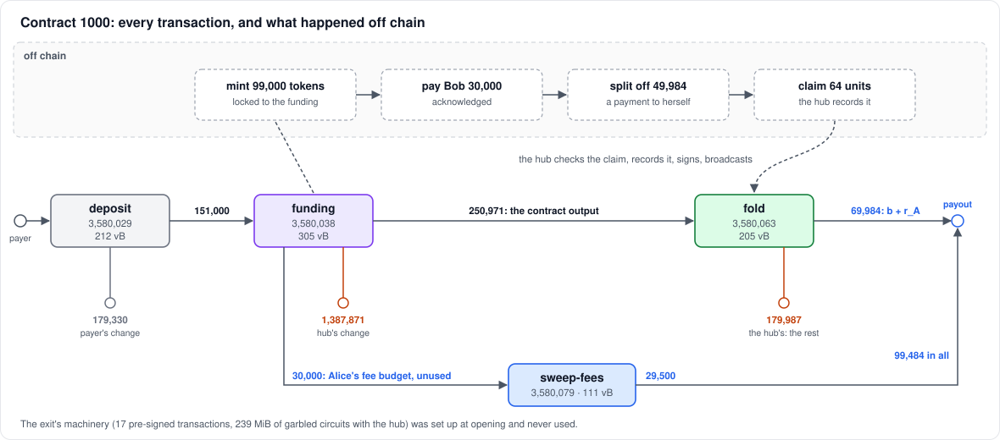
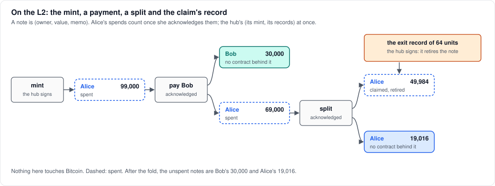
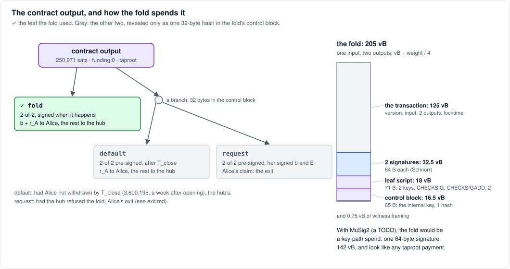
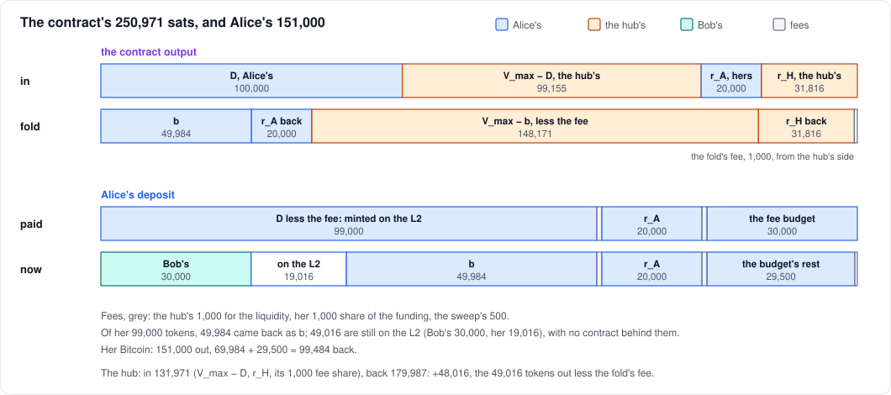

# A cooperative withdrawal

The simplest ending, on Mutinynet (2026-11-11):

1. Alice opens contract 1000 with a 100,000-sat deposit and 100,000 of
   liquidity ([opening.md](opening.md)).
2. She pays Bob 30,000 on the L2, and acknowledges the payment
   ([payments.md](payments.md)).
3. She withdraws 49,984: a claim of her notes, which the hub records on
   the L2, and the fold, which closes the contract in one transaction.

Every transaction is linked to the Mutinynet explorer, and sizes and fees
are as mined.



| transaction | block | size | fee | paid by |
|---|---|---|---|---|
| [deposit](https://mutinynet.com/tx/9749619ec83f9afd8c1be3b9be99ae1175c59929b8a940a5d66828440ef5f01f) | 3,580,029 | 212 vB | 227 | Alice's payer wallet |
| [funding](https://mutinynet.com/tx/59f181a9e2a21958628c9685d26ad3c1c3803fbb3558e97fc77ff583da1bfa2b) | 3,580,038 | 305 vB | 2,000 | half each |
| [fold](https://mutinynet.com/tx/73d282f3e9907a03958cd5c3832f72fd7c10035968066b5dbb6bb06beb9a8820) | 3,580,063 | 205 vB | 1,000 | the hub |
| [sweep-fees](https://mutinynet.com/tx/302fe03fa0e3f09d943bf0db7cce2eea925d65c0908c20c413abd17a70af119e) | 3,580,079 | 111 vB | 500 | Alice's fee budget |

The whole life of the contract: **833 vB, 3,727 sats in fees.** The
withdrawal itself, the fold and the fee sweep, is 316 vB.

## The contract

| term | value |
|---|---|
| deposit `D` | 100,000, of which 99,000 minted (the hub's fee for the liquidity is 1,000) |
| cap `V_max` | 199,155: 255 units of 781 |
| Alice's reserve `r_A` | 20,000 |
| the hub's reserve `r_H` | 31,816 |
| `T_close` | 3,600,195, a week after opening |

The contract output holds `V_max + r_A + r_H` = **250,971 sats**. On the
cooperative path none of the dispute machinery appears on chain. At
opening the two sides still exchanged every pre-signed transaction an
exit could need, and Alice garbled the circuits that would check the
hub's proof. Her ability to exit, with no help from the hub or the
sequencer, is what makes the hub agree to a fold.

## On the L2



1. **The mint.** With its offer, the hub minted 99,000 to a key locked to
   the funding; once the funding was out, Alice moved it to her own key
   with the secret the funding revealed, and acknowledged that move.
2. **Paying Bob.** She spent her 99,000 into 30,000 for Bob and 69,000 of
   change. The change stayed locked until she acknowledged the payment
   against an anchor ([payments.md](payments.md)). Bob needs no contract
   to receive it.
3. **The split.** A withdrawal claims whole notes, so to withdraw 49,984
   (64 units of 781) her wallet paid herself a note of exactly 49,984 out
   of the 69,000, and waited for that payment to be anchored and
   acknowledged. A withdrawal of a note she already holds, or of all her
   notes, needs no split.

## The withdrawal

**The claim.** Alice's wallet builds the same claim an exit would post
on Bitcoin ([exit.md](exit.md)): her notes by position, signed by their
owner for this contract, and `b` = 64 units. With it, it builds the fold
from the contract's terms, signs it, and sends the hub both
(`POST /withdraw`).

**The hub checks the claim against its own ledger,** now, not at an
anchor: each position is a note of hers, unspent, and unlocked (or the
claim carries the acknowledgment that unlocks it); the owners signed it
for this contract; the notes are worth at least `b` units. Then it
sequences the claim's **exit record** on the L2, which retires the notes:
a transaction the hub signs, so it counts at once, with no
acknowledgment. Only then does it sign the fold, and broadcast.

There's no wait for an anchor or a proof. The hub can fold at once
because the record is the hub's own word, applied by its own sequencer,
and because Alice is covered either way: if the hub records the claim
and then won't fold, her exit posts the very same claim, and the
contract's own exit record isn't a spend against it; if it never records
it, the notes are still hers. Either way she is paid, so she needn't
know which.

**Timing.** Olga's withdrawal of 60,000 from contract 1006, in the same
run, shows where the time goes:

| block | time (UTC) | what |
|---|---|---|
| 3,580,107 | 02:41:24 | `lichen withdraw 1006 60000`: 76 units, 59,356 sats |
| 3,580,109 | 02:42:05 | her wallet splits off a note of 59,356, a payment to herself, locked until acknowledged |
| 3,580,147 | 03:01:32 | the split's anchor recorded the margin deep; she acknowledges it; the claim goes to the hub, which records it and broadcasts the [fold](https://mutinynet.com/tx/d68901667a851f47306dc5de22c40eaf799113522d494a3db437e7a6f52b03f8) 123 ms later |

All of the 20 minutes was the split's acknowledgment, which waited two
anchors: the hub's part took a fraction of a second. A withdrawal of
notes she already holds, acknowledged, needs no split and no wait.

## The fold

[73d282f3…](https://mutinynet.com/tx/73d282f3e9907a03958cd5c3832f72fd7c10035968066b5dbb6bb06beb9a8820)
· 205 vB · fee 1,000 · block 3,580,063

**What it does.** It spends the contract output by its `fold` leaf and
pays:

- **69,984 to Alice's payout address**: `b + r_A`, her 49,984 and her
  reserve back, to the sat. (An exit would pay `b` the same, in units,
  and rounded down to one.)
- **179,987 to the hub's payout address**: `V_max − b + r_H`, less the
  fold's 1,000 fee. The hub gets its reserve back, and its share of the
  cap that Alice didn't withdraw.

**Its structure and size.**



The contract output is a taproot tree with three leaves:

- **`fold`**, 2-of-2, signed when it happens;
- **`default`**, the hub's, after `T_close`;
- **`request`**, the start of Alice's exit.

The fold reveals only its own leaf: a 71-byte script of the two keys,
checked with `CHECKSIG` and `CHECKSIGADD`. The other two leaves appear
only as one 32-byte hash in the control block. So the fold's witness
holds two 64-byte signatures, the 71-byte script and a 65-byte control
block: 68 vB on top of a plain one-input, two-output transaction. With
MuSig2, a TODO, it would be a key-path spend, indistinguishable from
any other taproot payment.

**Its fee** is a fixed 1,000 sats, which the hub pays from its side.

## The fee budget

[302fe03f…](https://mutinynet.com/tx/302fe03fa0e3f09d943bf0db7cce2eea925d65c0908c20c413abd17a70af119e)
· 111 vB · fee 500 · block 3,580,079

The 30,000 budget is for an exit's fees, and a fold needs none. `lichen
sweep-fees 1000` sends it to Alice's payout address, less a 500-sat fee.

## Where the money went



| Alice | sats |
|---|---|
| paid in (the deposit) | 151,000 |
| back at her payout address, from the fold (`b + r_A`) | 69,984 |
| back at her payout address, the fee budget less its fee | 29,500 |
| paid to Bob, on the L2 | 30,000 |
| still hers on the L2, with no contract behind it | 19,016 |
| the hub's fee for her liquidity | 1,000 |
| her share of the funding fee | 1,000 |
| the fee sweep's fee | 500 |

Of her 99,000 tokens, 49,984 came back as bitcoin. Bob holds 30,000,
and she holds 19,016 of change.

**The hub** put 131,971 into the contract and the funding's fee, and got
179,987 back from the fold: it is 48,016 up on Bitcoin. That is the
49,016 tokens still out (Bob's and Alice's), less its 1,000 for the fold
(its liquidity fee paid its half of the funding). The bitcoin those
tokens correspond to sits in the hub's wallet.

## Alice's 19,016

After the fold, Alice holds 19,016 tokens on the L2, and Bob 30,000.
They are ordinary tokens: either can pay them to anyone on the L2. What
they lack is a contract: each contract allows one withdrawal, the fold
spends the whole contract output, and contract 1000 is now closed. Bob
never had one. So nothing on Bitcoin makes the hub pay out either
balance, though the bitcoin for them is in its wallet
([minting.md](minting.md)).

Alice had two ways to leave nothing on the L2:

- **Withdraw it all.** A claim of all her notes, 69,000 here, would have
  needed no split.
- **Open another contract.** A cap limits how much a contract can
  withdraw, not which tokens. A new contract with room for 19,016 makes
  them withdrawable again; Bob could do the same with one of his own.

What Alice must not do is leave a contract open past `T_close` with
tokens she wants out: after it the hub may post the pre-signed
`default`, which pays her reserve back and the rest to the hub.

## What this run shows

- **The cooperative path is cheap:** one transaction to close, 205 vB,
  for an exact amount, with none of the 17 pre-signed transactions used.
- **It needs no proof and no anchor.** The hub checks the claim against
  its ledger, in milliseconds; the only waits are Alice's own: the
  acknowledgment of her payment, and of the split if she needs one.
- **To tidy:**
  - **The fold's fee is a fixed 1,000.** It could be sized to the
    transaction and the network's feerate.
  - **`sweep-fees` is a second transaction.** The fold could take the
    fee budget as a second input and pay it to Alice with `b + r_A`.
  - **MuSig2 for the fold:** a key-path spend, and private.

## Reproducing it

With a deployment as in [RUN_A_HUB.md](../RUN_A_HUB.md), and the wallet
built natively ([USE_A_WALLET.md](../USE_A_WALLET.md)):

```sh
L="./target/release/lichen --network mutinynet --statement hub-proves --sequencer http://<host>:18300 --hub http://<host>:18310"
$L --wallet alice.json init
$L --wallet alice.json open 100000 --liquidity 100000
#   it prints "pay 151000 sats to tb1p…": pay that from any wallet
$L --wallet alice.json ack --wait                   # her move of the mint
$L --wallet bob.json init && $L --wallet bob.json address
$L --wallet alice.json send <Bob's address> 30000
$L --wallet alice.json ack --wait                   # the payment
$L --wallet alice.json withdraw 1000 50000          # the claim, then the fold
$L --wallet alice.json sweep-fees 1000              # once the fold confirms
```

The diagrams are drawn by `img/cooperative.py` from the numbers above.
