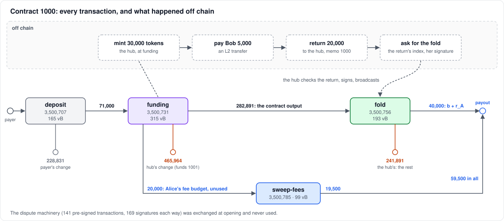
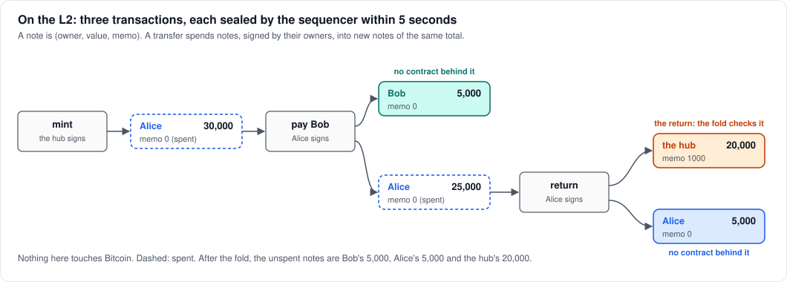
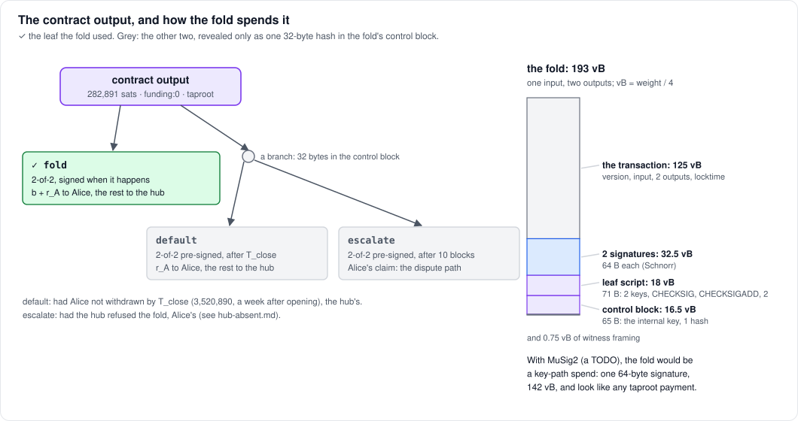
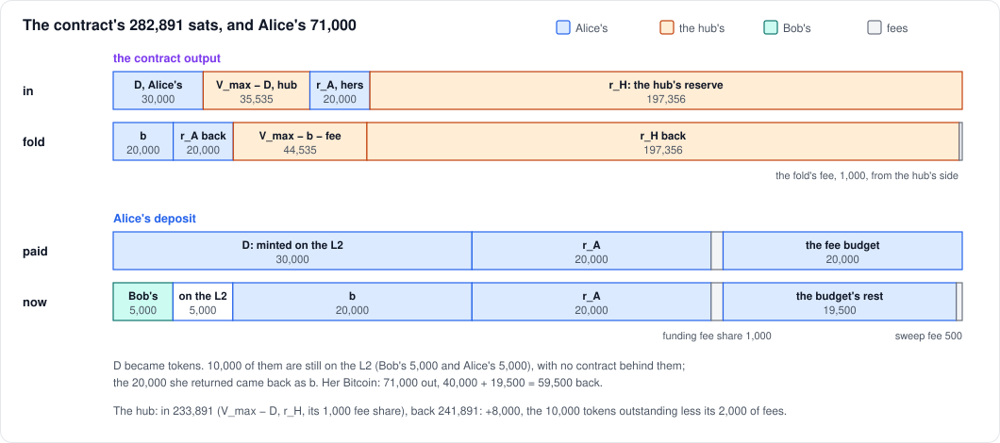

# A cooperative withdrawal

A walkthrough of the simplest case, on Mutinynet (2026-10-12):

1. Alice opens contract 1000 with a 30,000-sat deposit.
2. She pays Bob 5,000 on the L2.
3. She withdraws 20,000. The hub agrees, so the contract closes in one
   transaction, the fold.

Every transaction is linked to the Mutinynet explorer, and sizes and fees
are as mined. This is Test A of the local trials. Test B, where the hub
is gone and Alice has to dispute, is in [hub-absent.md](hub-absent.md).



| transaction | block | size | fee | paid by |
|---|---|---|---|---|
| [deposit](https://mutinynet.com/tx/ef493d9b74366870ec384961f87dc121990ef3e0d4febed76f6f6560bacb0c8e) | 3,500,707 | 165 vB | 169 | Alice's payer wallet |
| [funding](https://mutinynet.com/tx/b80d88d714f590b3b1d14afc187f619f2a252038d3e297491f117ca2285535f5) | 3,500,731 | 315 vB | 2,000 | half each |
| [fold](https://mutinynet.com/tx/0a1efc47e251e32dab3d57d1ef0052f9f55b5ef6527ecc0b65957d5f69652338) | 3,500,756 | 193 vB | 1,000 | the hub |
| [sweep-fees](https://mutinynet.com/tx/38b01f75e55ec16c89e18247a492f7c94aad56330d1ee83c1c225ff421ac0a9f) | 3,500,785 | 99 vB | 500 | Alice's fee budget |

The whole life of the contract: **772 vB, 3,669 sats in fees.** The
withdrawal itself (the fold and the fee sweep) is 292 vB. A dispute's
transactions come to 23,051 vB.

## The contract

The terms are the same as those of contract 1001 (see [its table](hub-absent.md#the-contract)):

| term | value |
|---|---|
| cap `V_max` | 65,535 |
| deposit `D` | 30,000 |
| Alice's reserve `r_A` | 20,000 |
| the hub's reserve `r_H` | 197,356 |
| `T_close` | 3,520,890, a week after opening |

The contract output holds `V_max + r_A + r_H` = **282,891 sats**. On the
cooperative path none of the dispute machinery appears on chain. At
opening, though, the two sides still exchange every pre-signed
transaction a dispute could need: 169 signatures each way. Alice's
ability to dispute is what makes the hub agree to a fold.

## Opening

**Deposit** (165 vB, fee 169). Alice pays 71,000 sats from an ordinary
wallet, here a Bitcoin Core wallet ("payer"), to the deposit address the
hub gave her. It is a taproot output with two leaves: the hub and Alice
together, or Alice alone after 2,880 blocks (her refund if the hub never
funds). The 71,000 is:

- the deposit `D`, 30,000;
- her reserve `r_A`, 20,000;
- her half of the funding fee, 1,000;
- a fee budget of 20,000, kept in case of a dispute.

**Funding** (315 vB, fee 2,000). It has two inputs:

- **Alice's deposit**, spent by the 2-of-2 leaf;
- **a coin of the hub's** (699,855).

And three outputs:

- **the contract output**, 282,891. The hub's part of it is
  `V_max − D + r_H` = 233,891, including its 1,000 fee share.
- **Alice's fee budget**, 20,000, a key-path output of a key her wallet
  derives for this contract;
- **the hub's change**, 465,964. It later funded contract 1001.

Once the funding had one confirmation, the hub minted 30,000 tokens to
Alice on the L2.

The 24 blocks between the deposit and the funding were not the
protocol's. The first attempt to open failed after the deposit was paid,
because of a hub bug at small caps (since fixed). `lichen open --resume
1000` then finished the opening with the same deposit. Normally the
funding follows the deposit by a block, as it did for contract 1001.

## On the L2



The L2 is a ledger of notes. Each note is an owner's key, a value and a
memo. A transfer spends notes, each one signed by its owner, and creates
new notes of the same total. The sequencer checks it and seals it into a
signed state root, within 5 seconds. None of this touches Bitcoin.

1. **The mint.** The hub creates a 30,000 note for Alice.
2. **Paying Bob.** Alice spends it into 5,000 for Bob and 25,000 of
   change for herself. It is an ordinary L2 payment: Bob needs no
   contract to receive it.
3. **The return.** A withdrawal starts on the L2. Alice spends her
   25,000 into a note of exactly 20,000 to the hub, carrying the
   contract's memo, 1000, and 5,000 of change. She chooses `b` = 20,000.
   It can be any amount up to her balance and the cap.

## The fold

[0a1efc47…](https://mutinynet.com/tx/0a1efc47e251e32dab3d57d1ef0052f9f55b5ef6527ecc0b65957d5f69652338)
· 193 vB · fee 1,000 · block 3,500,756

**The exchange.** Once the return is sealed, Alice's wallet builds the
fold from the contract's terms, signs it, and sends the hub her
signature and the return's index in the L2's tree. The hub reads that
note from the sequencer's state and checks four things:

- it is owned by the hub;
- it carries memo 1000;
- its value is exactly the `b` she asks for;
- `b` is within the cap.

Then the hub checks her signature, adds its own, and broadcasts. Nothing
about the fold was pre-signed: both sides sign it at the time, for the
amount returned.

**What it does.** It spends the contract output by its `fold` leaf and
pays:

- **40,000 to Alice's payout address**: `b + r_A`, her 20,000 and her
  reserve back, to the sat. (A dispute would pay `b` rounded down to a
  multiple of 512.)
- **241,891 to the hub's payout address**: `V_max − b + r_H`, less the
  fold's 1,000 fee. The hub gets its reserve back, and its share of the
  cap that Alice didn't withdraw.

**Its structure and size.**



The contract output is a taproot tree with three leaves:

- **`fold`**, 2-of-2, signed when it happens;
- **`default`**, the hub's, after `T_close`;
- **`escalate`**, the start of Alice's dispute.

The fold reveals only its own leaf: a 71-byte script of the two keys,
checked with `CHECKSIG` and `CHECKSIGADD`. The other two leaves appear
only as one 32-byte hash in the control block. So the fold's witness
holds:

- two 64-byte signatures;
- the 71-byte script;
- a 65-byte control block.

That is 68 vB on top of a plain one-input, two-output transaction of
125 vB. With MuSig2, a TODO, the fold would be a key-path spend of
142 vB, indistinguishable from any other taproot payment.

**Its fee** is a fixed 1,000 sats (5.2 sat/vB here), which the hub pays
from its side.

## The fee budget

[38b01f75…](https://mutinynet.com/tx/38b01f75e55ec16c89e18247a492f7c94aad56330d1ee83c1c225ff421ac0a9f)
· 99 vB · fee 500 · block 3,500,785

The 20,000 budget is for a dispute's fees, and a fold needs none. `lichen
sweep-fees 1000` sends it to Alice's payout address, less a 500-sat fee:
a key-path spend of one input, 19,500 out.

## Where the money went



| Alice | sats |
|---|---|
| paid in (the deposit) | 71,000 |
| back at her payout address, from the fold (`b + r_A`) | 40,000 |
| back at her payout address, the fee budget less its fee | 19,500 |
| paid to Bob, on the L2 | 5,000 |
| still hers on the L2, with no contract behind it | 5,000 |
| her share of the funding fee | 1,000 |
| the fee sweep's fee | 500 |

Of her 30,000 tokens, 20,000 came back as bitcoin. The other 10,000 are
still tokens on the L2, Bob's 5,000 and her own 5,000.

**The hub:**

- it put in 233,891 and got back 241,891, so it is 8,000 up on Bitcoin;
- that 8,000 is the 10,000 tokens still out (Bob's and Alice's), less
  its 2,000 of fees (its half of the funding, and the fold);
- the bitcoin those tokens correspond to sits in the hub's wallet.

## Alice's 5,000

After the fold, Alice holds 5,000 tokens on the L2, and so does Bob.
They are ordinary tokens: either can pay them to anyone on the L2. What
they lack is a contract.

A contract is what lets its holder enforce a withdrawal on Bitcoin, with
a dispute if the hub won't fold. Each contract allows one withdrawal:
the fold spends the whole contract output, and contract 1000 is now
closed. Bob never had a contract. So nothing on Bitcoin makes the hub pay
out either 5,000, though the bitcoin for them is in its wallet.

Alice had two ways to leave nothing on the L2:

- **Withdraw 25,000 instead.** The fold would have paid 45,000.
- **Open another contract.** A cap limits how much a contract can
  withdraw, not which tokens. So a new contract with a cap above 5,000
  makes her 5,000 withdrawable again. That is what she did next:
  [contract 1001](hub-absent.md) took a 30,000 deposit, and her return
  of 35,000 was the new 30,000 plus these 5,000. Bob could do the same
  with a contract of his own.

What Alice must not do is leave a contract open past `T_close` with
tokens she wants out. After `T_close` the hub may post the pre-signed
`default`, which pays `r_A` back to her and the rest to the hub. Her
tokens are then in the same position as her 5,000 now.

## What this run shows, and what to tidy

- **The cooperative path is cheap:**
  - one transaction to close, 193 vB;
  - an exact amount;
  - none of the dispute's 169 pre-signed transactions used.

  Alice's on-chain costs were 1,669 sats: her payer's 169, her funding
  share of 1,000, and the sweep's 500. The hub paid 2,000.
- **It is fast:**
  - the L2 steps take seconds;
  - the fold needs one confirmation;
  - Alice's bitcoin was at her payout address 25 blocks (13 minutes)
    after the funding confirmed. The protocol needs one confirmation
    for the mint and one for the fold; the rest was Alice's own time.
- **To tidy:**
  - **The fold's fee is a fixed 1,000.** It could be sized to the
    transaction and the network's feerate, as the dispute's timeouts now
    are (about 193 sats at 1 sat/vB).
  - **`sweep-fees` is a second transaction.** The fold could take the
    fee budget as a second input and pay it to Alice with `b + r_A`, as
    a won dispute's sweep now does. That changes the fold's shape in
    ln-gap's sessions crate. It is not done yet.
  - **MuSig2 for the fold:** 142 vB, and private.

## Reproducing it

With a deployment as in [deploy/README.md](../../deploy/README.md) and
the wallet built natively:

```sh
L="./target/release/lichen --network mutinynet --statement groth16"
$L --wallet alice.json init
$L --wallet alice.json open 30000 --bits 16 --reserve 20000 --payout <an address of yours>
#   it prints "pay 71000 sats to tb1p…": pay that from any wallet
$L --wallet alice.json balance                    # 30000, once the funding confirms
$L --wallet bob.json init                         # prints Bob's L2 address
$L --wallet alice.json send <Bob's address> 5000
$L --wallet alice.json withdraw 1000 20000        # the return, then the fold
$L --wallet alice.json sweep-fees 1000            # once the fold confirms
```

The diagrams are drawn by `img/cooperative.py` from the numbers above.
