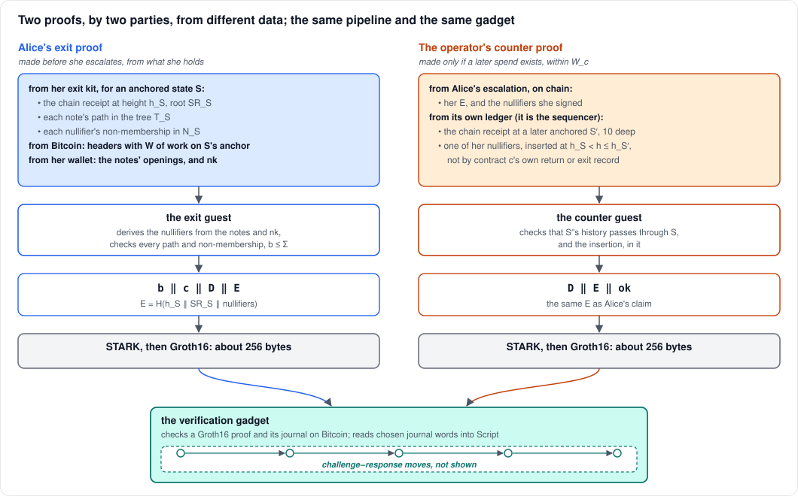
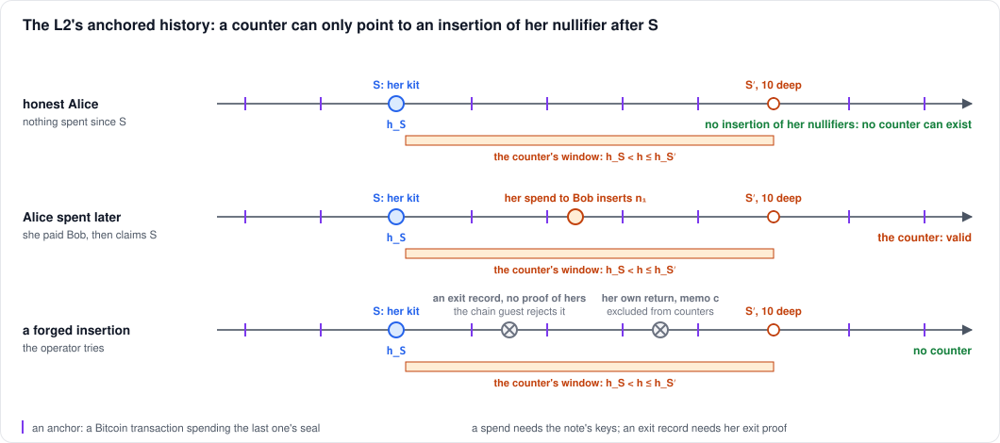
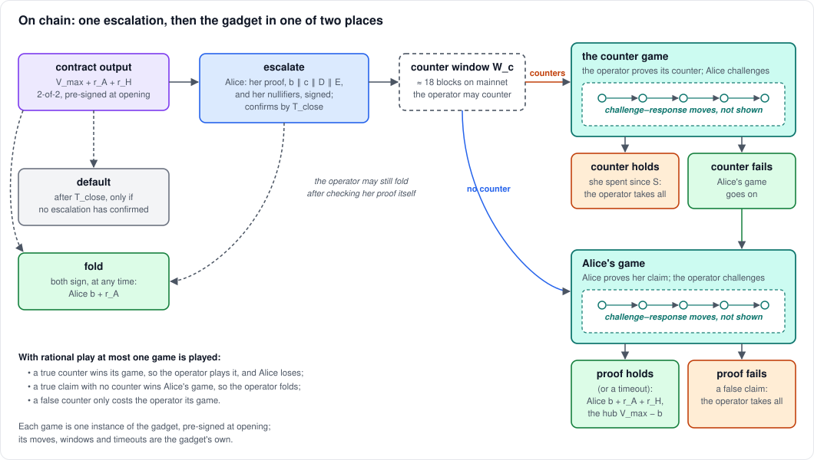

# Exiting against a hostile operator

A design, not yet built: [EXIT_PLAN.md](../EXIT_PLAN.md) has the plan.
This note explains how it protects a user from an operator that runs
both the hub and the sequencer and wants her money. It is about the
proofs: who makes each one, from what, and where each is checked on
Bitcoin.

The on-chain check is treated as a black box, the **verification
gadget**. Lichen has one built (BitVMX) and one designed (BABE), and
they differ in every detail of their moves. None of those details matter
here, so this note shows none of them.

## The problem

In today's withdrawal, Alice returns her tokens to the hub on the L2,
and then proves that return on Bitcoin. That needs the sequencer to
include her return. If the hub and the sequencer are one operator, it
profits from not including it: whatever isn't withdrawn by `T_close`
goes to the hub. So it might:

- censor her return;
- stop sealing the L2 to Bitcoin;
- withhold the data she needs to prove anything;
- or simply vanish.

Each of these blocks a withdrawal that starts with a return. The exit
doesn't start with one.

## The idea: claim from the past, answer with something real

Alice claims from a state of the L2 that's already anchored on Bitcoin:
"at state `S`, these notes of mine were unspent; pay me `b`." She can
make that claim with no help from the operator. She needs only data she
already holds.

The operator gets one answer, a **counter**: "one of those notes was
spent at a state after `S`." That's the only way a claim from the past
can be wrong: Alice could have spent the notes since. A counter must
point to that spend, and it must really have happened, since only Alice
can spend her notes.

So there are two proofs, by two parties:

## The gadget, as a black box

What this design needs from a verification gadget:

- **A claimant and a challenger.** The claimant posts a Groth16 proof
  and its public output (the journal). The challenger may dispute it.
- **Moves, on chain.** Some sequence of challenge and response, each
  move due within a window. A party that misses its window loses.
- **A verdict.** A valid proof wins for the claimant; an invalid one
  loses. The loser's side of the output goes to the winner.
- **Words Script can read.** Chosen journal words, such as the amount
  `b` and the claim's fingerprint `E`, are signed with one-time
  signatures, so Script can compare and pay by them.
- **Pre-signed at opening.** Every transaction of the game is signed by
  both parties when the contract opens, with fixed roles: who claims and
  who challenges.

Both of lichen's gadgets do this. Everything else about them, the
number of moves, their sizes, the setup, is left out here.

## Alice's exit proof

**Her exit kit.** Alice's wallet keeps, for some anchored state `S`:

- the sequencer's chain receipt at `S`'s height `h_S`: a recursive proof
  that every L2 block up to `h_S` was valid, ending in the state root
  `SR_S`;
- each of her notes' Merkle paths in the commitment tree `T_S`;
- each of her nullifiers' non-membership proofs in the spent set `N_S`.

A kit never goes stale. The tree only grows, so a path to `T_S` stays
valid, and a nullifier absent from `N_S` stays absent from `N_S`. She
fetches a new kit only after she spends or receives. If the operator
stops serving data, her last kit still works.

**The proof.** When she exits, she runs the exit guest on her kit, on
Bitcoin headers carrying `W` of work on `S`'s anchor block, and on her
notes' openings and her key `nk`. The guest:

- **derives each nullifier** from its note and `nk`, so the nullifiers
  are the real ones, the values any spend of those notes must insert;
- **checks** each path to `T_S`, each nullifier's absence from `N_S`,
  and `S`'s anchoring;
- **outputs** `b ‖ c ‖ D ‖ E`: the amount, the contract's memo, the
  deployment, and the claim's fingerprint
  `E = H(c ‖ h_S ‖ SR_S ‖ nullifiers)`.

RISC Zero proves it as a STARK, and the STARK is wrapped in Groth16,
about 256 bytes. This takes minutes, and the wrap can be delegated.

**Why `E`.** It fixes the claim's state and its notes in one value that
both games can compare. The nullifiers have to appear on chain too: for
shielded notes, the operator can't compute them without `nk`, and it
can't look for a spend of nullifiers it doesn't know. So Alice posts
them with her claim, beside `h_S` and `SR_S`, and the claim the gadget
checks includes that they hash to `E`. She can't post decoys.

## The operator's counter proof

The operator makes a counter only if one exists: if one of Alice's
nullifiers was inserted after `S`. It needs no help from her. Her `E`
and nullifiers are on chain from her escalation, and everything else is
in its own ledger, since it is the sequencer.

The counter guest takes:

- Alice's `E`, with what it hashes: her contract `c`, `h_S`, `SR_S` and
  her nullifiers;
- the chain receipt at a later anchored state `S′`, 10 deep, whose
  history passes through `S`;
- one of her nullifiers, with the transaction that inserted it, at a
  height `h` with `h_S < h ≤ h_S′`;
- proof of when Alice's escalation confirmed on Bitcoin, and that the
  insertion's anchor confirmed a few blocks before it (the cutoff,
  below).

It applies the exclusions below for the `c` inside `E`, and outputs
`D ‖ E ‖ ok`, wrapped in Groth16 like Alice's proof.
Proving takes about 20 minutes, and it must be posted within the counter
window `W_c`, about 18 blocks on mainnet.

## Why a counter exists only for a real spend

A nullifier enters the spent set in only two ways:

- **a spend,** which needs the note's keys. The chain proof checks every
  spend's authority, so the operator can't sign one for her.
- **an exit record,** which the operator posts after an exit to retire
  the exited notes. A record must carry the exit proof of the notes'
  owner, which the chain guest checks. Without that rule, the operator
  could post a record with Alice's nullifiers, taken from her escalation,
  and counter her with it.

Two insertions are excluded from counters:

- **Contract `c`'s own exit record**, which retires the very claim being
  answered.
- **Contract `c`'s own return.** Alice tries the cooperative way first,
  and exits only when her return isn't sealed. The operator still holds
  that signed return, and could otherwise sequence it after her
  escalation and counter her with her own transaction. Excluding it
  costs the hub nothing: if the return is sequenced, the hub has her
  tokens, and contract `c` still pays only once.

**The cutoff: only what was final before her claim.** Alice has signed
other transactions too, and the operator may be holding some of them,
unsealed. If a counter could cite anything sealed during `W_c`, the
operator could seal one of those after she has committed to her claim,
and take her contract with it. So a counter may cite only an insertion
anchored at least a few blocks before her escalation confirmed. The
counter proves that height from Bitcoin itself, so neither side chooses
it. Everything a counter can use was then already final on Bitcoin when
she claimed. This covers her return too, but the return stays excluded
in any case. Another contract's exit record is the one thing a counter
may cite whenever it was anchored: it needs Alice's own exit proof for
that contract, which she makes only if she's claiming the same notes
twice.

The history can't be rewritten either. Each anchor spends the previous
anchor's output on Bitcoin, so there is one anchored history, and `S`
and `S′` are both in it. If Alice hasn't spent since `S`, a counter
would need a spend she never made, in a history the operator can't
change.

**Why `c` is inside `E`.** The exclusions name a contract, so the
counter must be pinned to Alice's. If `E` left `c` out, the operator
could post her genuine exit record, then prove a counter that excludes
for some other contract `c_B`: to that counter her record is an
admissible insertion, and with the same `E` it would defeat her honest
claim. With `c` in `E`, matching `E` on chain means the counter excluded
for her contract.

## On chain: the gadget in one of two places

**Escalate.** Alice spends the contract output with her claim: her proof
and journal, and the rest of `E`'s preimage (her nullifiers, `h_S` and
`SR_S`; `c` is in the journal), all under her
one-time signatures. It must confirm by `T_close`. Once it does, the
contract output is spent and the operator's default can't happen.

**The counter window.** For `W_c` blocks the operator may open the
**counter game**: one instance of the gadget, with the roles reversed.
The operator claims its counter, and Alice challenges.

- Before anything else, the counter's `E` must equal the `E` on chain
  from Alice's escalation, and its `D` the contract's. Script compares
  the signed words, and a mismatch loses the counter game at once.
- **If the counter holds,** Alice spent after `S`: the operator takes the
  contract, as from any false claim.
- **If the counter fails,** Alice is paid at once, and her own game is
  never played. The party shown to cheat loses immediately, as
  everywhere in lichen's disputes. This is safe for the hub because a
  counter is always its choice: against a false claim it challenges her
  proof instead, and against a stale one it has a true counter.

**Alice's game.** With no counter: a second instance of the gadget,
with Alice claiming her exit proof and the operator challenging.

- **If her proof holds,** or the operator misses a window, Alice is paid
  `b` and the reserves, and the hub keeps `V_max − b`.
- **If it fails,** the claim was false, and the operator takes the
  contract.

**The fold** is still open throughout. The operator can check Alice's
proof itself, in milliseconds, and sign the cooperative payout instead.
That's what a rational operator does against an honest claim: a game it
must lose only costs it fees and its reserve.

**Exactly one game runs, under any play:**

| Alice's claim | a counter | what's played | result |
|---|---|---|---|
| true | none can exist | nothing, or Alice's game | Alice is paid |
| any | a false one, posted anyway | the counter game | Alice is paid; the operator loses the contract as from a lost game |
| she spent since `S` | true | the counter game | the operator takes the contract |
| false (a bad proof) | — | Alice's game | the operator takes the contract |
| true, operator gone | none | Alice's game, by timeouts | Alice is paid |

Both games are pre-signed at opening, so the gadget is never asked to do
anything new: in each, one party claims one proof and the other
challenges it. Using the gadget in one of two places costs a larger
pre-signed set, but the reserve needn't double: only one game's fees
are ever paid. In a mass exit, counters add no load to the chain except
at the operator's own expense.

## What a hostile operator can try

| the operator | what happens |
|---|---|
| censors her return | she exits from her kit; the return can't be used against her |
| stops sealing | her kit's `S` is already anchored |
| withholds data, with no spend of hers since her kit | her last kit still works |
| holds a transaction she signed, and seals it after her claim | past the cutoff: not a counter |
| seals a spend of hers, then withholds its new notes' data | she loses: the data-availability gap, see Limits |
| vanishes | no counter; the timeouts in Alice's game pay her |
| waits out `T_close` | her escalation confirms first; then no default is possible |
| posts a garbage counter | she challenges it, the gadget rejects it, and she is paid |
| forges an insertion | it can't: a spend needs her keys, an exit record her proof |
| counters with her own return | excluded |
| floods the chain | congestion: see Limits |

## The alternative: one place

The plan also describes a single game. Alice's program verifies both
proofs: hers, and the operator's counter as a second input. It accepts
if hers verifies and the counter doesn't (or names another `D` or `E`).
One gadget instance, no reversed roles.

It needs more from the gadget: a statement over two proofs, one of them
supplied by the challenger after setup. BitVMX can do this with a new
verifier program and a longer trace. BABE fixes its statement at setup,
and it's not obvious how it would take the challenger's proof as input. Two places
keep the gadget a black box, so this note describes them.

## Limits

- **Not built.** The exit claim, the counter, the exit record and the
  counter game are all to do.
- **Exits are disputes.** Hours, and fees, against the fold's 193 vB,
  unless the operator folds.
- **Mass exit.** A hostile operator can refuse every user at once. Each
  exit is one gadget run at most, after a counter window, all competing
  for block space. How many contracts a hub can safely hold is the
  congestion question again, with longer schedules and larger
  escalations (about 1 KB per note claimed).
- **Data availability: the one substantial gap.** With the cutoff, the
  exit is safe exactly when Alice can read the anchored data she needs.
  The gap affects senders as well as receivers. In the consolidation
  attack, Alice merges her covered notes into one new note. The operator
  seals that and withholds the new note's data: the old notes are
  countered, and the new one has no kit. Any spend that leaves her with
  change works the same way. EXIT_PLAN.md lists the options, most of
  them rules about what a counter must show. The leading one is the
  sender's acknowledgment: a spend can counter Alice only once she has
  signed that she holds its data, and its outputs stay locked until
  then. Others are publishing each batch's nullifiers and new
  commitments on Bitcoin (about 24 vB per L2 transaction), a data
  committee whose signatures the anchors need, or accepting the gap.
- **Whole notes.** A claim spends whole notes. Alice claims everything
  up to `V_max`, and above the cap the claimed notes' excess is forfeit.
