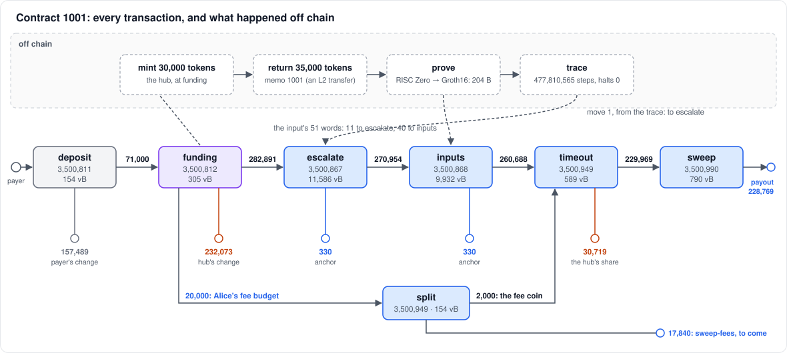
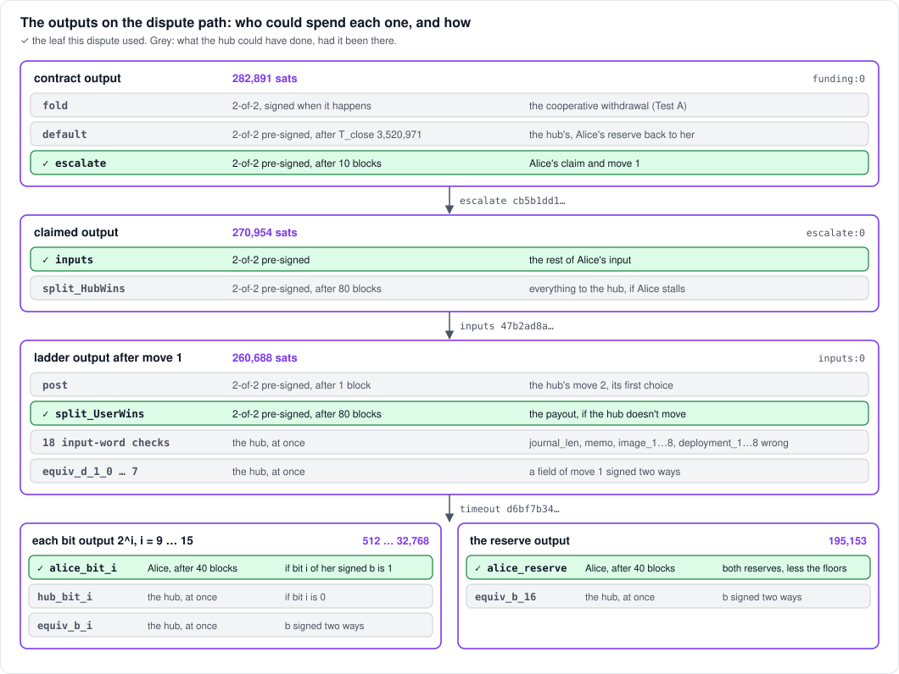
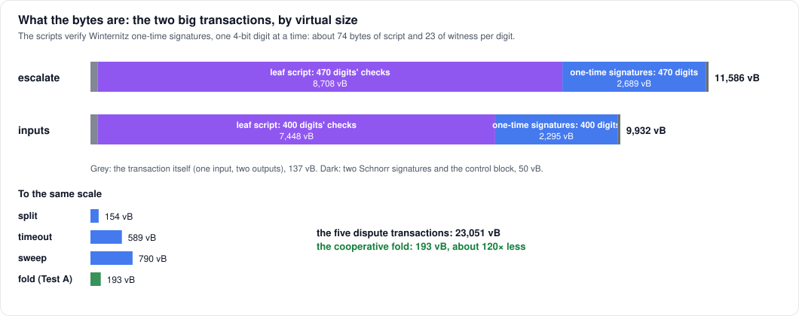
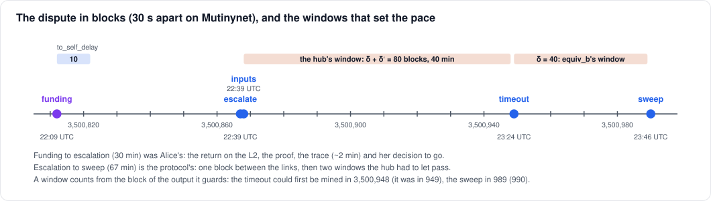
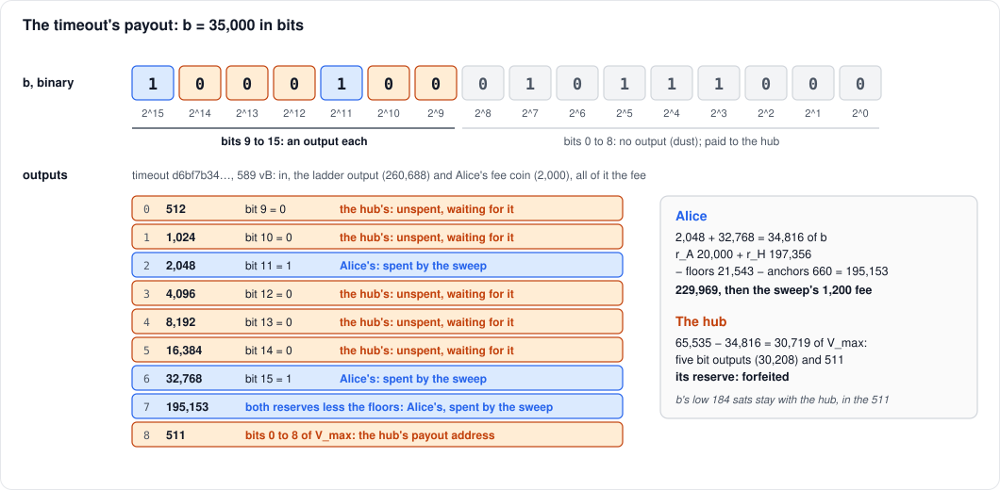
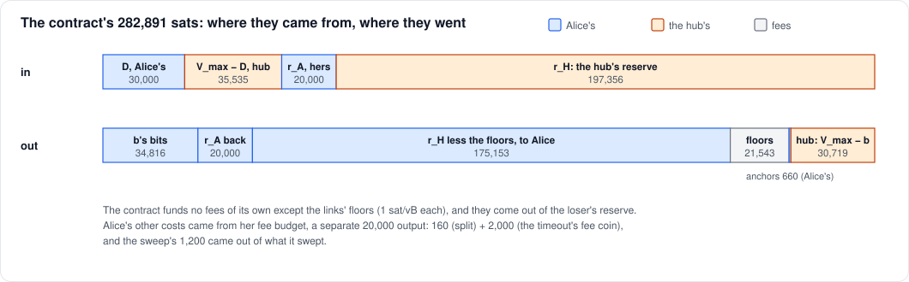

# A withdrawal when the hub disappears

A walkthrough of one real dispute on Mutinynet (2026-10-12). Alice
withdraws 35,000 sats from contract 1001. The hub has been switched off,
so it never answers. Every transaction is linked to the Mutinynet explorer;
sizes and fees are as mined.



| # | transaction | block | size | fee | paid by |
|---|---|---|---|---|---|
| | [deposit](https://mutinynet.com/tx/dc089a531e9a9eb785a6c6cd91c32334ef991d1975e7907092f3d0723543e757) | 3,500,811 | 154 vB | 342 | Alice's payer wallet |
| | [funding](https://mutinynet.com/tx/418b42cc4111e06a970d08afef94121f0a9e73cdf7bd8cd2f5e3e19fd6d4f7b6) | 3,500,812 | 305 vB | 2,000 | half each |
| 1 | [escalate](https://mutinynet.com/tx/cb5b1dd1d877cfeea84ad710e48740c975928e39036775764d5455fba1ffe92a) | 3,500,867 | 11,586 vB | 11,607 | the contract (the hub's reserve) |
| 2 | [inputs](https://mutinynet.com/tx/47b2ad8a8ec02633f41376dc08b5187dcf7fbcbe1780ffc0f961724f14a04ef9) | 3,500,868 | 9,932 vB | 9,936 | the contract (the hub's reserve) |
| 3 | [split](https://mutinynet.com/tx/94406505b6b1d1e54129098950e3f1cb3af2a9b40ea2fb7210b624bfcc4d6d53) | 3,500,949 | 154 vB | 160 | Alice's fee budget |
| 4 | [timeout](https://mutinynet.com/tx/d6bf7b34e0e3d64377069252bbec4bd5aabb5e7cf85519ea40e3d96802275306) | 3,500,949 | 589 vB | 2,000 | Alice's fee budget |
| 5 | [sweep](https://mutinynet.com/tx/21ee8b9fa01320928301915245d776f4f58bef0a41e653ed8e8311ada3fd0267) | 3,500,990 | 790 vB | 1,200 | what it swept |

The dispute is transactions 1 to 5: **23,051 vB, 24,903 sats in fees.**
For comparison, Test A's cooperative withdrawal from contract 1000 was one
[fold](https://mutinynet.com/tx/0a1efc47e251e32dab3d57d1ef0052f9f55b5ef6527ecc0b65957d5f69652338)
of 193 vB ([cooperative.md](cooperative.md)).

## The contract

| term | value | meaning |
|---|---|---|
| `V_max` | 65,535 | the cap: a withdrawal is `b < 2^16` sats |
| `D` | 30,000 | Alice's deposit, minted to her as tokens on the L2 |
| `r_A` | 20,000 | Alice's reserve: back to her in every honest outcome |
| `r_H` | 197,356 | the hub's reserve: covers the fee floors of the deepest possible dispute |
| `low_bits` | 9 | on the dispute path, bits of `b` below 2^9 (512 sats) get no output |
| `T_close` | 3,520,971 | after it, with no claim, the contract closes by default |
| `to_self_delay` | 10 blocks | the escalation waits this long after funding |
| `δ`, `δ′` | 40, 40 blocks | the response windows (20 min each at 30 s blocks) |
| statement | Groth16 | BitVMX's Groth16 verifier, run over a RISC Zero proof of the withdrawal |

The contract output holds `V_max + r_A + r_H` = 65,535 + 20,000 + 197,356 =
**282,891 sats**. Alice put in `D + r_A`, and the hub `V_max − D + r_H`.

**Why the hub's reserve is so large.** Each link of a dispute (each
transaction that posts a move) pays a fee floor of 1 sat/vB out of the
contract, and the loser's reserve covers the floors. The deepest Groth16
dispute plays 21 depths of an 8-ary search and then a jump-list tail, and
its floors come to 197,356. This dispute stopped after two links, so its
floors were 21,543.

## Before the dispute

**Deposit.** Lichen has no wallet of its own. The hub gives Alice a
deposit address and an amount, and she pays it from any wallet (here, a
faucet-funded one). The amount is 71,000 = `D` 30,000 + `r_A` 20,000 + her
half of the funding fee 1,000 + a fee budget of 20,000 for a dispute. The
deposit output's tree has two leaves: the hub and Alice together (the
funding spends it this way), or Alice alone after 2,880 blocks (a refund,
if the hub never funds).

**Funding** (305 vB, 2,000 sats of fee, half each) spends Alice's deposit
and a hub coin. It creates three outputs:

- the contract output, 282,891;
- Alice's fee budget, 20,000, a plain key-path output of a key derived
  from her wallet;
- the hub's change.

Before signing the funding, the two sides exchanged every pre-signed
transaction a dispute could need: 169 of the hub's signatures, and as
many of Alice's. When the funding confirmed, the hub minted 30,000 tokens
to Alice on the L2.

## Off chain: the return, the proof, the trace

None of this touches Bitcoin.

1. **The return.** Alice sends 35,000 tokens back to the hub on the L2,
   with memo 1001: an ordinary L2 transfer, sealed by the sequencer. She
   may return more than her deposit, up to the cap: tokens are
   fungible.
2. **The proof.** The withdrawal guest (RISC Zero) proves that the L2's
   sealed history contains that return. The Groth16 wrap makes this a
   proof that BitVMX's verifier program checks. The verifier's input is
   204 bytes, 51 words:

   | words | what | checked by |
   |---|---|---|
   | 0 | the journal's length (10 words) | a leaf (`journal_len`) |
   | 1–8 | the image id of the withdrawal guest | leaves (`image_1…8`) |
   | 9–40 | the Groth16 proof | the verifier program (the dispute) |
   | 41 | `b` = 35,000 | the payout's bit outputs |
   | 42 | the memo `c` = 1001 | a leaf (`memo`) |
   | 43–50 | the deployment id, `SHA256("lngap/deployment" ‖ sequencer ‖ hub)` | leaves (`deployment_1…8`) |

3. **The trace.** Alice's wallet runs the verifier over that input in
   BitVMX's emulator: 477,810,565 steps, halting with 0 (accept), in about
   2 minutes. It keeps checkpoints, so it can answer the hub's questions
   about any step. Move 1 of the search commits to the result: the last
   step and its hash (`f53c86d5…`), and the trace's hashes at the seven
   boundaries of the first round's eight segments.

Funding to escalation took 30 minutes, all of it Alice's: the return, the
proof, and deciding to go.

## The outputs, and the leaf each one is spent by

Each output on the dispute path is a taproot tree. One leaf continues the
dispute; the others are what the other side may do if it is there.
Everything the hub could have done here is greyed out.



The pattern is the same at every step. The next move is pre-signed by
both sides, so it can only go to the agreed next output. A timeout,
also pre-signed, pays the side that moved last if the other doesn't
answer. And there are runtime leaves where the other side can punish a
lie straight away: a checked word that isn't the agreed value, or a move
signed two ways.

## 1. `escalate`: the claim, and move 1

[cb5b1dd1…](https://mutinynet.com/tx/cb5b1dd1d877cfeea84ad710e48740c975928e39036775764d5455fba1ffe92a)
· 11,586 vB · fee 11,607 · block 3,500,867

**What it does.** It spends the contract output by its `escalate` leaf.
That leaf is 2-of-2 pre-signed, so the transaction is fixed, and it waits
`to_self_delay` (10 blocks) after funding. The witness carries Alice's
one-time (Winternitz) signatures on:

- **the claim's 11 input words:** `b`, the memo, the journal's length and
  the image id;
- **move 1's 8 fields:** the last step and its hash (28 bytes), and the
  seven trace hashes (20 bytes each).

Its outputs:

- **the claimed output (270,954):** `inputs` continues from here, or the
  hub takes everything after 80 blocks if Alice stalls;
- **a 330-sat anchor:** Alice's, for a fee child (none was needed, see
  below).

**Its size.** The witness has 944 stack elements and a 34,831-byte leaf
script. A Winternitz signature signs one 4-bit digit at a time: the
witness reveals a 20-byte hash and the digit, and the script hashes it up
the chain and checks it. That costs about 74 bytes of script and 23 bytes
of witness per digit, for 470 digits:

- the 11 words: 10 digits each (8, plus a 2-digit checksum), 110 in all;
- move 1: 59 digits for the claim field and 43 for each hash, 360 in all.



**Its fee.** It is the link's floor: 1 sat/vB of its own size, out of the
contract. On a busier chain, Alice would add a child spending her anchor
to bring it up to the market rate, paid from her fee budget. On Mutinynet
1 sat/vB confirms, so no child was posted.

## 2. `inputs`: the rest of the input

[47b2ad8a…](https://mutinynet.com/tx/47b2ad8a8ec02633f41376dc08b5187dcf7fbcbe1780ffc0f961724f14a04ef9)
· 9,932 vB · fee 9,936 · block 3,500,868

**What it does.** It publishes the input's other 40 words, signed the
same way: the proof (words 9–40) and the deployment id (43–50). Both
sides need the whole input before the search goes on, since the hub must
run the same program on the same input to answer move 1.

**Why a second transaction.** Script's stack holds at most 1,000
elements. `escalate`'s witness is already 944, and each word adds 20, so
the rest of the input can't fit in it. `inputs` is pre-signed too, and
spends the claimed output into **the ladder output after move 1**
(260,688). That output's leaves are:

- **`post`:** the hub's move 2, its first choice of segment, 2-of-2
  pre-signed after 1 block;
- **`split_UserWins`:** Alice's payout, after `δ + δ′` = 80 blocks;
- **18 input-word checks:** if any word Alice signed differs from the
  agreed value (the journal's length, the memo, the image id, the
  deployment), the hub reveals her signature on it and takes everything;
- **`equiv_d_1_0…7`:** if Alice signed any field of move 1 two ways, the
  hub takes everything.

The size works as for `escalate`: 400 digits, a 29,791-byte script, 804
stack elements. The fee is again the floor.

## The hub's window

Nothing happens for 80 blocks (40 minutes). Had the hub been there, it
would have checked the 18 words (a millisecond's work), re-run the trace
on the published input, and posted move 2 to start bisecting. It would
have done this whether Alice's claim was true or false: the search finds
the first step where they disagree, and a true claim survives it. The
hub is off, so the window runs out.



## 3 and 4. The fee coin, and the timeout

**`split`**
([94406505…](https://mutinynet.com/tx/94406505b6b1d1e54129098950e3f1cb3af2a9b40ea2fb7210b624bfcc4d6d53),
154 vB, fee 160) splits a 2,000-sat coin off Alice's fee budget (17,840
change, to the same key). The timeout needs a coin of exactly the fee it
adds.

**`timeout`**
([d6bf7b34…](https://mutinynet.com/tx/d6bf7b34e0e3d64377069252bbec4bd5aabb5e7cf85519ea40e3d96802275306),
589 vB, fee 2,000) spends the ladder output by `split_UserWins`. The
2-of-2 signatures on it were made at opening with ALL|ANYONECANPAY and no
fee, so its outputs are fixed, but anyone may add an input to pay for it.
Alice adds the 2,000-sat coin. Both were mined in the same block, 81
blocks after `inputs`.

Its outputs are the payout. `b` is paid in powers of two, so that a
script can tell, from Alice's signature on `b` alone, who owns each
output:



- **Seven bit outputs, 2^9 to 2^15.** Each one has three leaves:
  - `alice_bit_i`: Alice, after `δ` (40 blocks), if bit `i` of her signed
    `b` is 1;
  - `hub_bit_i`: the hub, at any time, if the bit is 0;
  - `equiv_b_i`: the hub, at once, if Alice ever signed two values of `b`.

  The signature on `b` is already public (it is in `escalate`). So the
  owner of each output is settled the moment the timeout confirms, and
  only the wait for `δ` remains.
- **The reserve output (195,153):** `r_A + r_H`, less the floors and
  anchors the dispute's links carried. Alice's after `δ`, unless there is
  an equivocation on `b`.
- **511 to the hub's payout address:** bits 0 to 8 of `V_max`. Bits that
  small would be dust as outputs, so the dispute path pays `b` rounded
  down to a multiple of 512: 34,816. Alice loses the low 184 sats of `b`,
  where a cooperative fold would pay her exactly.

## 5. The sweep

[21ee8b9f…](https://mutinynet.com/tx/21ee8b9fa01320928301915245d776f4f58bef0a41e653ed8e8311ada3fd0267)
· 790 vB · fee 1,200 · block 3,500,990

After `δ`, Alice spends her three outputs to her payout address,
`tb1qedat…`:

| input | leaf | witness |
|---|---|---|
| bit 11, 2,048 | `alice_bit_11` | her signature on `b` again (10 digits), her key's signature; a 787-byte script |
| bit 15, 32,768 | `alice_bit_15` | the same |
| reserve, 195,153 | `alice_reserve` | her key's signature; a 38-byte script |

Out: **228,769 sats** to her payout address. Re-revealing the signature
on `b` gives nothing away: it is the same signature, already on chain.

## Where the money went



| | sats |
|---|---|
| Alice paid in (the deposit) | 71,000 |
| Alice received at her payout address | 228,769 |
| still hers: the fee budget's remainder, for `sweep-fees` | 17,840 |
| still hers: two anchors, unspent | 660 |
| the hub's: five bit outputs and 511, waiting for it | 30,719 |
| the hub's reserve: forfeited | 197,356 |
| fees in all: the floors 21,543, the split 160, the timeout 2,000, the sweep 1,200 | 24,903 |

For her 35,000 returned tokens, Alice got:

- her bits of `b`, 34,816;
- her reserve back, 20,000;
- the hub's reserve less the dispute's floors and anchors, 175,153.

The hub keeps its share of `V_max`, 30,719. It can collect that whenever
it comes back, since the bit leaves for zero bits have no timelock. What
the hub loses by vanishing is its reserve.

## What this run shows, and what to tidy

- **The hub can't stop a withdrawal by disappearing.** Alice was paid
  about 67 minutes after she escalated: one block between the two links,
  then the hub's 80-block window, then the 40-block `δ`. All of it was
  pre-signed, apart from three things: her one-time signatures (made from
  her wallet's seed), her fee coin, and her final sweep. She needed no
  part of the hub, and no node of her own (the wallet reads Mutinynet
  through mutinynet.com's Esplora).
- **A disappearance costs the hub its reserve.** That is the incentive
  that keeps disputes rare. This one was cheap, because the hub forfeited
  in the first window.
- **Proving cost Alice time, not sats.** Her on-chain costs were 3,360
  sats from her budget and her payout. The 21,543 of floors came out of
  the hub's reserve.
- **Tidy-ups this run surfaced, since fixed:**
  - the anchors (2 × 330) were left unspent when no fee child was
    needed: the sweep now collects them;
  - the timeout's fee coin was a fixed 2,000 sats, 3.4 sat/vB at
    589 vB: it is now the transaction's size at the network's feerate
    (about 590 sats here), for the hub's timeouts too;
  - the fee budget's rest needed `sweep-fees`: a won dispute's sweep now
    takes it, and `sweep-fees` is left for folds, refunds and lost
    disputes.

  A rerun would show a timeout fee of about 590 sats, and one sweep
  paying out the winnings, the anchors and the budget's rest together.

## Reproducing it

This is Test B of the local Mutinynet trials ([TESTNET_PLAN.md](../TESTNET_PLAN.md),
T5): a deployment as in [deploy/README.md](../../deploy/README.md), with
Alice's wallet on the same machine (but reading the chain through
Esplora). With the hub stopped, after her return, Alice runs:

```sh
lichen --network mutinynet --statement groth16 --wallet alice.json \
  dispute 1001 35000 --input claim.hex
```

`claim.hex` is the verifier's 204-byte input, made by the withdrawal
prover. From there, the wallet posts each transaction above as it falls
due. The diagrams are drawn by `img/hub_absent.py` from the numbers
above.
