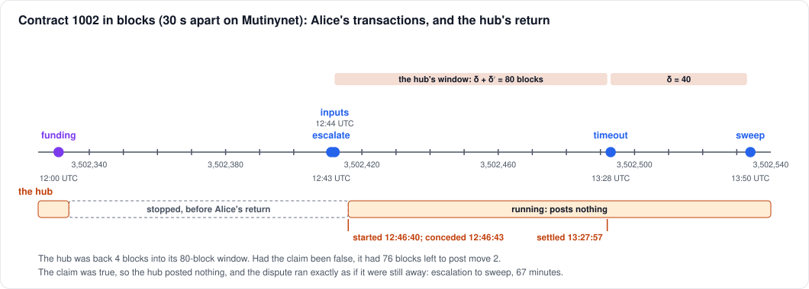
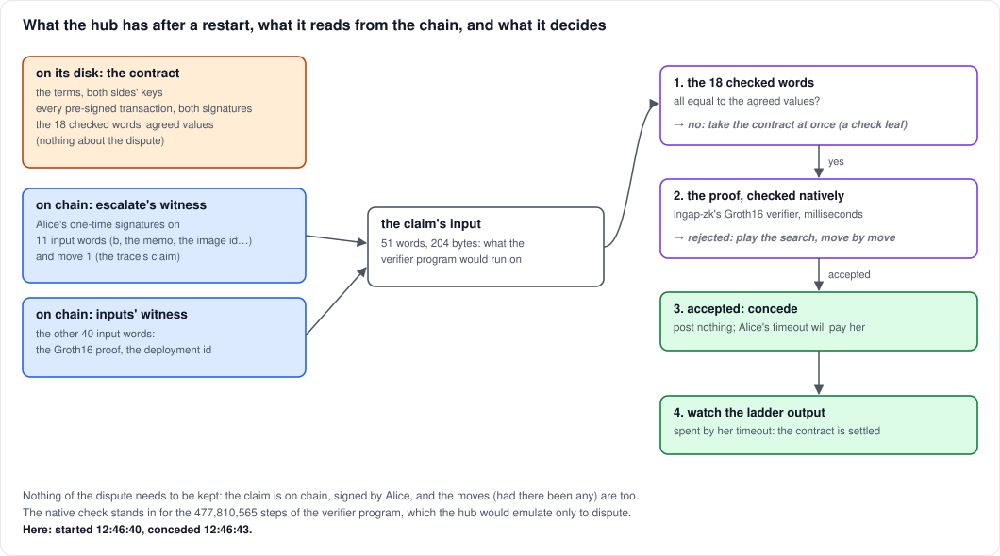
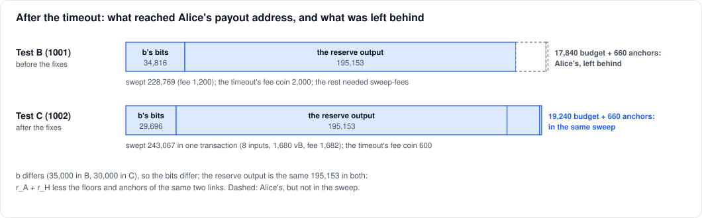

# A withdrawal when the hub comes back

> A BitVMX dispute, lichen's first verification gadget, kept as the
> record of Test C. A BABE hub restarts the same way, reading each
> dispute back from the chain.

A walkthrough of Test C on Mutinynet (2026-10-13). Alice withdraws
30,000 sats from contract 1002 by dispute, as in
[hub-absent.md](hub-absent.md). The difference is that the hub, stopped
before her return, is started again after she escalates. This note
covers what such a hub does, and the dispute's transactions, the first
since the fixes that Test B prompted. For what each transaction is and
why it is the size it is, see hub-absent.md: the structure is the same.



| # | transaction | block | size | fee | paid by |
|---|---|---|---|---|---|
| | [deposit](https://mutinynet.com/tx/30ffad758060649f262ea77561cf6b84045a6b9659d77285c804cbfe2a7bceed) | 3,502,330 | 165 vB | 364 | Alice's payer wallet |
| | [funding](https://mutinynet.com/tx/a94ccbb713b42a8b0f4173bee86bd98d3cb06c1a0ea287dacf946f7c63cadf8f) | 3,502,331 | 362 vB | 2,000 | half each |
| 1 | [escalate](https://mutinynet.com/tx/38fae084a6f8b80494e862cd1f0d380dc1628c3b7d0d38a85dd0b6aa93c921b3) | 3,502,411 | 11,595 vB | 11,607 | the contract (the hub's reserve) |
| 2 | [inputs](https://mutinynet.com/tx/5193b49e0c3bc62a5a72636b0a28ef83a279effb6f5ed79dcaaa632912a72ff8) | 3,502,412 | 9,931 vB | 9,936 | the contract (the hub's reserve) |
| 3 | [split](https://mutinynet.com/tx/0c3a53e6895b3f5a7b663259bfc766553bf0773ec93e6b0585037ba2624b2367) | 3,502,493 | 154 vB | 160 | Alice's fee budget |
| 4 | [timeout](https://mutinynet.com/tx/51ca8850a59057d4f2c8756f2463ec855b56fe9a51652848eb4f34f1a48e1e59) | 3,502,493 | 597 vB | 600 | Alice's fee budget |
| 5 | [sweep](https://mutinynet.com/tx/d4005c4802dac4afaf99aa27ccc0b25598a6a34a71c1226fd875a5d5f100a5ee) | 3,502,534 | 1,680 vB | 1,682 | what it swept |

The dispute is transactions 1 to 5: **23,957 vB, 23,985 sats in fees.**
Test B's came to 23,051 vB and 24,903 sats. This sweep is bigger, but
the fees are lower overall, and nothing of Alice's is left behind.

The contract's terms are the same as Test B's, apart from `T_close`:
the cap, the deposit, both reserves, and δ = δ′ = 40.

## The hub's return

The hub was stopped after the mint, before Alice handed back her
30,000 tokens. When she asked for the fold, it wasn't there. She proved
her return, as in Test B, and escalated at 12:43. It was started again
at 12:46:40, four blocks into its 80-block window, after `inputs` had
confirmed.



**What it had.** A hub keeps nothing about a dispute, only the contract.
That record holds:

- the terms and both sides' keys;
- every pre-signed transaction with both signatures;
- the values the 18 checked input words must have.

Everything else is on chain. Its watcher sees that the contract output
has been spent by `escalate`. It then reads Alice's one-time signatures
from `escalate`'s witness and `inputs`' witness, and puts the claim's
whole input back together: 51 words, 204 bytes.

**What it checked, in order:**

1. **The 18 checked words:** the journal's length, the memo, the image id
   and the deployment. (Since 2026-10-20, in a deployment that anchors,
   the last eight are the contract's own `D`, which also binds the
   sequencer's genesis seal and the work asked on top of an anchor.)
   Had any been wrong, it would have taken the
   contract at once, using that word's check leaf on the ladder output.
2. **The proof.** It verifies the Groth16 proof directly, with lngap-zk's
   verifier, in milliseconds. The verifier program on chain makes the
   same check, but the hub would only emulate that program (477,810,565
   steps, about 2 minutes) if it meant to dispute. Had the proof been
   rejected, it would have played the search from move 2.
3. **Accepted: it concedes.** It logged `the claim is true (checked
   natively); conceding` at 12:46:43, 2.4 seconds after starting.
   Conceding means posting nothing and letting Alice's timeout pay her.
4. **It watches the ladder output.** When her timeout spent it, the hub
   logged the contract `settled: the user's timeout paid the claim` and
   closed it. (Since 2026-10-17 it first collects its bit outputs from
   the payout, then closes the contract.)

**Why concede, and not play.** An honest hub disputes only a claim the
program rejects. Against a true claim, a search ends with Alice's last
move standing, and every link would cost the hub more of its reserve in
floors. Conceding is the cheapest way to lose a dispute it can't win.

**What the native check risks.** If the native verifier and the program
on chain ever disagreed, only the hub could lose. In one direction, it
concedes a claim it could have beaten. In the other, it disputes a claim
the program accepts, and loses the search. Either way, Alice is paid
what the program says she is owed.

**When the hub must be back.** Here, any time: the claim was true, so
there was nothing to do. Against a false claim, the hub must post move 2
before its window closes, 80 blocks after `inputs`. That gives it the
same 40 minutes to react as in Test B. It came back with 76 blocks to
spare. The window is the hub's liveness requirement, and on Mutinynet it
is short on purpose.

Since 2026-10-17 a contract's windows depend on the obligation. On
Mutinynet a new contract gives Alice 80 blocks for each of her moves,
the hub 20 blocks (10 minutes) for each of its choices, move 2 among
them, and 80 for its heavy moves. Contract 1002 predates this and has
one 80-block window for every move. `lichen contracts` prints each
contract's windows.

The same restart had already caught the hub up on contract 1001
(Test B). There it found the payout already spent, so it logged that
contract as settled straight away.

## The links: as in Test B

`escalate` and `inputs` are the same transactions as in Test B: the same
leaves and the same floors. Their sizes differ by a few bytes:

- **`escalate` is 9 vB bigger.** In this contract's tree the `escalate`
  leaf sits one level deeper, so its control block is 97 bytes against
  65. The contract output's three leaves have equal weights, so which
  one gets the top place varies between contracts (in contract 1000 it
  was the fold).
- **The digits differ.** A one-time signature's zero digit is an empty
  witness element, and this claim signs four more of them non-zero.

The fees are the same as Test B's, 11,607 and 9,936. A link's floor is
fixed at opening, from a witness of the link's shape with a margin, so
differences this small don't change it.

## The timeout, with its fee sized

**`split`** (154 vB, fee 160) cuts a 600-sat coin off the fee budget,
with 19,240 change. **`timeout`** (597 vB) spends the ladder output by
`split_UserWins`, with that coin as its added input. Its fee is now its
own size, counting the coin's input, at the network's 1 sat/vB. In
Test B it was a fixed 2,000.

The payout is `b` = 30,000 in bits:

| bits of 30,000 (from 2^9) | outputs |
|---|---|
| 14, 13, 12, 10 are 1 | 16,384 + 8,192 + 4,096 + 1,024 = **29,696**, Alice's after δ |
| 15, 11, 9 are 0 | 32,768 + 2,048 + 512 = 35,328, the hub's |
| bits 0 to 8 | no outputs: 511 to the hub's payout address |

Plus the reserve output, 195,153, the same as Test B's: `r_A + r_H`,
less the same two links' floors and anchors. Alice loses the low 304
sats of `b` to the rounding.

## One sweep for everything

[d4005c48…](https://mutinynet.com/tx/d4005c4802dac4afaf99aa27ccc0b25598a6a34a71c1226fd875a5d5f100a5ee)
· 1,680 vB · fee 1,682 · block 3,502,534, the first block after δ



| inputs | sats | spent by |
|---|---|---|
| bits 10, 12, 13, 14 | 29,696 | `alice_bit_i`: her signature on `b` again, about 800 B of script each |
| the reserve output | 195,153 | `alice_reserve` |
| `escalate`'s and `inputs`' anchors | 660 | the anchor's `fee` leaf, her key |
| the fee budget's rest | 19,240 | key path |
| **out, to her payout address** | **243,067** | |

The fee is the sweep's size at 1 sat/vB, plus 2 vB of slack. In Test B
the sweep took only the bits and the reserve. Its anchors stayed
unspent, and its budget needed a separate `sweep-fees`.

## Where the money went

| | sats |
|---|---|
| Alice paid in (the deposit) | 71,000 |
| Alice received at her payout address | 243,067 |
| left of Alice's on chain | 0 |
| the hub's: three bit outputs, unspent | 35,328 |
| the hub's: bits 0 to 8, paid to it | 511 |
| the hub's reserve: forfeited | 197,356 |
| fees in all: the floors 21,543, the split 160, the timeout 600, the sweep 1,682 | 23,985 |

For her 30,000 tokens, Alice got:

- her bits of `b`, 29,696;
- her reserve back, 20,000;
- the hub's reserve less the floors and anchors, 175,153;
- the anchors and her unused fee budget back.

Coming back changed nothing for the hub: a true claim costs it its
reserve whether it is there or not. Being there would only have
mattered against a false claim.

## What this run shows

- **A hub can restart in the middle of a dispute.** It rebuilt
  everything from its contract record and the chain, and decided in
  2.4 s.
- **The fixes from Test B work on Mutinynet:**
  - the timeout's fee coin is now 600 sats, not 2,000;
  - one sweep empties everything of Alice's.
- **Still to do:**
  - the hub never collected its own bit outputs. 1002's 35,328 sat
    unspent, as did 1001's 30,208. Since 2026-10-17 the hub sweeps its
    `hub_bit_i` leaves once a dispute settles, and on upgrading collects
    what its earlier disputes left.
  - the contract output's leaves could be weighted, so that the fold, the
    common case, always gets the top of the tree.

## Reproducing it

As in Test B ([hub-absent.md](hub-absent.md#reproducing-it)), with the
hub started again after the escalation. Since this run the proof also
needs the sequencer's chain receipt at the return's height:

```sh
L="./target/release/lichen --network mutinynet --statement groth16"
docker compose -f deploy/hub/docker-compose.yml stop hub
$L --wallet alice.json withdraw 1002 30000             # the return; the fold fails
$L --wallet alice.json withdraw-input 1002 > withdraw-input.json
$L --wallet alice.json chain-receipt 1002 chain.receipt
#   on x86 Linux with Docker (lichen-r0, r0/host):
lichen-r0 claim withdraw-input.json chain.receipt claim-1002.hex
$L --wallet alice.json dispute 1002 30000 --input claim-1002.hex
#   once it prints "escalated, confirmed at …":
docker compose -f deploy/hub/docker-compose.yml start hub
```

The diagrams are drawn by `img/hub_returns.py` from the numbers above.
