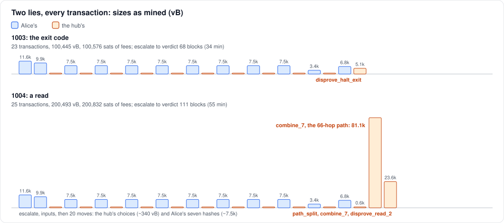
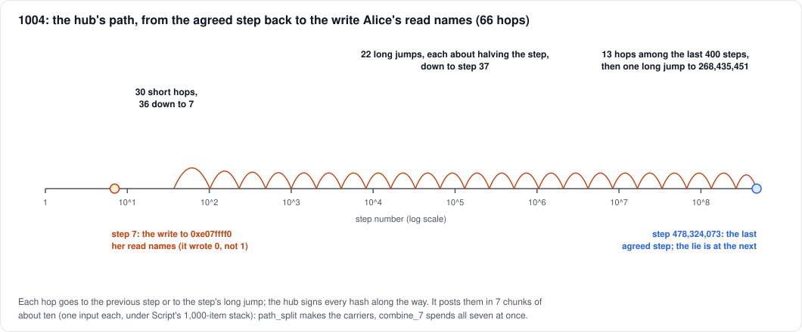

# When Alice lies

Two false claims on Mutinynet (2026-10-14), each played to the end
against an honest hub. In both, Alice deposits 30,000 and returns 10,000
tokens on the L2, then claims a withdrawal of 40,000. The hub disputes
both, the search lands on her lie, and the hub's verdict takes the
contract. Every transaction is linked to the Mutinynet explorer, with
sizes and fees as mined.

| contract | the lie | the search lands on | verdict | on chain | fees |
|---|---|---|---|---|---|
| 1003 | the exit code: her run of the verifier rejects, but she says it accepts | the last step, the halt | `disprove_halt_exit`, 5,143 vB | 23 txs, 100,445 vB | 100,576 |
| 1004 | a read: one word read near the end has a bit flipped | that step, 5 before the halt | a 66-hop path, then `disprove_read_2` | 25 txs, 200,493 vB | 200,832 |

The contracts' terms are those of Tests B and C
([opening.md](opening.md)): a cap of 2^16, `D` = 30,000, `r_A` = 20,000,
`r_H` = 197,357, δ = δ′ = 40 blocks (20 minutes each).

## The claim: a proof that doesn't verify

Alice's claim says that BitVMX's Groth16 verifier, run on her 204-byte
input, accepts. Her input is Test B's, with two words changed: `b`
(35,000 → 40,000) and the memo (1001 → 1003, or 1004). The rest stays:

- **The 18 checked words are right:** the journal's length, the image
  id, the deployment, and the memo. A wrong one would lose at once to
  the hub's input-word check, with no search.
- **The proof is Test B's.** Those 32 words aren't checked, since checking
  them is the verifier's job. The proof was made for 35,000 and memo
  1001, so for this input it is garbage.

So the verifier rejects. Run honestly, its 478,324,079 steps end in
the reject code. Her claimed trace ends in accept, and starts from the
same state as the honest one, since both follow from the input she
signed. Somewhere between, one step must be the first wrong one. The
search finds it, wherever the liar puts it.

The hub needs no search to know the claim is false: it checks the proof
natively in milliseconds and finds it invalid. The search is for
showing *Bitcoin*.

## The search, played out



The two searches look alike. `escalate` and `inputs` carry her signed
input. Then come 20 moves, alternating:

- **the hub's**, about 340 vB each: a one-time signature on its choice of
  one segment in eight;
- **Alice's**, about 7,500 vB each: one-time signatures on the trace's
  hashes at the seven boundaries inside that segment. 301 digits make
  606 witness items, and most of the bytes are the 22 kB script that
  checks them.

Move 19 is smaller (3.4k): the last round splits a short segment. Move 21
is Alice's signed record of the disputed step.

| | 1003 | 1004 |
|---|---|---|
| [escalate](https://mutinynet.com/tx/55071e7af3e156c8d22cabfec1064f5fd489124ad14a5e81f3ca22c687f9f762) / [escalate](https://mutinynet.com/tx/2a7cd05bcc894c046f1953b0f45d1b36a1cb73bbef6b0703732c72f0a680562c) | 3,505,085 | 3,505,171 |
| [inputs](https://mutinynet.com/tx/35c411265ed6a8bac5a979bebb39b6e19a767d5ef005b645e8f914778d4c1214) / [inputs](https://mutinynet.com/tx/ee946f634934ce7fc2d27b9823fec29b25c1cbb17a121f37a09cc8d7cc3f0754) | 3,505,086 | 3,505,172 |
| move 2, the hub's first choice | 3,505,091 | 3,505,177 |
| [move 21](https://mutinynet.com/tx/eabaaad215c1e3c21683bd10c955013f86e315f39b217a806d88360755c7ef34) / [move 21](https://mutinynet.com/tx/0a8b375e293bc6e27e99a73a76a86c92ac6507c9274f86efbbe3d1c0dc6bc0da), her record | 3,505,112 | 3,505,197 |

From `escalate` to Alice's record took 27 blocks in 1003 and 26 in
1004: about 13 minutes for 21 moves. Each side answered within a block
or two of the other's move, far inside its 40-block window. The hub's
first move came five blocks after `inputs`, the time it took to run the
whole verifier once.

To follow a dispute on the explorer, start at `escalate` and keep
following output 0's "spent by": each link spends output 0 of the one
before.

## Her record, and who must show what

Alice's record of the disputed step says what the step read (two
addresses and values, the pc, the instruction word), what it wrote, and
the hash after it. Each read also names the step that last wrote its
address. Then:

1. **The hub may refute the record's inputs**, with one of its
   `disprove_<rule>` leaves: the instruction isn't the program's at that
   pc, the pc doesn't follow, a read doesn't match memory, the halt's
   exit code isn't success, and so on.
2. **If nothing refutes it, Alice must prove the step's computation**,
   with the `prove_<op>` leaf for its instruction: Script runs that one
   RISC-V instruction on nibbles and checks her write and her hash.

Proving the computation is the claimant's burden, so a step that can't
be proved loses for her. The facts about memory are the hub's to
refute, because one counterexample is a short certificate.

## Lie 1: the exit code (1003)

The simplest liar runs the verifier honestly and lies only about how it
ended. Every one of her trace hashes is the honest one, except the last.
So the search has to descend all the way: the first disagreement is the
final step, the `ecall` that halts.

Her record of that step is honest in everything but the exit code, so
the hub needs no path. Its `disprove_halt_exit` leaf reads the record's
exit code from her signed move and shows it isn't success:

[9952f19c…](https://mutinynet.com/tx/9952f19c2a81231e419b8e824c26c561039cefb766c7fbe420e77a54bc548785)
· 5,143 vB · fee 5,153 · block 3,505,153

That is 41 blocks after her record: the hub's disproves wait δ (40
blocks) after it. Its one output,
175,056 sats, goes to the hub: everything left in the contract.

## Lie 2: a read (1004)

The second liar lies earlier, and about memory. At step 478,324,074,
five steps before the halt, the verifier reads the word at address
0xe07ffff0, near the top of the stack. That word was written at step 7,
during start-up, with the value 0. Alice's trace says she read 1, and
names step 7 as its last write. From that step on, her trace hashes
differ from the honest ones, so the search lands on it.

The `prove_<op>` leaf can't catch this: it checks the computation given
the reads, and takes the reads on trust. Showing the read is wrong needs
the history: that step 7 wrote 0 there. That fact is about a step 478
million steps earlier, and the jump list is what makes it short to show.

**The path.** Every step's hash commits to the hash before it and to one
earlier step's hash, its long jump. So from the agreed step back to
step 7, the hub can show a chain of hashes, each one a back-link of the
one before:



66 hops: 13 among the last 400 steps, one long jump to step 268,435,451,
22 more long jumps roughly halving the step each time, and 30 short hops
from 36 down to 7.

**Posting it** takes two transactions, three blocks after her record:

- **`path_split`**
  ([b636120e…](https://mutinynet.com/tx/b636120eb1cad13d73a644730c8e2d1b9c500e36a041f78f49ad8eea40875852),
  587 vB): turns her record's output into eight carriers, one holding the
  value (176,974) and seven of dust, plus an anchor.
- **`combine_7`**
  ([fea1baa2…](https://mutinynet.com/tx/fea1baa265a95e20f9ec233a085e42cb0a56254f6defc97f8caa4efb1fb5f932),
  **81,056 vB**, fee 81,205): spends seven carriers at once, each input
  carrying one chunk of the path. One input's witness counts toward
  Script's 1,000-item stack, and a signed byte costs four items. So the
  path's 66 hashes go about ten to a chunk: each input's witness is
  about 45 kB, near the limit.

**Alice's window.** For the next 80 blocks (δ + δ′), Alice may challenge
any one hop. The hub would then have to reveal that hash's preimage, and
a forged hop couldn't be revealed. Her wallet checked all 66 against its
own history and found them genuine, so it didn't challenge.

**The verdict:** `disprove_read_2`
([f17f114d…](https://mutinynet.com/tx/f17f114dcce2b3c7f275cec786d6e0a3733d4005d9bd5e5b7fa2f8481e543147),
23,599 vB, block 3,505,282). It opens the path's end, the preimage of
step 7's hash, which includes step 7's write: 0xe07ffff0, value 0. Her
read names step 7 as the last write, but says 1. Most of the
transaction is its 88.6 kB script, mostly BLAKE3 in Script, to hash the
preimage. Its one output, 73,810 sats, goes to the hub.

## Who paid

In both disputes the hub won, and Alice lost what she had put into the
contract. The search's fees are paid as it goes, out of the contract,
and the winner takes what is left:

| | 1003 | 1004 |
|---|---|---|
| the contract | 282,892 | 282,892 |
| fees of the links and the verdict | 100,576 | 200,832 |
| anchors and carriers, at 330 sats each | 7,260 | 8,250 |
| to the hub, by its verdict | 175,056 | 73,810 |
| the hub had put in | 232,892 | 232,892 |
| **the hub, net on chain** | **−57,836** | **−159,082** |
| Alice, net on chain (she keeps her fee budget) | −51,000 | −51,000 |

So at this size an honest hub loses money beating a liar. A false claim
forfeits the liar's stake, `D + r_A` = 50,000. A full search costs
100,000 to 200,000 sats in fees at 1 sat/vB, and the hub's reserve pays
the difference. The hub's reserve is sized to these floors for the case
where the hub loses. Nothing sizes Alice's stake to them.

That is a matter of scale, not of the mechanism. These contracts are
tiny, for a test network. At the sizes lichen is meant for, deposits
well above 1M sats with generous reserves, the liar's forfeit covers the
search many times over. On mainnet the floors grow with the feerate:
about ten times these figures at 10 sat/vB. Either way the liar loses
everything she put in. The search's cost only decides how much of it
reaches the hub.

The tokens are another matter. Alice's 20,000 tokens left on the L2 are
still hers, but no longer backed by her contract, which is closed.
[cooperative.md](cooperative.md) covers what tokens left on the L2 mean.

## What these runs show

- **Both lies were caught where they were told.** The halt lie needed
  only a one-step verdict. The read lie needed the path: the jump list's
  reason for being, shown here across 478 million steps in 66 hops.
- **The sizes match the estimates.** Our earlier figures were about 123
  kvB for a dispute without a read and 187 kvB with one. These came to
  100 and 200 kvB.
- **The expensive part of a read lie is the hub's path:** 81 kvB for
  66 hops, and 105 kvB with the verdict. Other reads need more hops, up
  to 86, and the path's cost grows with them.
- **The liar chooses what the hub's win costs.** Every false claim
  costs Alice the same, her stake. But she chooses the lie, and with it
  the search's cost to the hub: 100 kvB for the exit code, 200 kvB for
  a read. That is why the liar's stake should cover the deepest
  dispute.

## Reproducing it

The wallet has a hidden option for trials, `--lie <json>`, which takes
BitVMX's fault configuration. A lie must be one the honest search lands
on. `crates/hub/examples/read_lie.rs` finds one for a given input: it
runs the execution once, flips a read in its last steps, and plays the
search off chain to check where it lands. The read lie was rehearsed
first on regtest (`crates/hub/tests/groth16_read.rs`, opt-in).

With `--sequencer` and `--hub` as in [deploy/README.md](../../deploy/README.md):

```sh
# the input: Test B's with b and the memo changed (here 1004)
cargo run --release -p lichen-hub --example read_lie -- lie-1004.hex /tmp/rl > lie-1004-lie.json
lichen --network mutinynet --wallet lie.json open 30000 --bits 16 --payout <address>
lichen --network mutinynet --wallet lie.json return 10000 1004
lichen --network mutinynet --wallet lie.json --statement groth16 \
  dispute 1004 40000 --input lie-1004.hex --lie lie-1004-lie.json
```

Without `--lie`, `dispute` runs the verifier honestly and claims it
accepts: the exit-code lie of 1003.
