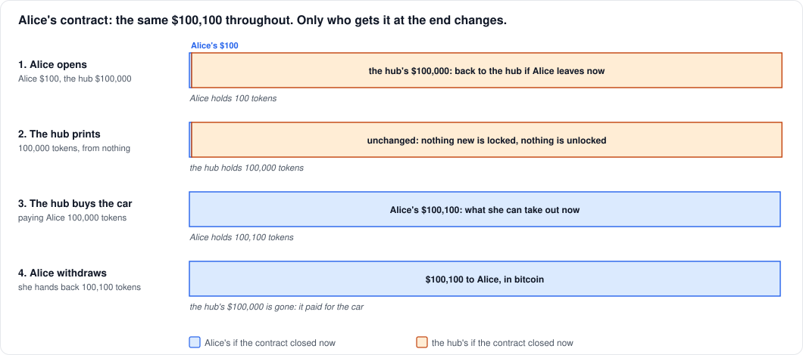
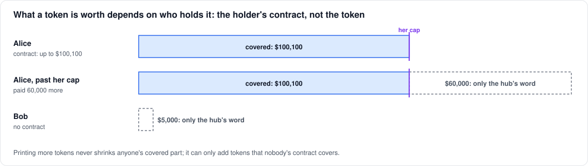

# Why the hub may print tokens

On lichen's L2, the hub can create tokens whenever it likes, as many as
it likes. That sounds like the one thing a money system must never
allow. This note explains why it doesn't put anyone's money at risk. It
starts with a story, then gives the details.

## The story

Alice sells sports cars. She wants to be paid on the L2, so she opens a
contract with the hub.

**1. She opens a contract.** She puts in **$100**. She also asks the hub
for room to receive large payments, since a car costs $100,000. So the
hub puts in **$100,000** of its own. The $100,100 is locked in the
contract on Bitcoin. Alice gets 100 tokens on the L2, one per dollar
she put in. If the contract closed now, Alice would get her $100 and
the hub its $100,000.

**2. The hub prints 100,000 tokens.** Some time later the hub wants a
car. It creates 100,000 tokens out of thin air, which sounds bad. But
nothing has changed on Bitcoin: the contract still holds the same
$100,100, and if it closed now, the split would still be $100 to Alice
and $100,000 to the hub.

**3. The hub buys the car.** It pays Alice the 100,000 tokens, and she
now has 100,100.

**4. Alice withdraws.** She hands back all 100,100 tokens, and the
contract pays her **$100,100** in bitcoin. The hub's $100,000 is gone:
it went to Alice.

So the hub didn't get a free car. It paid with the $100,000 it had
locked in Alice's contract at the start. Printing the tokens cost it
nothing. Spending them with Alice cost it exactly what they were worth,
because Alice could turn them into the hub's bitcoin.

**The hub can print tokens, but it can't print the bitcoin behind
them.** What a token is worth depends on who holds it:

- **Held by someone whose contract has room for it,** a token is worth a
  dollar of the hub's locked bitcoin, and the hub can't take that back.
- **Held by anyone else,** a token is worth only the hub's word.

If the hub printed a million more tokens and gave them to Alice, her
contract would still pay her $100,100 and no more. The rest would be
tokens that nobody's contract covers. No amount of printing makes her
$100,100 worth less.

## The details

### What the story leaves out

- **Units.** Tokens are sats, not dollars. A contract's terms are in
  bitcoin, and so is what it pays. The dollars above are only for
  readability.
- **Reserves and fees.** A contract also holds a reserve from each side
  (`r_A`, `r_H`), and its transactions pay fees. A cooperative
  withdrawal pays each side its reserve back. The hub's reserve is what
  it loses if it refuses a valid withdrawal and Alice enforces it by
  dispute ([hub-absent.md](hub-absent.md)).
- **One withdrawal per contract.** A withdrawal closes the contract. The
  cap limits how much can be withdrawn, not which tokens: Alice can hand
  back tokens she received from anyone, as she did in the story.

In the real terms, Alice's deposit is `D`, her cap is `V_max`, and the
hub puts in `V_max − D` plus its reserve. In the story, `D` = $100 and
`V_max` = $100,100.

### Why printing can't touch a covered balance

Alice can always take out the smaller of her balance and her cap. Her
contract output pays it, and that output is on Bitcoin, out of reach of
anything that happens on the L2. It can be spent in only three ways:

- **a withdrawal both sides sign** (the fold);
- **a dispute,** if the hub refuses: Alice proves the tokens she handed
  back;
- **the default,** after the contract's end date, `T_close`.

Printing appears in none of them. The hub could mint a billion tokens,
and Alice's contract would pay her exactly what it would have paid
anyway.

Being covered is a property of the holder, not the token. Every token
is the same. A token in Alice's hands is backed by her contract. If she
pays it to Carol, it is backed by Carol's contract, if Carol has room.

### The hub's side: bounded, and no shared pool

In each contract the hub can lose at most what it put in, `V_max − D`
(and its reserve, if it loses a dispute). Across all its contracts, its
exposure is the sum of those amounts, however many tokens it prints.
Printing is only a way of spending collateral it has already locked.

Nor is there a shared pool. A bank, or the issuer of a stablecoin, backs
everyone's balance from one reserve, so creating more claims dilutes
everyone's, and a rush to withdraw can empty it. Here each contract
stands alone. Alice's withdrawal is paid from her contract, never from
Carol's, so nobody's withdrawal depends on anyone else's.

### Where the hub's word is all there is

Printing is harmless only to holders whose contracts cover them.
Everyone else holds tokens worth only the hub's word:

- **Tokens beyond a contract's room.** In the story, a second car would
  have taken Alice past her cap.
- **Holders with no contract,** like Bob in
  [cooperative.md](cooperative.md#alices-5000).
- **Balances left past `T_close`.** After the contract's end date, the
  hub may close it by default, paying Alice her reserve, and her tokens
  are no longer covered.

That is an ordinary custodial balance, and a holder who wants more can
act:

- accept only payments that fit in their contract's room;
- open a contract, or a bigger one;
- withdraw, or move to a new contract, before `T_close`.

A wallet could show the covered part of a balance, to make this easy.
Lichen's doesn't yet.

### Room to receive has a price

What Alice asked for in the story is what Lightning calls **inbound
liquidity**. On Lightning, room to receive in a channel is the other
side's balance. Lightning service providers sell it, through liquidity
ads and channel leases, because it ties up their capital.

Here it is the same. To give Alice room for $100,000, the hub locks
$100,000 of its own bitcoin, plus a reserve, for the contract's life. A
merchant who deposits little but wants to receive a lot is asking for
that capital, so in a working market it would have a price, set by how
much and for how long. Lichen doesn't price it yet: a hub only limits
the size of the caps it offers.

The story is also what happens on Lightning. If the provider buys
Alice's car by paying across her channel, the payment moves its side of
the channel to hers. The hub's tokens are the same bookkeeping, with
two differences:

- **Payments need no route.** Any user can pay any other on the L2.
- **A payment beyond a holder's room doesn't fail,** as it would on
  Lightning. It goes through, and the excess is simply not covered.
  That is why it's the holder's job to watch their room.
