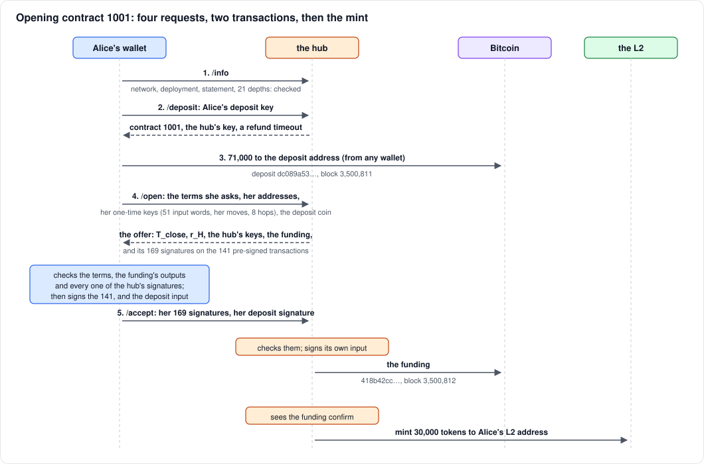
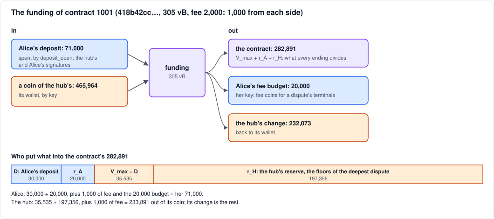

# Opening a contract

> On BitVMX, lichen's first verification gadget, kept as the record of
> Test B. A BABE contract pre-signs 19 transactions, not 141, after a
> cut-and-choose of garbled circuits ([its opening](babe-challenged.md#opening-the-cut-and-choose));
> the terms, the deposit and the mint are the same under either.

A walkthrough of how Alice opened contract 1001 on Mutinynet
(2026-10-12). That's the contract of Test B, whose dispute is in
[hub-absent.md](hub-absent.md). Opening takes four requests to the hub
and two Bitcoin transactions. Between them, Alice and the hub sign every
transaction any ending of the contract could need, before the contract
holds a single sat.

The figures are the run's. Openings have changed since in a few ways,
noted where they come up. The largest: the hub now mints Alice's tokens
with its offer, locked to the funding (see [the mint](#the-mint)), and
the diagram shows that order.

| transaction | block | size | fee | paid by |
|---|---|---|---|---|
| [deposit](https://mutinynet.com/tx/dc089a531e9a9eb785a6c6cd91c32334ef991d1975e7907092f3d0723543e757) | 3,500,811 | 154 vB | 342 | Alice's payer wallet |
| [funding](https://mutinynet.com/tx/418b42cc4111e06a970d08afef94121f0a9e73cdf7bd8cd2f5e3e19fd6d4f7b6) | 3,500,812 | 305 vB | 2,000 | 1,000 each |

## The terms

Alice asks for three things. The hub sets the other three.

| term | value | set by | meaning |
|---|---|---|---|
| `D` | 30,000 | Alice | her deposit, minted to her as tokens on the L2 |
| `V_max` | 65,535 = 2^16 − 1 | Alice, within the hub's limit | the cap: the most any withdrawal can be |
| `r_A` | 20,000 | Alice | her reserve: back to her in every honest ending |
| contract number | 1001 | the hub | also the memo `c` her returns must carry |
| `T_close` | 3,520,971 | the hub | a week of blocks: after it, with no claim, the contract closes by default |
| `r_H` | 197,356 | the hub | its reserve: what the loser of the deepest dispute pays in fees |

Contracts opened since carry two more terms, both the hub's. The
dispute's **windows**, in blocks: one for each of Alice's moves, one
for the hub's choices, and one for its heavy moves (its path, at the
last step). On Mutinynet they are 80, 20 and 80 (40, 10 and 40
minutes); contract 1001 has one window of 80 for every move. And in a
deployment that anchors the L2's history on Bitcoin, a **checkpoint**:
the block the contract opened at, whose difficulty fixes the work a
withdrawal must show on top of its anchor.

Alice also gives two addresses. Her **payout address**, of any wallet she
likes, is where every ending pays her. Her **L2 address** is where the
hub mints her tokens.

`r_H` looks large next to a cap of 65,535. It is the most that a dispute's
links can peel off the contract as fees: the links pay their own way, at
a fixed floor, out of the contract. The hub measures it from the
pre-signed set itself, and takes the larger of that and a share of the cap
(2%, here 1,310). The amount is the same for every contract on the
statement, because the links' sizes don't depend on the amounts. At this
cap, it dominates.

## 1 and 2. Checking the hub; the deposit address

**`/info`.** Before anything else, Alice's wallet checks that the hub is
the one it means to deal with:

- the same network;
- the same deployment, which the wallet pinned at `init`: the
  sequencer's key, the hub's L2 key and, in a deployment that anchors,
  the genesis seal its first anchor spends;
- the same statement, here Groth16, with the same 21 search depths.

**`/deposit`.** Alice sends a fresh deposit key. The hub answers with the
contract's number, its own key, and a timeout: 2,880 blocks on
Mutinynet, a day. The wallet takes no other timeout than the network's:
a longer one would lock the deposit up for as long. Together these make
the deposit address, a taproot
output with two leaves:

- **`deposit_open`:** the hub's signature and Alice's. Only the funding
  transaction spends it this way.
- **`deposit_refund`:** Alice alone, after the timeout. If the hub
  disappears, or the opening fails part-way, she takes her deposit back
  (`lichen refund`).

Thanks to the deposit address, the lichen wallet holds no bitcoin of
Alice's: she pays the address from anywhere, an exchange or a faucet.

## 3. The deposit

Alice paid **71,000** sats to the deposit address
([dc089a53…](https://mutinynet.com/tx/dc089a531e9a9eb785a6c6cd91c32334ef991d1975e7907092f3d0723543e757)):

| | sats |
|---|---|
| `D`, the deposit | 30,000 |
| `r_A`, her reserve | 20,000 |
| her share of the funding's fee | 1,000 |
| her fee budget, for a dispute's terminal transactions | 20,000 |

The wallet waits for it to confirm, then asks to open.

Since this run (2026-10-18), the fee budget on Mutinynet is 30,000, so
the same terms ask 81,000. The wallet checks at opening that the budget
covers the heaviest transaction a dispute may need of her: on Groth16,
a last step's proof, 26,793 sats at 1 sat/vB. Test B's 20,000 would now
be refused.

## 4. The offer

**`/open`.** Alice's request carries the terms she asks for, her
addresses, the deposit's coin, and her public keys. Besides her ordinary
signing key, these are **one-time (Winternitz) keys**, generated from
her wallet's seed and a fresh nonce:

- 51 for the claim's input words, one per word. In a dispute she signs
  her claim with these: `b`, the memo, the proof, the deployment. In a
  deployment that anchors, that last word is the contract's own: the
  deployment, its genesis seal and the checkpoint's work, hashed.
- one per field of each of her moves in the search: depths 1, 3, 5,
  …, 21;
- 8 for the read challenge: one per hop she might challenge.

The hub checks the request against its limits (a cap of at most 2^24
by default), and that the deposit is on chain, confirmed, unspent and
paid to the right address. It also refuses a deposit whose refund
matures too soon ([the mint](#the-mint) says why), and a second offer
for one contract within a minute of the first. Then it builds the
contract and returns an **offer**:

- `T_close` and `r_H`, the windows and, in a deployment that anchors,
  the checkpoint;
- its own keys: its signing key, and one-time keys for its moves (depths
  2, 4, …, 20) and for the read challenge's path;
- the funding transaction, unsigned;
- **its signatures on all 141 pre-signed transactions;**
- the point `T` and the note it has minted to Alice, locked to the
  funding ([the mint](#the-mint)).

### What is pre-signed

Every transaction that spends an output the two of them share is signed
by both, now. Later, neither side needs the other's cooperation to use
any of them. 141 transactions, with 169 inputs, so 169 signatures from
each side:

| transactions | how many | what they do |
|---|---|---|
| `escalate` | 1 | Alice's claim and move 1: spends the contract output |
| `inputs` | 1 | the rest of the claim's input words |
| `move_2` … `move_21` | 20 | the search's moves, the hub's at even depths and Alice's at odd |
| `timeout_1` … `timeout_21`, `timeout_inputs` | 22 | if a side doesn't move in its window, the other wins: Alice by the payout of her claim, the hub by taking everything |
| `prove_<op>` | 62 | Alice's proof of the disputed last step: one for each instruction variant the verifier runs |
| `path_split`, `combine_1` … `combine_8` | 9 | the hub's read-challenge path, posted in up to 8 chunks then combined |
| `hop_1` … `hop_8` | 8 | Alice challenging one hop of that path |
| `timeout_path_split`, `timeout_combine_*`, `timeout_hop_*` | 17 | the read challenge's windows |
| `default` | 1 | after `T_close` with no claim: Alice's reserve back, the rest to the hub |

`combine_K` has `K` inputs, one per chunk, which is where the extra 28
signatures come from.

Some transactions aren't in the set: those that pay one side everything.
Examples are the hub's disproves, its input-word checks, and its
equivocation leaves. Each needs only the winner's key and the evidence
in its witness, so nobody has to pre-sign it.

67 of each side's signatures are 64 bytes: SIGHASH_DEFAULT, committing to
the whole transaction. The other 102, on every timeout, every
`prove_<op>` and `default`, are 65 bytes: ALL|ANYONECANPAY. These carry no fee of their own,
so whoever broadcasts one adds a coin to pay for it. That's the fee
budget's job.

## 5. Alice checks, then signs

Alice's wallet checks, in order:

- the offer is for her deposit's contract number;
- the terms are hers, and `T_close` is at least a day away (2,880
  blocks on Mutinynet; in this run, only that it was in the future);
- the windows give each of her moves at least the network's (80 blocks
  on Mutinynet), and in a deployment that anchors, the checkpoint is a
  recent block of the best chain as she sees it;
- the funding: output 0 is exactly the contract the terms make, it
  spends her deposit, and it pays her fee budget;
- **every one of the hub's 169 signatures**, against the transactions
  she rebuilds herself from the terms and both sides' keys;
- the fee budget covers her heaviest terminal transaction.

Then she signs the 141 transactions, and sends nothing yet. She waits
for the hub's mint to be sealed on the L2: `D`, to the locked key, memo
0. Only then does she sign her deposit's input to the funding, as an
adaptor pre-signature locked to `T` ([the mint](#the-mint)). Taproot
signatures commit to every input's coin, so hers fixes the hub's coins
as well as her own: the hub can't swap the funding for another.

**`/accept`.** She sends her 169 signatures and the pre-signature. The
hub checks them all, and completes her pre-signature with `t`. If the
deposit's refund is still far enough off, it adds its own signature on
the deposit input and on its coin, keeps the contract's record, and
broadcasts the funding. It answers with the funding's txid and `t`. (In
this run, before the swap, she sent a plain signature on the deposit
input, and the hub minted once the funding confirmed.)

## The funding

[418b42cc…](https://mutinynet.com/tx/418b42cc4111e06a970d08afef94121f0a9e73cdf7bd8cd2f5e3e19fd6d4f7b6)
· 305 vB · fee 2,000 · block 3,500,812

| | sats | |
|---|---|---|
| **in:** Alice's deposit | 71,000 | by `deposit_open`: 4 witness items, the two signatures, a 68-byte script, its control block |
| **in:** a coin of the hub's | 465,964 | by key |
| **out 0:** the contract | 282,891 | `V_max + r_A + r_H` |
| **out 1:** Alice's fee budget | 20,000 | her key |
| **out 2:** the hub's change | 232,073 | its wallet |

Into the contract, Alice put `D + r_A` = 50,000, and the hub
`V_max − D + r_H` = 35,535 + 197,356 = 232,891. The hub covers the rest
of the cap, the part above Alice's deposit. That is what lets her
receive more on the L2 than she deposited, and still withdraw it.

## The mint

When the funding confirmed, the hub issued `D` = 30,000 tokens to
Alice's L2 address, through the sequencer. For 1001 and 1002 that took
about a minute from the deposit's confirmation.

**That order had a hole, since closed.** Nothing made the hub mint. A
hub that took the funding and never minted left Alice with no tokens to
return, so no way to withdraw, and at `T_close` the default paid the hub
everything but her reserve, her `D` included. Minting first doesn't fix
it: Alice could then refuse to sign the funding, refund her deposit, and
keep tokens no contract of hers backs. It is an exchange, and either
side going first could be cheated.

Openings now make the funding and the mint one swap:

1. **The offer mints first, locked.** The hub picks a secret `t` for this
   funding transaction (it derives it from its seed, the contract, Alice's
   L2 key and the funding's txid, so every offer has its own) and mints
   `D` to the key `P = H(A ‖ T)·A + T`, where `A` is Alice's L2 key and
   `T = t·G`. Spending it takes Alice's secret and `t`. The offer carries
   `T` and where the note is.
2. **Alice checks the mint, sealed,** before she signs the deposit
   input or sends any signature: `D`, to `P`, memo 0.
3. **Alice's deposit signature is an adaptor pre-signature,** locked to
   `T`. It is not yet a valid signature; adding `t` makes it one.
4. **The hub completes it to broadcast the funding.** It can't spend the
   deposit any other way: `deposit_open` needs Alice's signature, and
   only `t` makes one from her pre-signature. The completed signature
   is in the funding's witness, and it, less her pre-signature, is `t`.
   The hub also sends `t` in its answer.
5. **Alice spends the locked note to her own key** with her secret and
   `t`.

If the hub never broadcasts, Alice refunds her deposit after the
timeout, and the locked note stays where it is: tokens that no one can
spend, which cost the hub nothing to print. That is what makes this
simpler than a usual swap: the hub's side needs no refund and no
timeout. If its answer is lost, Alice's wallet reads `t` from the
funding on chain (`lichen claim-mint`).

The hub carries the one timing risk. `t` is public once the funding
reaches the mempool, and if the funding were still unconfirmed when the
deposit's refund matures, Alice could take both. So the hub broadcasts
only in the first half of the timeout: it checks at `/open`, and again
at `/accept`. Its change output would let it bump the funding's fee
without Alice, but fee-bumping is not yet implemented, so that deadline
is the only guard.

Once the funding is out, the contract is open. Its endings are:

- a cooperative fold ([cooperative.md](cooperative.md));
- a dispute ([hub-absent.md](hub-absent.md),
  [hub-returns.md](hub-returns.md)), paid out as in
  [payout.md](payout.md);
- `default`, after `T_close`, if Alice never claims.

## Why the order is safe

- **Before the funding, Alice risks only a delay.** Until she signs the
  deposit input, the hub can't spend her deposit. If the hub stalls at
  any point, she refunds after the timeout.
- **Alice signs nothing until she holds the hub's signatures on
  everything.** Her signatures and the funding go last, so the contract
  can't exist without all its exits already signed.
- **The hub broadcasts, but can't change what it broadcasts.** Alice's
  signature on the deposit input commits to the whole funding: its
  outputs, and every coin it spends.
- **The hub risks nothing before it broadcasts.** It checks all 169 of
  Alice's signatures before adding its own to the funding. The tokens it
  minted with its offer are locked until it does.
- **The funding and Alice's tokens come together.** Broadcasting the
  funding reveals `t`, which unlocks her `D`; without the funding, no one
  can spend it.

## What it costs

On chain, 459 vB: the deposit (154 vB, from Alice's payer wallet) and the
funding (305 vB, 2,000 sats split between the two sides). Off chain,
the offer and the acceptance carry the one-time public keys and 338
signatures. The hub keeps them all in the contract's record, its only
memory of the contract: everything else about a dispute it reads from the
chain ([hub-returns.md](hub-returns.md)).
