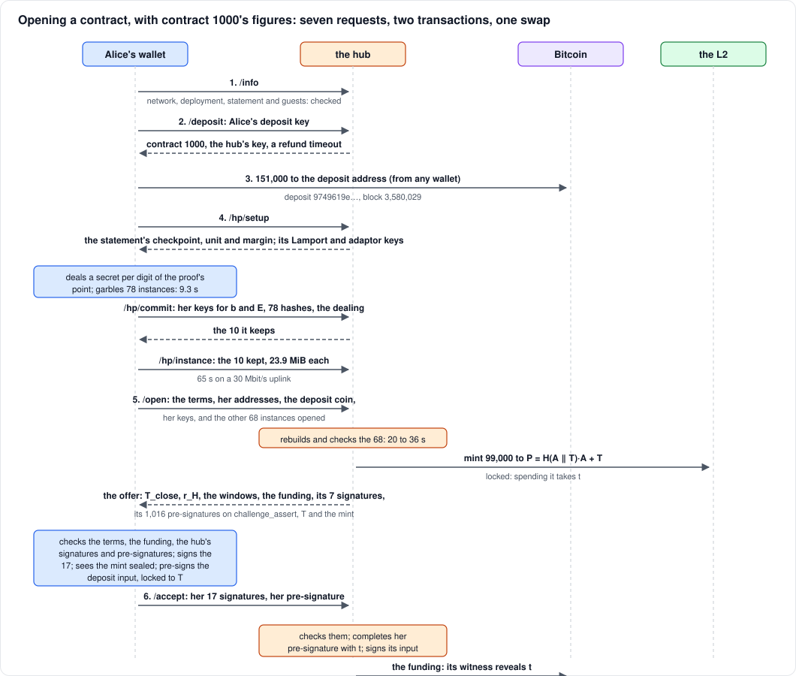
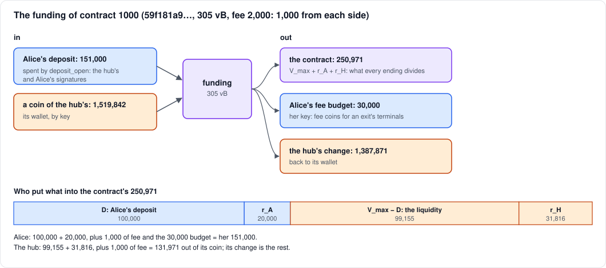

# Opening a contract

How Alice opened contract 1000 on Mutinynet (2026-11-11), on the
hub-proves deployment. Opening takes seven kinds of request to the hub and two
Bitcoin transactions. Between them, Alice garbles the circuits that will
check the hub's proof if it ever says her claim is false, and the two
sides sign every transaction any ending of the contract could need,
before the contract holds a single sat.

| transaction | block | size | fee | paid by |
|---|---|---|---|---|
| [deposit](https://mutinynet.com/tx/9749619ec83f9afd8c1be3b9be99ae1175c59929b8a940a5d66828440ef5f01f) | 3,580,029 | 212 vB | 227 | Alice's payer wallet |
| [funding](https://mutinynet.com/tx/59f181a9e2a21958628c9685d26ad3c1c3803fbb3558e97fc77ff583da1bfa2b) | 3,580,038 | 305 vB | 2,000 | 1,000 each |

## The terms

Alice asks for three things. The hub sets the rest.

| term | value | set by | meaning |
|---|---|---|---|
| `D` | 100,000 | Alice | her deposit |
| liquidity | 100,000 | Alice | what she can receive beyond her balance |
| `r_A` | 20,000 | Alice | her reserve: back to her in every honest ending |
| the hub's fee | 1,000 | the hub | 1% of the liquidity, kept out of the mint: she is minted 99,000 |
| `V_max` | 199,155 | the hub, from her ask | the cap: `D` less the fee, plus the liquidity, rounded up to the unit |
| unit `u`, bits `K` | 781 sats, 8 | the hub | `V_max = u (2^K − 1)`: an exit pays in units ([payout.md](payout.md)) |
| contract number | 1000 | the hub | `c` in the hub's statement's journal |
| `T_close` | 3,600,195 | the hub | a week of blocks: after it, the default closes the contract |
| `r_H` | 31,816 | the hub | its reserve: what a dispute's links can take in fees from the side that loses |
| windows | `w_H` 240, `Δ2` 2,880, `Δ1` 240 | the network | the hub's to assert (2 hours), hers to challenge (a day), the hub's to answer (2 hours) |
| margin | 20 blocks | the network | a claim is judged at the last anchor at least this deep before her `request` |
| checkpoint | block 3,580,029 | the hub | its difficulty fixes the work `W` the hub's statement asks on top of `request` |

Alice also gives two addresses: her **payout address**, of any wallet she
likes, where every ending pays her (by default the lichen wallet's own),
and her **L2 address**, where the hub mints her tokens.

`r_H` is the most a dispute's links can peel off the contract as fees:
each link pays its own way, at a floor of 1 sat/vB, out of the contract,
and the loser's reserve covers it. The hub measures it from the
pre-signed set and takes the larger of that and 2% of the cap (here
3,983). It is the same for every contract on the network, because the
links' sizes don't depend on the amounts.

## 1 and 2. Checking the hub; the deposit address

**`/info`.** Alice's wallet checks that the hub is the one it means to
deal with: the network; the deployment, which the wallet pinned at
`init` (the sequencer's key, the hub's L2 key, and the genesis seal the
first anchor spends); and the statement, `hub-proves` with the guests'
image ids, which must be the wallet's own.

**`/deposit`.** Alice sends a fresh deposit key. The hub answers with the
contract's number, its own key, and a timeout: 2,880 blocks on Mutinynet,
a day. Together they make the deposit address, a taproot output with two
leaves:

- **`deposit_open`:** the hub's signature and Alice's. Only the funding
  spends it this way.
- **`deposit_refund`:** Alice alone, after the timeout. If the hub
  disappears, or the opening fails part-way, she takes her deposit back
  (`lichen refund`).

So the lichen wallet holds no bitcoin of Alice's: she pays the address
from anywhere, an exchange or a faucet.

## 3. The deposit

Alice paid **151,000** sats to the deposit address
([9749619e…](https://mutinynet.com/tx/9749619ec83f9afd8c1be3b9be99ae1175c59929b8a940a5d66828440ef5f01f)):

| | sats |
|---|---|
| `D` | 100,000 |
| `r_A`, her reserve | 20,000 |
| her share of the funding's fee | 1,000 |
| her fee budget, for a dispute's terminal transactions | 30,000 |

The wallet checks that the budget covers the heaviest transaction a
dispute may need of her, at 1 sat/vB: her challenge, about 20.7 kvB.
Then it waits for the deposit to confirm.

## 4. The cut-and-choose: Alice garbles

The hub proves, if it ever proves anything: that her exit claim is
false ([exit.md](exit.md)). Bitcoin checks its proof through BABE
([pipeline.md](pipeline.md#4-the-check-on-bitcoin-under-babe)), and BABE
needs the circuits that check it garbled now, by the side the proof
would be used against. That is Alice.

**`/hp/setup`.** The hub fixes its statement for this contract: the
checkpoint, the unit and the margin, which with the deployment make the
statement's journal, `c ‖ D ‖ H(O_D ‖ margin)`. It gives its keys as the
prover: a Lamport key for the proof's first point (254 two-bit digits)
and an adaptor key for each digit's four values.

**Garbling.** Alice's wallet deals a secret for each digit of the
proof's point, shared across 78 instances by Shamir's scheme, and
garbles the 78 instances of the circuit, each with its own scalar and
its own `msg`: **9.3 s** on a Mac.

**`/hp/commit`.** She commits: her one-time Winternitz keys for `b` (a
4-byte word) and `E` (32 bytes), each instance's hash, and the dealing's
commitments. The hub answers with the 10 instances it keeps, chosen
after her commitment, so she can't know which to make well.

**`/hp/instance/1000/<i>`.** She uploads the 10: **23.9 MiB each**, 239
MiB in all. In Olga's opening, alone on a home connection, that took
65 s, about 6.4 s an instance (some 30 Mbit/s). The six contracts opened
at once in this run shared the uplink, and took about half an hour.

**`/open`.** Her request carries the terms she asks for, her addresses,
the deposit's coin, her keys, and the other **68 instances opened**: each
one's seed and its shares of the dealing. The hub rebuilds each from its
seed and checks it against her commitment, and the shares against the
dealing: **20 to 36 s** on lichen-hub for each of the seven contracts.
A cheating Alice, who garbled some instances wrong, is caught unless
every one she garbled wrong is among the 10 kept: 1 in C(78, 10), about
2^-40.

## 5. The offer

The hub checks the request against its limits (here at most 200,000 of
liquidity), and that the deposit is confirmed, unspent and paid to the
right address, with its refund far enough off. Then it builds the
contract and returns an **offer**:

- `T_close`, `r_H`, the windows and the checkpoint;
- the funding transaction, unsigned;
- **its signatures on 7 of the pre-signed transactions**;
- **its 1,016 adaptor pre-signatures on `challenge_assert`,** one for
  each of the 254 digits and four values, each locked to the point of
  that digit's secret in her dealing;
- the point `T` and the note it has minted to Alice, locked to the
  funding ([the mint](#the-mint)).

### What is pre-signed

Every transaction that spends an output the two of them share is signed
by both, now. Later, neither needs the other's cooperation to use any of
them. 17 transactions:

| transaction | how many | what it does |
|---|---|---|
| `request` | 1 | Alice's claim: `b`, `E` and her notes; spends the contract output |
| `request_timeout` | 1 | after `w_H` with no assertion: pays Alice `b`, in units, and both reserves |
| `assert` | 1 | the hub's proof that her claim is false: its first point, Lamport-signed |
| `success` | 1 | after `Δ2` with no challenge: the contract is the hub's |
| `challenge_assert` | 1 | Alice's challenge: completes the hub's pre-signatures for the point it asserted |
| `wrongly_challenged_0` … `_9` | 10 | the hub's answer: one kept instance's `msg`, which only a valid proof unlocks; the contract is the hub's |
| `failure` | 1 | after `Δ1` with no answer: pays Alice `b` and both reserves |
| `default` | 1 | after `T_close` with no claim: Alice's reserve back, the rest to the hub |

Alice signs all 17. The hub signs 7: the `wrongly_challenged` answers are
its own moves, so it keeps its signatures on them and needs only hers.
(She knows every `msg`, having garbled the instances: with the hub's
signature she could post an answer herself, large and at a low fee rate,
and pin the hub's own.)

The contract output itself has three leaves: `fold`, the 2-of-2 signed
when they agree; `default`, after `T_close`; and `request`. Each link
after it (`request`, `assert`, `challenge_assert`) pays its own fee, at a
floor of 1 sat/vB, out of the value it carries; each terminal
(`request_timeout`, `success`, `failure`) and each answer is paid for by
whoever broadcasts it, with a coin of their own, which for Alice is her
fee budget.

## 6. Alice checks, then signs

Alice's wallet checks, in order:

- the offer is for her deposit's contract, on the quoted terms, and
  `T_close` is at least a day away;
- the windows are the network's, and the checkpoint is a recent block of
  the best chain as she sees it;
- the funding: output 0 is exactly the contract the terms make, it
  spends her deposit, and it pays her fee budget;
- **each of the hub's 7 signatures**, against the transactions she
  rebuilds herself from the terms and both sides' keys;
- **each of its 1,016 pre-signatures**, against her own dealing's points;
- the fee budget covers her heaviest terminal transaction.

Then she signs the 17, and sends nothing yet. She waits for the hub's
mint to be sealed on the L2: 99,000, to the locked key. Only then does
she sign her deposit's input to the funding, as an adaptor
pre-signature locked to `T`. Taproot signatures commit to every input's
coin, so hers fixes the hub's coin as well as her own: the hub can't swap
the funding for another.

**`/accept`.** She sends her 17 signatures and the pre-signature. The hub
checks them, completes her pre-signature with `t`, adds its own
signatures on the deposit input and its coin, keeps the contract's
record, and broadcasts the funding. It answers with the funding's txid
and `t`.

## The funding

[59f181a9…](https://mutinynet.com/tx/59f181a9e2a21958628c9685d26ad3c1c3803fbb3558e97fc77ff583da1bfa2b)
· 305 vB · fee 2,000 · block 3,580,038

| | sats | |
|---|---|---|
| **in:** Alice's deposit | 151,000 | by `deposit_open`: 4 witness items, the two signatures, a 68-byte script, its control block |
| **in:** a coin of the hub's | 1,519,842 | by key |
| **out 0:** the contract | 250,971 | `V_max + r_A + r_H` |
| **out 1:** Alice's fee budget | 30,000 | her key |
| **out 2:** the hub's change | 1,387,871 | its wallet |

Into the contract Alice put `D + r_A` = 120,000, and the hub `V_max − D
+ r_H` = 99,155 + 31,816 = 130,971. The hub covers the cap above Alice's
deposit: that is the liquidity she paid 1,000 for, which lets her
receive more on the L2 than she deposited and still withdraw it.

## The mint

The funding and the mint are one swap, so that neither side can be
cheated by going first:

1. **The offer mints first, locked.** The hub picks a secret `t` for this
   funding (from its seed, the contract, Alice's L2 key and the funding's
   txid) and mints `D` less its fee to the key `P = H(A ‖ T)·A + T`,
   where `A` is Alice's L2 key and `T = t·G`. Spending it takes Alice's
   secret and `t`.
2. **Alice checks the mint, sealed,** before she signs the deposit input
   or sends any signature.
3. **Her deposit signature is an adaptor pre-signature,** locked to `T`:
   adding `t` makes it a valid one.
4. **The hub completes it to broadcast the funding.** It can't spend the
   deposit any other way. The completed signature is in the funding's
   witness, and it, less her pre-signature, is `t`. The hub also sends
   `t` in its answer.
5. **Alice spends the locked note to her own key** with her secret and
   `t`. That is her first L2 spend, and like every spend it counts once
   she acknowledges it against an anchor ([payments.md](payments.md)).

If the hub never broadcasts, Alice refunds her deposit after the timeout,
and the locked note stays where it is: tokens no one can spend, which
cost the hub nothing to print. If its answer is lost, her wallet reads
`t` from the funding on chain (`lichen claim-mint`). The hub broadcasts
only in the first half of the deposit's timeout, so that the funding
confirms long before Alice could refund the deposit with `t` in hand.

Once the funding is out, the contract is open. Its endings are:

- a cooperative withdrawal, the claim recorded and the contract folded
  ([cooperative.md](cooperative.md));
- an exit, if the hub won't fold: her claim on Bitcoin, which the hub
  must prove false or pay ([exit.md](exit.md)), paid out as in
  [payout.md](payout.md);
- `default`, after `T_close`, if Alice never claims.

## Why the order is safe

- **Before the funding, Alice risks only a delay.** Until she signs the
  deposit input, the hub can't spend her deposit. If the hub stalls, she
  refunds after the timeout.
- **Alice signs nothing until she holds the hub's signatures on
  everything it must sign,** and its pre-signatures on `challenge_assert`:
  the contract can't exist without every exit already signed.
- **The hub can't change what it broadcasts.** Alice's signature on the
  deposit input commits to the whole funding.
- **The hub checks her garbling before it offers.** A contract whose
  circuits it couldn't use, against a false claim, never opens.
- **The hub risks nothing before it broadcasts.** It checks her
  signatures before adding its own, and the tokens it minted are locked
  until it does.
- **The funding and Alice's tokens come together.** Broadcasting the
  funding reveals `t`, which unlocks her tokens; without it, no one can
  spend them.

## What it costs

| | |
|---|---|
| on chain | 517 vB: the deposit (212 vB, from Alice's payer wallet) and the funding (305 vB, 2,000 sats split) |
| Alice's device | 9.3 s of garbling; 239 MiB uploaded; a seed for her secrets kept |
| the hub | 20 to 36 s checking the 68 opened; 239 MiB stored for the contract's life |
| signatures | Alice's 17, the hub's 7 and its 1,016 adaptor pre-signatures |

The upload is the cost the swapped roles bring: under the earlier design
the hub garbled and Alice downloaded the instances. It is two to three
minutes on a 10 to 20 Mbit/s uplink, poor on mobile data. Fewer instances,
by VSSS or soldering, would shrink it (docs/BABE_DISPUTE_PLAN.md).
