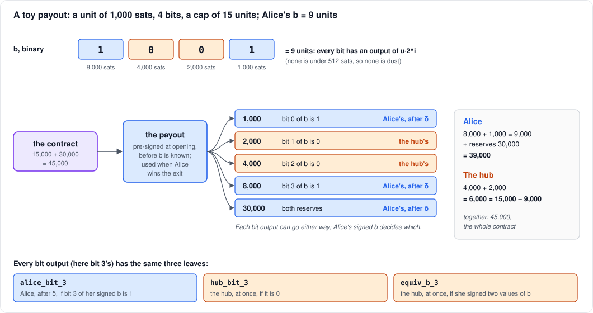
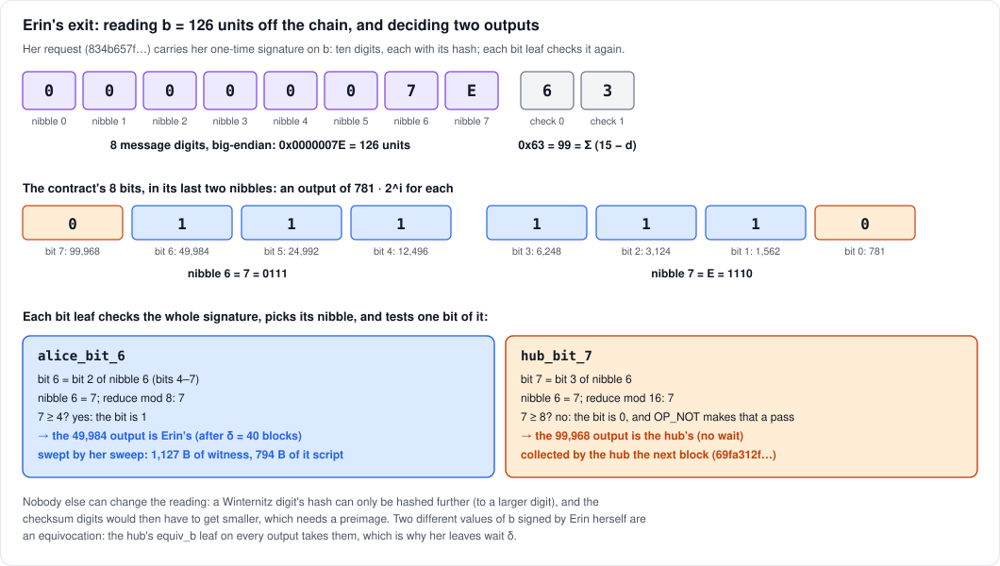

# How an exit pays out

When Alice wins an exit, because the hub didn't assert her claim false
or couldn't answer her challenge, one transaction splits the contract
between her and the hub. It has to pay her exactly `b`, her claim, but it
was signed when the contract opened, before anyone knew `b`. This note
explains how: first with a toy example, then traced through a real
payout on Mutinynet (contract 1002, Erin's exit, 2026-11-11).

## Part 1: a toy payout

### The problem

Bitcoin Script can't build an output. A transaction's outputs, and their
amounts, are fixed when it is signed. So the payout's 2-of-2 signatures,
made at opening, fix its outputs before `b` exists. There is no covenant
to say "pay Alice `b`, and the hub the rest".

What a script *can* do is check a signature on a number and test one of
its bits. So the payout has one output for each power of two, every one
of them, whatever `b` turns out to be. Alice's signature on `b` then
decides who may spend each one.

### Units

A contract counts in a **unit** `u` of its own, with `K` bits: its cap
is `V_max = u (2^K − 1)`, and Alice claims `b` units, a number below
`2^K`. The hub picks the largest `K` (at most 32) for which every bit's
output, `u 2^i`, is at least 512 sats, so none is dust, and `u` the
smallest that reaches the cap Alice asked for. Contract 1000's cap of
199,155 is 255 units of 781: `K` = 8.

| term | toy value |
|---|---|
| unit `u`, bits `K` | 1,000 sats, 4 |
| cap `V_max` | 15 units: 15,000 |
| reserves `r_A + r_H` | 10,000 + 20,000 = 30,000 |
| the contract output | `V_max + r_A + r_H` = 45,000 |
| Alice's claim `b` | 9 units = 8 + 1: bits 3 and 0 |

Alice signed `b` in her `request`, with a one-time (Winternitz) key
fixed in the contract. That signature is the claim the exit is about.
When she wins, the same signature, already public, does a second job:
dividing the payout.

### The outputs

| output | sats | whose |
|---|---|---|
| bit 0 | 1,000 | bit 0 of `b` is 1: **Alice's**, after δ |
| bit 1 | 2,000 | bit 1 is 0: **the hub's** |
| bit 2 | 4,000 | bit 2 is 0: **the hub's** |
| bit 3 | 8,000 | bit 3 is 1: **Alice's**, after δ |
| the reserves | 30,000 | **Alice's**, after δ: the winner takes both |

The arithmetic:

- **Alice:** 8,000 + 1,000 = 9,000, her `b` exactly, plus 30,000 of
  reserves: 39,000.
- **The hub:** 2,000 + 4,000 = 6,000, which is `V_max − b`. It loses its
  reserve, but keeps the part of the cap Alice didn't claim.

So the hub gets the complement, spread across the bit outputs whose bit
is 0. A claim is in whole units, so nothing is rounded away: Alice asks
for a number of units, and her wallet claims notes worth at least that
much. What her notes hold above it stays with the hub (and is retired
with them).

### The leaves

Every bit output has the same three leaves:

- **`alice_bit_i`:** Alice, after δ, if bit `i` of her signed `b` is 1.
- **`hub_bit_i`:** the hub, at once, if bit `i` is 0.
- **`equiv_b_i`:** the hub, at once, if Alice ever signed two different
  values of `b`.

Each leaf checks the whole signature on `b`, then reads its one bit.
Nobody can make the signature say anything else: the hub can't forge
it, and a second value Alice signed would be an equivocation. Her leaves
wait δ so that the hub has time to take every output with `equiv_b`
first. The reserve output has two: `alice_reserve`, hers after δ, and
`equiv_b` again.

### Fees

The links before the payout (`request`, and `assert` and
`challenge_assert` in a disputed exit) each paid a floor of 1 sat/vB out
of the contract. The winner's payout carries the reserves less those
floors: the loser's reserve pays for the dispute. The payout itself
carries no fee: whoever broadcasts it adds a coin of their own, Alice
from her fee budget.

### Spending a bit output

Spending one costs about **330 vB**: the signature on `b`, revealed
again, and the script that checks it (Part 2 measures it). So a bit's
output must be worth more than that at the feerates the contract will
see, which is why no unit is under 512 sats. Whatever the cap, the
unit is between 512 and about 1,024 sats, and `K` grows with the cap:
8 bits for contract 1000's, 23 for a cap of 43 BTC.

## Part 2: Erin's exit, traced

Erin's exit ([exit.md](exit.md#erin-a-true-claim-paid)): a true claim
the hub didn't assert against, so after `w_H` her timeout paid her.

| term | contract 1002 |
|---|---|
| unit `u`, bits `K` | 781 sats, 8 |
| cap `V_max` | 255 units: 199,155 |
| reserves | `r_A` 20,000, `r_H` 31,816 |
| `b` | 126 units = 98,406 sats = `0111 1110`: bits 1 to 6 |

### The payout transaction

The payout is `request_timeout`,
[2eb4200a…](https://mutinynet.com/tx/2eb4200a19ec65b82b024b787df44a0843511adb4a9ec28b8e636c988d4579d3)
(565 vB, block 3,580,314, 241 blocks after `request`).

**In:** `request`'s output (248,257 sats), spent by its `request_timeout`
leaf with the two pre-signed signatures; and a 568-sat coin from Erin's
fee budget, all of it the fee. The pre-signed transaction carries no fee
of its own, so whoever broadcasts it adds one.

**Out:**

| # | sats | bit of `b` | whose |
|---|---|---|---|
| 0 | 781 | bit 0 = 0 | the hub's |
| 1 | 1,562 | bit 1 = 1 | Erin's |
| 2 | 3,124 | bit 2 = 1 | Erin's |
| 3 | 6,248 | bit 3 = 1 | Erin's |
| 4 | 12,496 | bit 4 = 1 | Erin's |
| 5 | 24,992 | bit 5 = 1 | Erin's |
| 6 | 49,984 | bit 6 = 1 | Erin's |
| 7 | 99,968 | bit 7 = 0 | the hub's |
| 8 | 49,102 | the reserves, less the floor | Erin's |

- **Erin's bits:** 1,562 + 3,124 + 6,248 + 12,496 + 24,992 + 49,984 =
  98,406, her 126 units exactly.
- **The hub's:** 781 + 99,968 = 100,749 = 199,155 − 98,406.
- **The reserves:** `r_A + r_H` = 51,816, less what `request` took on
  its way, its floor (2,384) and its anchor output (330): 49,102.

The outputs add up to the whole input: 199,155 in bit outputs and
49,102 of reserves are 248,257.

### Reading `b` off the chain

Erin's signature on `b` first appeared in `request`'s witness: the claim
in its first 15 items, then her signature on `E`, then her signature on
`b`, ten pairs of a 20-byte hash and a digit, then the two pre-signed
signatures, the 5,765-byte leaf script and its control block. The
digits of `b` are `0 0 0 0 0 0 7 E` and then `6 3`:

- **The eight message digits** are `b`'s nibbles, most significant
  first: 0x0000007E = 126.
- **The two checksum digits** are 0x63 = 99 = Σ (15 − d) over the eight:
  6 × 15 for the zeros, plus 8 and 1.

Each hash is the digit's secret hashed `d` times. The script hashes it
another `15 − d` times and compares the result with the public key in
the contract. So anyone can raise a digit, by hashing further, but no
one can lower one. Raising any message digit lowers the checksum, which
would mean lowering a checksum digit. That is why nobody but Erin can
produce a signature on any other value.

### How a leaf reads one bit

After checking the signature, a bit leaf picks the nibble holding its
bit and tests that one bit. Bit `i` is bit `i mod 4` of the nibble
covering bits `4⌊i/4⌋` to `4⌊i/4⌋ + 3`:

- **`alice_bit_6`:** bit 6 is bit 2 of the nibble for bits 4 to 7,
  which is 7 (`0111`). Reduced modulo 2^3 it is 7, and 7 ≥ 4: true, so
  Erin's leaf passes. Its script also carries `δ` (40 blocks) as a CSV,
  and her key.
- **`hub_bit_7`:** bit 7 is bit 3 of the same nibble. Reduced modulo
  2^4, 7 is 7, and 7 ≥ 8 is false. The hub's leaf ends with `OP_NOT`,
  so for it a 0 passes, at once.

### The sweeps

Erin's outputs wait `δ`, 40 blocks, the hub's chance to show an
equivocation; then her wallet swept them, with the leftovers of her
side, to her payout address in one transaction:
[6136d1d2…](https://mutinynet.com/tx/6136d1d26f545c3719ca7174b87e99098d00a57032f3f7df9960e21ad49c9b41)
· 2,275 vB · fee 2,277 · block 3,580,355

| input | sats | leaf | witness |
|---|---|---|---|
| bits 1 to 6 | 98,406 | `alice_bit_1` … `alice_bit_6` | 1,127 to 1,173 B each: the ten pairs, her key's signature, a script of 787 to 808 B |
| the reserves | 49,102 | `alice_reserve` | 167 B |
| `request`'s anchor output | 330 | hers, as its poster | 131 B |
| her fee budget's rest | 29,272 | by key | 64 B |
| **out** | **174,833** | to her payout address | |

Each bit input costs about 330 vB, most of it the script that checks the
signature on `b`, and the ten pairs it consumes: that's the figure Part
1's dust limit rests on.

**The hub's outputs.** The zero-bit leaves have no timelock, and the hub
collects its outputs itself once an exit settles: here bits 0 and 7,
100,749 sats, in
[69fa312f…](https://mutinynet.com/tx/69fa312f732e2e5dc50d8f4e812b777929ba2e53b683b2868923630b2c8f9815)
(721 vB, fee 723, block 3,580,315, the block after the payout).

Sara's exit, of a shielded note ([exit.md](exit.md#sara-a-shielded-note)),
claimed the same 126 units, and paid out the same way.
