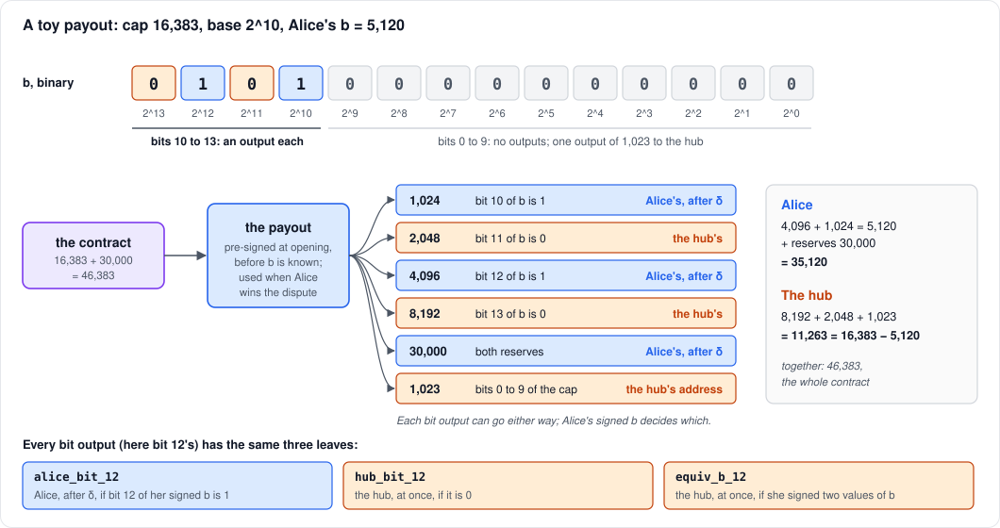
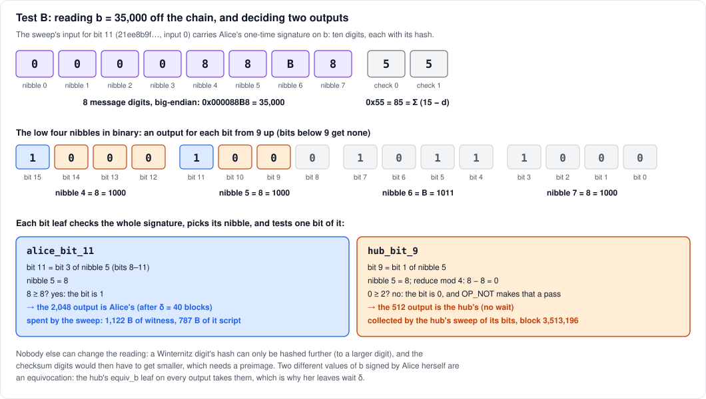

# How a dispute pays out

When Alice wins a dispute, by proving her claim or because the hub didn't
answer, one transaction splits the contract between her and the hub. It
has to pay her exactly `b`, her withdrawal, but it was signed when the
contract opened, before anyone knew `b`. This note explains how that
works: first with a toy example, then traced through a real payout on
Mutinynet (Test B, contract 1001, 2026-10-12).

The toy uses a base of 2^10, which we expect to move to. Today's code,
and Test B, use 2^9 (`LOW_BITS` in `crates/proto`). The toy also leaves
out fees, fee floors and anchors.

## Part 1: a toy payout

### The problem

Bitcoin Script can't build an output. A transaction's outputs, and their
amounts, are fixed when it is signed. So the payout's 2-of-2 signatures,
made at opening, fix its outputs before `b` exists. There is no
covenant to say "pay Alice `b`, and the hub the rest".

What a script *can* do is check a signature on a number and test one of
its bits. So the payout has one output for each power of two, every one
of them, whatever `b` turns out to be. Alice's signature on `b` then
decides who may spend each one.

### The contract

| term | toy value |
|---|---|
| cap `V_max` | 16,383 = 2^14 − 1: a withdrawal is at most 14 bits |
| base | 2^10: bits 10 to 13 get an output each; bits 0 to 9 get none |
| reserves `r_A + r_H` | 10,000 + 20,000 = 30,000 |
| the contract output | `V_max + r_A + r_H` = 46,383 |
| Alice's claim `b` | 5,120 = 4,096 + 1,024: bits 12 and 10 |

Alice signed `b` when she escalated, with a one-time (Winternitz) key
fixed in the contract. That signature is the claim the dispute was
about. When she wins, the same signature, already public, now does a
second job: dividing the payout.

### The outputs

| output | sats | whose |
|---|---|---|
| bit 10 | 1,024 | bit 10 of `b` is 1: **Alice's**, after δ |
| bit 11 | 2,048 | bit 11 is 0: **the hub's** |
| bit 12 | 4,096 | bit 12 is 1: **Alice's**, after δ |
| bit 13 | 8,192 | bit 13 is 0: **the hub's** |
| the reserves | 30,000 | **Alice's**, after δ: the winner takes both |
| the low part | 1,023 | bits 0 to 9 of `V_max`: **the hub's**, to its address |

The arithmetic:

- **Alice:** 4,096 + 1,024 = 5,120 of `b`, plus 30,000 of reserves:
  35,120.
- **The hub:** 8,192 + 2,048 + 1,023 = 11,263, which is `V_max − b`.
  It loses its reserve, but keeps the part of the cap Alice didn't
  withdraw.

So the hub does get the complement, but not as one output. The amount
is spread across the bit outputs whose bit is 0, plus the low part.

### The leaves of a bit output

Every bit output has the same three leaves:

- **`alice_bit_i`:** Alice, after δ, if bit `i` of her signed `b` is 1.
- **`hub_bit_i`:** the hub, at once, if bit `i` is 0.
- **`equiv_b_i`:** the hub, at once, if Alice ever signed two different
  values of `b`.

Each leaf checks the whole signature on `b`, then reads its one bit.
Nobody can make the signature say anything else: the hub can't forge
it, and if Alice signed a second value, that is an equivocation. Her
leaves wait δ so that the hub has time to take every output with
`equiv_b` first.

### Rounding

Bits below the base get no output. They would be too small to be worth
spending, and an output under the dust limit is non-standard. So the
dispute path pays `b` rounded down to a multiple of the base. Had Alice
claimed 5,500, she would get the same two bit outputs, 5,120, and the
380 left over would stay with the hub. A cooperative fold has no
such rounding: it pays her exactly.

### Choosing the base

Spending a bit output costs about **320 vB**: the signature on `b`,
revealed again, and the script that checks it (measured in Part 2). An
output of 2^i sats is worth spending only if it is worth more than
that:

| feerate | cost of spending one bit output | smallest bit worth an output |
|---|---|---|
| 1 sat/vB | ~320 sats | 2^9 (512) |
| 2 sat/vB | ~640 sats | 2^10 (1,024) |
| 5 sat/vB | ~1,600 sats | 2^11 (2,048) |
| 20 sat/vB | ~6,400 sats | 2^13 (8,192) |

The base is fixed when the contract opens, so it has to suit the fees of
the contract's whole life. Raising it costs little: Alice loses at most
`base − 1` sats, and only when she has to dispute. It also saves outputs:
with a cap of 2^32 (about 43 BTC) and a base of 2^10, the payout has 22
bit outputs (about 0.95 kvB of them), rather than 23.

## Part 2: Test B, traced

Test B is the dispute in [hub-absent.md](hub-absent.md): the hub was
switched off, and Alice withdrew 35,000 sats from contract 1001 by
timeout. That note walks through the whole dispute. This part follows
only the payout, down to the witness bytes.

| term | Test B |
|---|---|
| cap `V_max` | 65,535 = 2^16 − 1 |
| base | 2^9: bits 9 to 15 get an output each |
| reserves | `r_A` 20,000, `r_H` 197,356 |
| `b` | 35,000 = 0x88B8: bits 15 and 11, plus some below 2^9 |

### The payout transaction

The payout here is the **timeout**,
[d6bf7b34…](https://mutinynet.com/tx/d6bf7b34e0e3d64377069252bbec4bd5aabb5e7cf85519ea40e3d96802275306)
(589 vB, block 3,500,949). Had the hub played and lost, Alice's proving
transaction would have carried the same outputs.

**In:** the ladder output after move 1 (260,688 sats), spent by its
`split_UserWins` leaf with the two pre-signed signatures; and a
2,000-sat coin from Alice's fee budget, all of it the fee.

**Out**, as read from Mutinynet's Esplora on 2026-10-14, and what spent
them later:

| # | sats | bit of `b` | whose | on chain, 2026-10-14 | later |
|---|---|---|---|---|---|
| 0 | 512 | bit 9 = 0 | the hub's | unspent | the hub's sweep, block 3,513,196 |
| 1 | 1,024 | bit 10 = 0 | the hub's | unspent | the hub's sweep |
| 2 | 2,048 | bit 11 = 1 | Alice's | spent by her sweep | |
| 3 | 4,096 | bit 12 = 0 | the hub's | unspent | the hub's sweep |
| 4 | 8,192 | bit 13 = 0 | the hub's | unspent | the hub's sweep |
| 5 | 16,384 | bit 14 = 0 | the hub's | unspent | the hub's sweep |
| 6 | 32,768 | bit 15 = 1 | Alice's | spent by her sweep | |
| 7 | 195,153 | the reserves, less the links' floors and anchors | Alice's | spent by her sweep | |
| 8 | 511 | bits 0 to 8 of `V_max` | the hub's address | unspent | the hub's wallet, block 3,519,232 |

The outputs add up to the whole input: 65,024 in bit outputs, plus 511,
is `V_max`; with the reserves, 260,688. Nine P2TR outputs are 387 bytes,
about two-thirds of the transaction.

- **Alice's bits:** 2,048 + 32,768 = 34,816. Bits 7, 5, 4 and 3 of
  35,000 are also set, but fall below the base: she loses the low 184
  sats.
- **The hub's:** 512 + 1,024 + 4,096 + 8,192 + 16,384 = 30,208, plus the
  511: 30,719 = 65,535 − 34,816.

### Reading `b` off the chain

Alice's signature on `b` first appeared in `escalate`. Each bit leaf
checks it again, so it is in the sweep's witness too. Input 0 of the
sweep, the one spending bit 11, has 23 witness items:

- ten pairs of (a 20-byte hash, a digit): the signature;
- Alice's key signature, 64 bytes;
- the leaf script (787 bytes) and its control block.

The digits are `0 0 0 0 8 8 B 8` and then `5 5`:

- **The eight message digits** are `b`'s nibbles, most significant
  first: 0x000088B8 = 35,000.
- **The two checksum digits** are 0x55 = 85 = Σ (15 − d) over the eight:
  4 × 15 for the zeros, plus 7 + 7 + 4 + 7.

Each hash is the digit's secret hashed `d` times. The script hashes it
another `15 − d` times and compares the result with the public key in
the contract. So anyone can raise a digit, by hashing further, but no
one can lower one. Raising any message digit lowers the checksum, which
would mean lowering a checksum digit. That is why nobody but Alice can
produce a signature on any other value.

### How a leaf reads one bit

After checking the signature, a bit leaf picks the nibble holding its
bit and tests that one bit. Bit `i` is bit `i mod 4` of the nibble
covering bits `4⌊i/4⌋` to `4⌊i/4⌋ + 3`. The leaf reduces the nibble
modulo 2^(j+1), then compares it with 2^j, where `j = i mod 4`:

- **`alice_bit_11`:** bit 11 is bit 3 of the nibble for bits 8–11,
  which is 8 (`1000`). The test is 8 ≥ 8: true, so Alice's leaf passes.
  Its script also carries `δ` (40 blocks) as a CSV, and her key.
- **`hub_bit_9`:** bit 9 is bit 1 of the same nibble. Reduced mod 4,
  8 becomes 0, and 0 ≥ 2 is false. The hub's leaf ends with `OP_NOT`, so
  for it a 0 passes. There is no timelock: the hub could take the output
  at once.

Alice's leaf can't spend bit 9's output, and the hub's can't spend bit
11's. The `equiv_b` leaf, needing two different signed values, can't
spend either: Alice signed only one.

### The sweep

[21ee8b9f…](https://mutinynet.com/tx/21ee8b9fa01320928301915245d776f4f58bef0a41e653ed8e8311ada3fd0267)
· 790 vB · fee 1,200 · block 3,500,990, 41 blocks after the timeout

| input | sats | leaf | witness | about |
|---|---|---|---|---|
| bit 11 | 2,048 | `alice_bit_11` | 1,122 B | 322 vB |
| bit 15 | 32,768 | `alice_bit_15` | 1,154 B | 330 vB |
| the reserves | 195,153 | `alice_reserve` | 167 B | 83 vB |
| **out** | **228,769** | to her payout address | | |

Each bit input costs about 320 vB: that is the figure Part 1's table of
bases uses. Most of it is the 787-byte script, mostly the signature
check, and the ten pairs it consumes. The reserve input is cheap: just a
key signature after `δ`.

### The hub's outputs

The hub's six outputs, 30,719 sats, were still unspent on 2026-10-14:
the zero-bit leaves have no timelock, but the hub had no code to collect
them. Since 2026-10-17 it sweeps its bit outputs itself once a dispute
settles, and on upgrading it collected those its earlier disputes had
left. For 1001 that was
[032413dc…](https://mutinynet.com/tx/032413dc31861b05d69bcb8192416819de92de5386f6ad14bc0a6297c3fae4b1)
(block 3,513,196): the five bit outputs, 30,208 sats, in one
transaction of 1,722 vB, fee 1,724, about 344 vB an input. The 511 was
already at its address, and its wallet spent it as an ordinary coin in
[fb2fb609…](https://mutinynet.com/tx/fb2fb609cc7b754f7d38cfd6225a351f87a4e7295adbe8646323129db47cf3e7)
(block 3,519,232).

The 512-sat output shows the case for a higher base. Spending it costs
about 320 vB, so above 1.6 sat/vB it is worth less than its fee. With a
base of 2^10, bits 9 and below would have been one output of 1,023 to the
hub. Alice would have been paid the same 34,816: bit 9 of 35,000 is 0,
so she lost the same 184. And the hub would have had one bit output fewer
to collect.

**Test C**, contract 1002 ([hub-returns.md](hub-returns.md)), is the same
check with `b` = 30,000 = 0x7530. Bits 14, 13, 12 and 10 are Alice's,
29,696. Bits 15, 11 and 9 are the hub's, 35,328, plus the 511. Here too
Alice loses the same 304 sats under either base, since bit 9 of 30,000
is 0.
