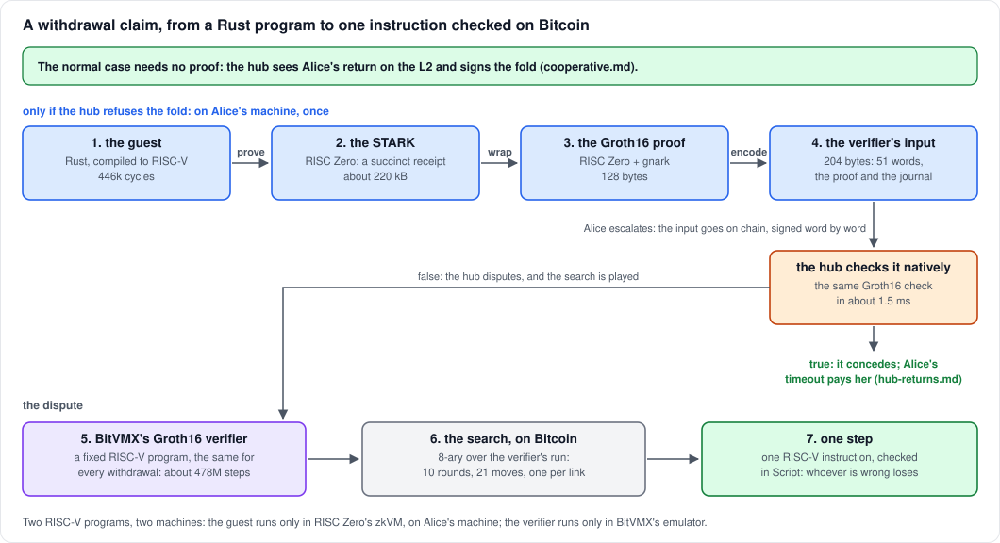
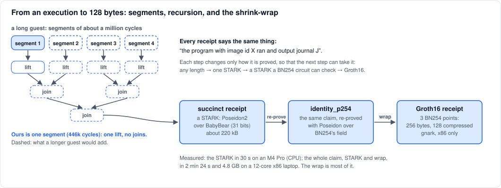
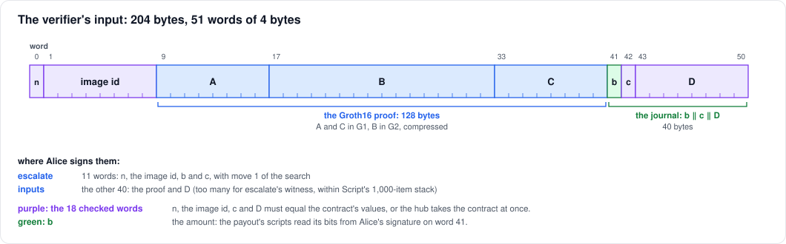
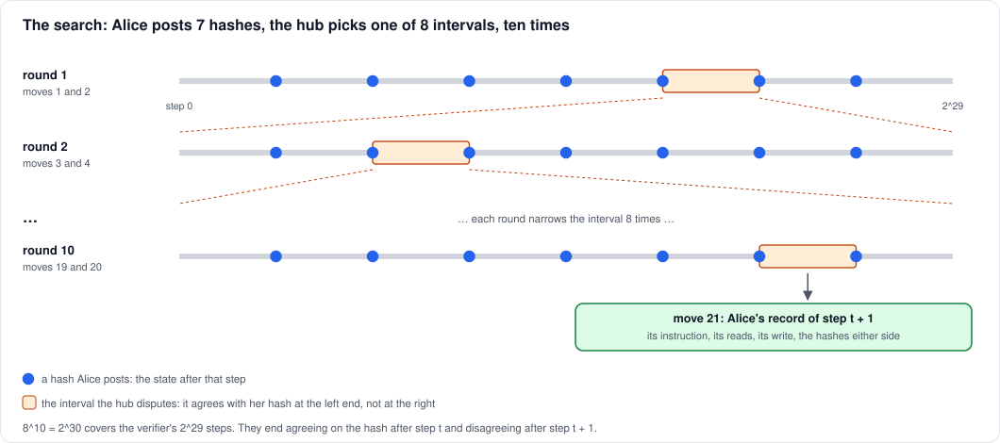
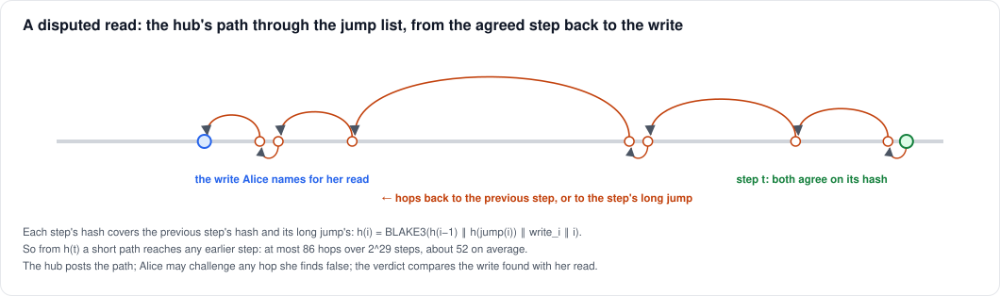

# From a Rust program to one step on Bitcoin

> The pipeline into BitVMX's verifier, lichen's first verification
> gadget. Under BABE the proof is made and wrapped the same way (its
> guest also checks the hub's signature on the amount), and what checks
> it on Bitcoin is a garbled circuit of the Groth16 verifier
> ([BABE in one paragraph](babe-challenged.md#babe-in-one-paragraph)).

How a withdrawal is proved, wrapped and, if the hub refuses it, disputed.
For engineers with a basic familiarity with zero-knowledge proofs. The
figures are from lichen's canonical withdrawal guest and the Mutinynet
trials of October 2026.

A withdrawal that Alice enforces is a claim that a program, run on some
input, produced some output. Bitcoin can't run programs, so the claim
passes through four machines:

1. RISC Zero proves the program's execution with a STARK.
2. RISC Zero and gnark compress that STARK into a 128-byte Groth16 proof.
3. A fixed RISC-V program, BitVMX's Groth16 verifier, checks the proof in
   about 478 million steps.
4. If Alice and the hub disagree about that check, they search its
   execution on chain until a single RISC-V instruction is left, which
   Bitcoin Script can check.



Most withdrawals never touch any of this. In the normal case the hub sees
Alice's return on the L2 and signs the fold
([cooperative.md](cooperative.md)), and Alice proves nothing. On the
real statement the hub first checks the withdrawal statement itself,
natively and in milliseconds, against the sequencer's chain receipt
(below), so it folds only what Alice could win by dispute. If the hub
refuses, Alice makes the proof and escalates. The hub checks the proof
natively, and if the claim is true it concedes
([hub-returns.md](hub-returns.md)). The search is only for a claim the
hub believes false.

> **There are two RISC-V programs here, run by two different machines.**
> The withdrawal statement (the *guest*) runs only in RISC Zero's zkVM, on
> Alice's machine. BitVMX never sees it. BitVMX's emulator runs only the
> Groth16 verifier, and the verifier's execution is what gets searched.
> The verifier is the same program for every withdrawal and every
> deployment.

## Background: STARKs and SNARKs

A proof system convinces a verifier of a statement of one form: "program
P, run on some input w, halts and outputs J". The output J is public, the
*journal*. The input w is the prover's *witness* and may stay private. We
need *soundness* (a false statement can't be proved) and *succinctness*
(the proof is small and quick to check). Zero knowledge is a bonus here:
the withdrawal doesn't need it.

Two families are used, for opposite strengths:

| | STARK (RISC Zero) | Groth16 (a pairing-based SNARK) |
|---|---|---|
| statement | any program, any length (split into segments) | one fixed circuit |
| setup | transparent: no secrets | a trusted setup per circuit |
| cryptography | hashes (Poseidon2 over the BabyBear field) | pairings (the BN254 curve) |
| proof size | hundreds of kilobytes | 3 curve points: 128 bytes compressed |
| verifier | many hash computations | 3 pairings and a few curve operations |

RISC Zero's STARKs prove an arbitrary program cheaply. A Groth16 proof is
what you hand a constrained verifier: tiny, with a fixed check. So the
STARK comes first, and then a fixed Groth16 circuit proves the one
statement "this STARK verifies". That circuit is the same for every
program, so one trusted setup, RISC Zero's public ceremony, serves
everyone. Changing our guest needs no new ceremony.

For us, proof size is what matters most: every byte of the claim is
signed on chain in a dispute. Groth16 is close to the floor here. Groth
showed that a pairing-based SNARK of this kind needs at least two group
elements, and Groth16 has three.

## 1. The guest

The statement is an ordinary Rust program compiled for RISC Zero's zkVM,
a 32-bit RISC-V machine (RV32IM). Lichen's withdrawal guest
(`r0/withdraw-guest`) reads its input as raw bytes and runs on it the
same check the hub runs natively:

```rust
const CHAIN_ID: &str = include_str!("../../guests/chain.id"); // the chain guest's image id

fn main() {
    let n: u32 = env::read();                                  // private input: its length,
    let mut words = vec![0u32; (n as usize).div_ceil(4)];      // then its bytes
    env::read_slice(&mut words);
    let bytes: Vec<u8> = words.iter().flat_map(|w| w.to_le_bytes()).take(n as usize).collect();
    let input = WithdrawInput::from_bytes(&bytes).expect("the statement's input");
    let chain_id = hex32(CHAIN_ID);
    let journal = check(&input, &chain_id, &mut |j| env::verify(Digest::from_bytes(chain_id), j).is_ok())
        .expect("the withdrawal statement");
    env::commit_slice(&journal);                               // public output
}
```

`check` (`lichen_withdraw`, in `crates/withdraw`) takes the return note,
its Merkle path, the state root's height and nullifier root, the
sequencer's signature, the deployment's two keys, the rest of the chain
receipt's journal (its anchoring state among it), the Bitcoin headers on
top of the anchor's block, and the work W the contract asks. It accepts
if:

- the note is owned by the hub's key;
- the path has the tree's depth (16);
- the note's value fits in 32 bits;
- the root rebuilt from the note and its path is the one the sequencer
  signed (BIP340);
- that root is the last one anchored on Bitcoin: the anchoring state's
  last anchor committed it, at its height, under the same sequencer key;
- a chain receipt with that journal verifies under the chain guest's
  image id;
- the headers follow the anchor's block, each within its own target,
  and their work sums to at least W.

It then commits the journal **`b ‖ c ‖ D`**, 40 bytes: the amount, the
memo (the contract's number) and the contract identifier
D = SHA256("lichen/contract" ‖ deployment id ‖ genesis seal ‖ W). The
deployment id is SHA256("lngap/deployment" ‖ sequencer key ‖ hub key),
and the genesis seal is the Bitcoin output the sequencer's anchors
descend from. If any check fails, the guest panics and nothing can be
proved.

The keys, the genesis seal and W are input, not constants, so one guest
serves every deployment and every contract. A contract pins its own D,
just as it pins its memo: the claim is bound to that deployment, its
anchored history, and the depth the contract asked for.

**The chain receipt.** The guest doesn't take the signed root on trust.
The sequencer's chain prover proves each sealed height with the chain
guest: the block is valid, each shielded transaction's own proof checked
inside it, and so was the history before it, back to genesis, each
receipt verifying the last. Its journal carries the height, the roots, a
hash of the history and the anchoring state: the last anchor recorded on
the L2 and the Bitcoin block it is in. The withdrawal guest's
`env::verify` of that journal is an *assumption*: its own proof holds
only given a chain receipt with that journal, and the prover resolves it
with the sequencer's receipt at the first height that carries the
return's anchor (section 2). The chain guest's image id is built into the
withdrawal guest, and the spend guest's into the chain guest, so the
withdrawal guest's image id pins all three. The spend and chain proofs,
and anchoring, are in [SHIELDED.md](../SHIELDED.md).

**The image id.** A compiled guest is identified by its *image id*, a
hash of its memory image. A proof is always about one image id: "the
program with image id X output J". So the contract checks that X is the
withdrawal guest's. Otherwise Alice could prove the output of any program
she liked. The image id changes with any change to the code or the
toolchain, so the guest is built reproducibly, in RISC Zero's pinned
builder image (`r0/build-guest.sh`), and committed
(`r0/guests/withdraw.bin` and `withdraw.id`). Its image id is
`11a9f930…4e67`. A new build is a new deployment's contracts.

**Its size.** The guest uses RISC Zero's accelerated `sha2`, `k256` and
`crypto-bigint`, which hand the hashing and the curve arithmetic to
built-in circuits. With ten headers on the anchor it runs in about 393k
user cycles, and it grows with the number of headers. The guest only
records the chain receipt's claim; checking that receipt is left to the
recursion. (ln-gap's earlier guest, without the chain receipt or
anchoring, took 5.9M cycles without the accelerators.)

## 2. The STARK

RISC Zero executes the guest and records every cycle. A long execution is
split into *segments* of about a million cycles, each proved with its
RISC-V circuit. Then RISC Zero proves the verification of those proofs,
in a smaller circuit made for checking STARKs (*recursion*):

1. each segment's proof is *lifted* into the recursion circuit;
2. pairs are *joined*;
3. the joining repeats until one proof is left.



The result is a *succinct receipt*: one STARK of about 220 kB, the same
size however long the execution. Our guest is a single segment, so it's
one lift and no joins. One more recursion step, the *resolve*, takes the
sequencer's chain receipt (itself a succinct receipt) and discharges the
guest's assumption, so the receipt that comes out holds unconditionally.

The recursion programs are identified by *control ids*. The set of
allowed ones is committed to by a Merkle root, the *control root*, which
is fixed per RISC Zero release. That's why the version is pinned:
lichen uses RISC Zero 3.0.6.

**Where and how long.** On any machine, on its CPU: about 75 s on a Mac
in Docker with 8 cores (RISC Zero 3.x has no Metal prover for segments;
its GPU prover is CUDA only), 361 s on a 4-vCPU x86 server.

## 3. The shrink-wrap into Groth16

The succinct receipt is too big and too hash-heavy for a small verifier.
RISC Zero wraps it in two steps.

**identity_p254.** The Groth16 circuit computes over BN254's 254-bit
field. Checking a BabyBear STARK inside it would mean emulating every
31-bit operation with non-native arithmetic, which is far too large. So
one more recursion step, *identity_p254*, re-proves the same claim with a
STARK whose commitments use Poseidon over BN254's own field. Checking
*that* inside a BN254 circuit is affordable.

**Groth16.** A fixed circuit checks an identity_p254 STARK and outputs a
Groth16 proof: three BN254 points, A and C in G1 and B in G2, 256 bytes,
or 128 compressed. Its public inputs are:
- the control root, as two halves;
- the *claim digest* (a hash of the image id, the journal and the exit
  status), as two halves;
- the BN254 control id.

A verifier recomputes the claim digest from the image id and the journal
it is given, so the proof is bound to exactly that program and that
output.

Every step outputs the same claim, "image id X ran and output J". Only
how it is proved changes, so that the next step can take it.

**Where and how long.** RISC Zero runs the Groth16 prover (gnark) in a
Docker image built for x86 only, so this step needs x86 Linux. On a
4-vCPU x86 server the wrap took 258 s, after 361 s for the STARK, and it
uses about 8 GB of memory.

## 4. The verifier's input

BitVMX's Groth16 verifier takes its input as a flat byte string, with the
points compressed (an x coordinate and a sign bit). For lichen it's
**204 bytes, 51 words of 4 bytes**:



The journal is part of the input, so `b`, `c` and `D` sit in fixed
words. That's what lets the contract read them. In a dispute Alice signs
every word with a one-time key, in two transactions:
- **`escalate`** carries 11 words: the journal's length, the image id,
  `b` and `c`. It also carries move 1 of the search.
- **`inputs`** carries the other 40: the proof and `D`. They don't fit in
  escalate's witness, which is limited by Script's 1,000-item stack.

The contract treats the words in three ways:
- **18 words are checked.** The journal's length, the image id, `c` and
  `D` must equal the contract's values. If any differs, the hub takes the
  contract at once with that word's check leaf.
- **`b` is the payout.** The payout's scripts read its bits from Alice's
  signature on word 41 ([hub-absent.md](hub-absent.md)).
- **The proof's 32 words are not checked by the contract.** Checking
  them is the verifier's job.

## 5. The verifier program

The verifier is a C program (FairgateLabs' `bitvmx-zk-verifier`)
compiled to RISC-V for BitVMX's emulator, and used unpatched. It's fixed:
the same binary checks every withdrawal. Its constants are baked in: the
Groth16 verifying key of RISC Zero's circuit, the control root and the
BN254 control id, all from RISC Zero 3.0. Given the 204 bytes, it:

1. decompresses the three points;
2. recomputes the claim digest from the image id and the journal;
3. combines the verifying key's points, weighted by the public inputs;
4. checks the pairing equation e(A, B) = e(α, β) · e(L, γ) · e(C, δ);
5. halts with exit code 0 if it holds, and otherwise non-zero.

Pairings on a 32-bit machine without big-number instructions are slow.
Test C's claim took **477,810,565 steps** and halted with code 0. With
`b` tampered, the same proof halts with code 1: the proof is bound to the
journal.

**The hub's shortcut.** The hub makes the same check natively with
lngap-zk's Groth16 verifier, the same equation over the same constants,
in about 1.5 ms. It emulates the 478M steps (about 2 minutes) only to
play a search, that is, for a claim it means to dispute. If the native
check and the program ever disagreed, only the hub could lose
([hub-returns.md](hub-returns.md)).

## 6. The search, on Bitcoin

Suppose Alice claims "the verifier, run on these 204 bytes, halts with
code 0" and the hub disagrees. Each can run the verifier locally, and
both are bound to the same input, since Alice has signed it. Instead of
asking Bitcoin to run 478 million steps, they search for the first step
on which they disagree. This is BitVMX's search, played with BitVMX's
emulator and scripts, in a fork with two bug fixes and an authenticated
jump list (AdamISZ/BitVMX-CPU, branch `lngap`).

**Step hashes.** The emulator sums up the machine after step i as a
20-byte hash h(i), chained so that h(i) depends on h(i − 1) and on what
step i wrote. Agreeing on h(i) means agreeing on the whole execution up
to step i.

**The search is 8-ary.** In each round, Alice posts the hashes at the 7
points that split the disputed interval into 8, and the hub names the
eighth it disputes: it agrees with her hash at the start of that eighth,
not at the end. Ten rounds cover the verifier's 2^29 steps, since
8^10 = 2^30. They end agreeing on h(t) and disagreeing on h(t + 1).



**21 moves, one transaction each.**
- **Odd moves are Alice's.** Move 1, in `escalate`, is her claim and her
  first seven hashes. Each later round of hashes is about 7.5 kvB.
- **Even moves are the hub's.** Each is its choice of one interval in
  eight, about 0.3 kvB.
- **Move 21 is Alice's record of step t + 1,** about 6.8 kvB: the
  instruction, the values it read (and the step that last wrote each),
  what it wrote, and the hashes either side.

A move is its mover's one-time signatures on what it posts, one key per
field, and nothing else. A rule that needs a posted value re-reveals the
signatures, which are public once posted. Each link also has a timeout:
a party that fails to move within its window loses.

**The last step.** Bitcoin judges one RISC-V instruction:
- **Alice's proof:** one pre-signed leaf per class of instruction runs
  BitVMX's verification script for that instruction on her record, and
  checks the hashes.
- **The hub's disproves** are BitVMX's challenges:
  - the agreed step must be the hub's choices put together;
  - her record's hashes must be those she posted in the search, with an
    *equivocation* challenge for each round and index;
  - the record must agree with the program: the opcode at its pc, the
    entry point, the pc the previous step wrote, the memory sections;
  - reads of never-written memory must match the input or the initial
    data;
  - a claimed success must end in a success exit (`halt_exit`).

  A disprove of `halt_exit` is about 5.1 kvB.

### Reads, by the jump list

A step hash covers what a step writes, not what it reads; a read's value
is whatever was last written to its address. So Alice could claim a false
value for a read, name a plausible step as its last write, and execute
the instruction faithfully on it. The search would end at that step, and
her proof would pass. BitVMX catches this with a second search, as long
again as the first. Lichen hashes the trace as an **authenticated jump
list** (Lerner), which needs only a few more transactions:



1. Each step's hash also covers the hash of an earlier step, its *long
   jump*, chosen by the step number alone. So a short path, at most 86
   hops over 2^29 steps and about 52 on average, leads from h(t) back to
   any earlier step.
2. To show a false read, the hub posts the path from h(t) back to the
   write, and the write itself.
3. Alice, holding the true history, may challenge any hop she finds
   false. The hub must then reveal that step's preimage, so a forged
   path loses at its first false hop.
4. If the path stands, the verdict compares the write it found with
   Alice's read.

The same path settles one more lie that a jump list makes possible: a
false long-jump hash in her record.

### What a search costs

| | transactions | size |
|---|---|---|
| a whole search, no read disputed | 22 | about 123 kvB |
| with a read disputed (one measured case: a 58-hop path) | 25 | about 187 kvB |
| the Mutinynet trials (the hub absent, or conceding) | 2 links, then the timeout | 21.5 kvB of links |

Each link pays a fee floor of 1 sat/vB out of the contract, and the
loser's reserve covers the floors. For the Groth16 statement the deepest
dispute's floors come to 197,356 sats, which is why the hub's reserve is
that large.

**Honesty is enough.** An honest Alice can always answer, because her
hashes come from the true execution. An honest hub can always find a
disagreement with a false claim, because the true execution ends
differently. Whoever is wrong runs out of moves, or loses at the last
step.

## Who does what, where, and how long

| step | who | where | measured |
|---|---|---|---|
| build the guest | anyone (the image id is the contract's) | x86 Docker, RISC Zero's builder image | reproducible |
| prove each height (the chain receipt) | the sequencer's prover | any machine | 1 to 2.5 min a small block on a Mac ([SHIELDED.md](../SHIELDED.md)) |
| prove (STARK) | Alice, only if the hub refuses | any machine | about 393k user cycles; 75 s on a Mac (Docker, 8 cores), 361 s on 4 x86 vCPUs |
| wrap (identity_p254 + Groth16) | Alice | x86 Linux, Docker | 258 s on 4 vCPUs, about 8 GB |
| check the proof | the hub | any machine | about 1.5 ms |
| emulate the verifier | both, only to play the search | any machine | 477.8M steps, about 2 minutes |
| the search | both | Bitcoin, one link per move | 21 moves; on regtest, both engines, 725 s |
| the last step | Alice's proof, or the hub's challenge | Bitcoin, in Script | one instruction |

## Practical notes

- **Pin RISC Zero** to the release whose constants the verifier carries:
  3.0.x (lichen uses 3.0.6). The image id depends on the toolchain too,
  so build the guest in the builder image (`r0/build-guest.sh`).
- **The claim needs the chain receipt.** The wallet prints the
  withdrawal input, with the headers on the anchor, and fetches the
  sequencer's chain receipt:

  ```sh
  lichen --wallet alice.json withdraw-input <memo> > withdraw-input.json
  lichen --wallet alice.json chain-receipt <memo> chain.receipt
  ```

  They refuse, saying what is missing, until the return's root is
  anchored, the anchor has the work W on top (`withdraw-input`), and the
  sequencer has proved the height that carries the anchor
  (`chain-receipt`).
- **The Groth16 step needs x86 and Docker.** On x86 Linux,
  `lichen-r0 claim withdraw-input.json chain.receipt claim.hex` proves,
  wraps and writes the 204-byte input as hex (`r0/host`, or the prover
  image with `r0/withdraw-prover.sh claim …`). On a Mac,
  `r0/withdraw-prover.sh withdraw withdraw-input.json chain.receipt <out>`
  makes the STARK only; `lichen-r0 wrap` and `lichen-r0 bitvmx-input`
  finish it on Linux.
- **Snap-installed Docker can't see `/tmp`**, where RISC Zero hands the
  Groth16 step its files. Point RISC Zero's work directory
  (`RISC0_WORK_DIR`) at a directory under your home.
- **Memory:** budget about 8 GB for the wrap; a 16 GB machine is
  comfortable. It was killed on a 2 GB Docker VM.

## Glossary

- **assumption:** a receipt that a guest's proof depends on
  (`env::verify`), discharged by a *resolve* step in the recursion.
- **BabyBear:** the 31-bit prime field 15 · 2^27 + 1 that RISC Zero's
  STARKs compute in.
- **BN254:** the pairing-friendly curve that the Groth16 proof lives on.
- **BitVMX:** a protocol and RISC-V emulator for disputing a program's
  execution on Bitcoin by searching it, by FairgateLabs.
- **chain receipt:** the sequencer's proof, made for each sealed height,
  that the L2's history up to it is valid; it carries the anchoring
  state.
- **claim digest:** a hash of the image id, the journal and the exit
  status. It's what a RISC Zero proof is about.
- **control id, control root:** RISC Zero's recursion programs, and the
  Merkle root of the allowed ones. Fixed per release.
- **guest:** the program whose execution is proved, in RISC Zero's zkVM.
- **identity_p254:** the recursion step that re-proves a STARK with a
  BN254-friendly hash, so that Groth16 can check it.
- **image id:** the hash of a guest's compiled memory image.
- **journal:** the guest's public output, here `b ‖ c ‖ D`.
- **jump list:** a hash chain in which each step also commits to an
  earlier step's hash, so that any earlier step is a short path away.
- **receipt:** RISC Zero's proof object (a journal plus a seal):
  segment, succinct, or Groth16.
- **segment:** a slice of a long execution, proved on its own.
- **shrink-wrap:** turning a succinct receipt into a Groth16 receipt.
- **witness:** the private input that makes a statement true.

The diagrams are drawn by `img/pipeline.py`.
