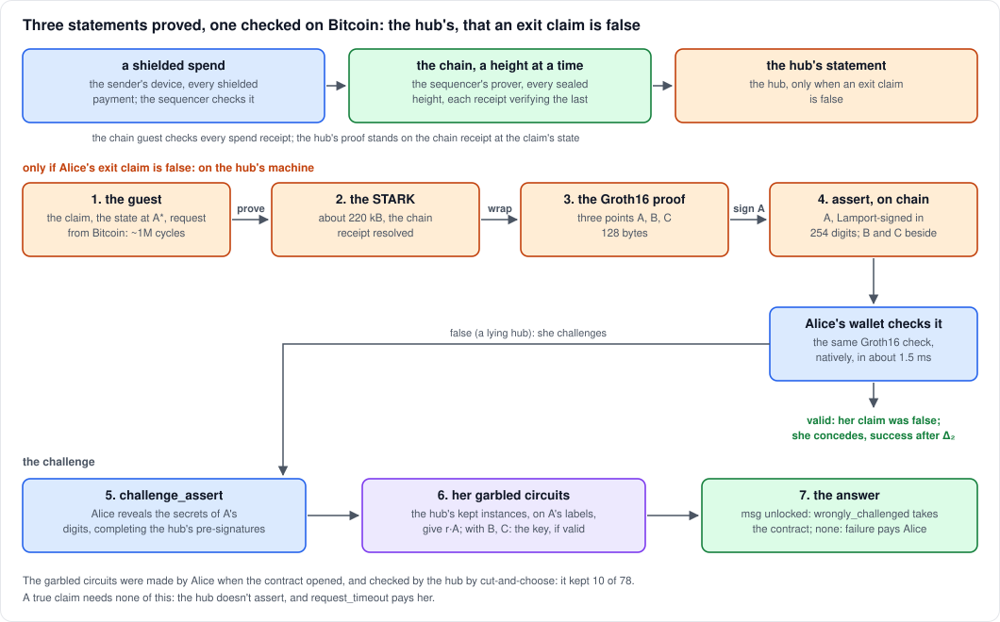
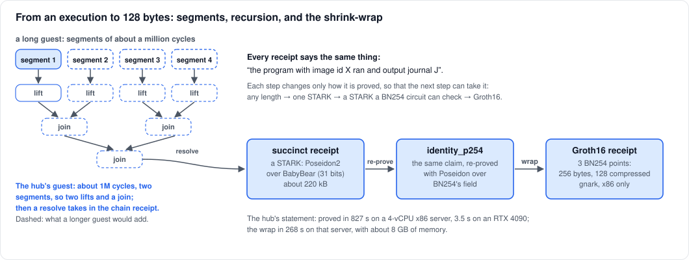
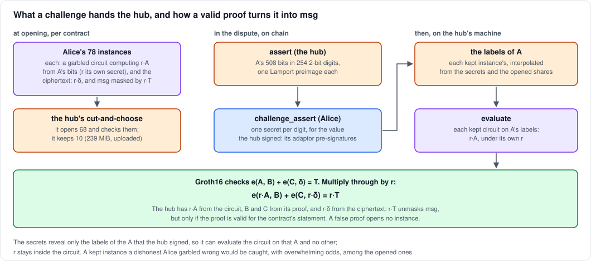

# From a Rust program to a check on Bitcoin

How lichen's proofs are made, and how one of them is checked on
Bitcoin. For engineers with a basic familiarity with zero-knowledge
proofs. The figures are from lichen's guests (2026-11-10), the
Mutinynet runs of 2026-11-11, and the real-circuit runs on regtest of
2026-11-10.

Three programs are proved, by three different parties:

| statement | its guest | who proves it | when |
|---|---|---|---|
| a shielded spend is valid | `spend` | the sender's wallet | every shielded payment |
| a sealed L2 block is valid, and the history before it | `chain` | the sequencer's chain prover | every height it seals |
| an exit claim is false | `hp` | the hub | only when a user's exit claim is false |

The first two stay off Bitcoin: the sequencer checks every spend proof,
and the chain receipts are what the third proof stands on. Only the
hub's statement reaches Bitcoin, and only in a dispute:

1. RISC Zero proves the hub's statement with a STARK, composing the
   sequencer's chain receipt for the state the claim is judged at.
2. RISC Zero and gnark compress that STARK into a Groth16 proof.
3. Bitcoin checks the Groth16 proof through BABE, with the roles of the
   BABE paper swapped: the hub proves, and Alice garbled the circuits
   when her contract opened. The hub posts the proof's first point,
   signed. If Alice challenges it, she reveals secrets that let the hub
   run one of her garbled circuits, which, on a valid proof, unlocks a
   message whose posting wins the hub the contract.



**A user never proves a withdrawal.** Her cooperative withdrawal is a
claim the hub checks against its own ledger
([cooperative.md](cooperative.md)), and her exit is the same claim
posted on Bitcoin ([exit.md](exit.md)). If the claim is true, nothing is
proved: the hub lets her timeout pay her. Only a false claim brings the
pipeline below into play, and it is the hub that runs it. A user proves
only her own shielded spends, on her device.

## Background: STARKs and SNARKs

A proof system convinces a verifier of a statement of one form: "program
P, run on some input w, halts and outputs J". The output J is public, the
*journal*. The input w is the prover's *witness* and may stay private. We
need *soundness* (a false statement can't be proved) and *succinctness*
(the proof is small and quick to check). Zero knowledge matters for the
spend proof, which hides who pays whom; the hub's statement doesn't need
it.

Two families are used, for opposite strengths:

| | STARK (RISC Zero) | Groth16 (a pairing-based SNARK) |
|---|---|---|
| statement | any program, any length (split into segments) | one fixed circuit |
| setup | transparent: no secrets | a trusted setup per circuit |
| cryptography | hashes (Poseidon2 over the BabyBear field) | pairings (the BN254 curve) |
| proof size | hundreds of kilobytes | 3 curve points: 128 bytes compressed |
| verifier | many hash computations | 3 pairings and a few curve operations |

RISC Zero's STARKs prove an arbitrary program cheaply. A Groth16 proof is
what you hand a constrained verifier: tiny, with a fixed check. So the
STARK comes first, and then a fixed Groth16 circuit proves the one
statement "this STARK verifies". That circuit is the same for every
program, so one trusted setup, RISC Zero's public ceremony, serves
everyone. Changing a guest needs no new ceremony.

## 1. The guests

Each statement is an ordinary Rust program compiled for RISC Zero's
zkVM, a 32-bit RISC-V machine (RV32IM). The statements live in lichen's
crates (`crates/shielded`, `crates/validity`, `crates/withdraw`), and the
sequencer and the hub run the same code natively, so they know a proof's
outcome before they make it. Each guest reads its input as raw bytes and
runs the check. The hub's (`r0/hp-guest`):

```rust
const CHAIN_ID: &str = include_str!("../../guests/chain.id"); // the chain guest's image id

fn main() {
    let n: u32 = env::read();                                  // private input: its length,
    let mut words = vec![0u32; (n as usize).div_ceil(4)];      // then its bytes
    env::read_slice(&mut words);
    let bytes: Vec<u8> = words.iter().flat_map(|w| w.to_le_bytes()).take(n as usize).collect();
    let chain_id = hex32(CHAIN_ID);
    let verify_chain = &mut |j: &[u8]| env::verify(Digest::from_bytes(chain_id), j).is_ok();
    let input = HubInput::from_bytes(&bytes).expect("the statement's input");
    let journal = check(&input, &chain_id, verify_chain).expect("the hub's statement");
    env::commit_slice(&journal);                               // public output
}
```

### The hub's statement: "the claim posted in `request` is false"

Its input:

- **`request`, from Bitcoin:** the transaction, its path to its block's
  Merkle root, and the headers on top, whose work must reach the `W` the
  contract fixed. `request` is the spend of the contract's output, and
  its witness carries the claim (her notes, by position, and their
  openings) and her one-time signatures on `b` and on the claim's
  fingerprint `E`. The guest doesn't check those signatures: Bitcoin did,
  in `request`'s script. It reads their digits. So `b` needs no
  signature of the hub's: Bitcoin authenticated it.
- **`A*`, the state the claim is judged at:** the last anchor confirmed
  at least the margin (20 blocks on Mutinynet) before `request`'s block.
  The hub shows it is the last by the first spend of its seal output,
  confirmed after that cutoff. Anchors spend the seal one after another,
  and Bitcoin allows one spend, so no later anchor came before the
  cutoff.
- **The chain state at `A*`:** the journal of the sequencer's chain
  receipt at that height, and openings of the commitment tree and the
  spent set for the notes the ground needs.

It accepts if the claim is false on any ground:

| ground | shown by |
|---|---|
| malformed | the claim doesn't parse, doesn't hash to `E`, repeats a note, or `b` exceeds the cap |
| not hers | a note's owner (for a shielded note, its exit key) signed none of the claim's signatures |
| too much | the notes are worth less than `b` |
| not a note | at `A*`, the leaf at a note's position isn't its commitment |
| spent | at `A*`, its nullifier is spent by a spend that counts: the hub's, or one its sender acknowledged |
| locked | at `A*`, it's an output of a spend its sender hasn't acknowledged, and the claim carries no acknowledgment |
| voided | at `A*`, it's an output of a spend an exit record voided |
| a second claim | the owner's signature on a claim of the note through another contract |

Acknowledgments are how a spend comes to count: [payments.md](payments.md).
If no ground holds, the guest panics, and nothing can be proved.

**Its journal is fixed at opening:** `c ‖ D ‖ H(O_D ‖ margin)`, 68
bytes: the contract's number `c`; its identifier `D`, a hash of the
deployment's keys, its genesis seal, the work `W` and the contract's
unit; and a hash of the contract's deposit coin and the margin. Neither
`b` nor the claim is in it: they are read from `request`, which the
journal pins through the coin it spends. BABE needs the public input
fixed when the contract opens (section 4), and this one is.

**The chain receipt is an assumption.** The guest doesn't take the
state at `A*` on trust. The sequencer's chain prover proves each sealed
height with the chain guest: the block is valid (each shielded spend's
own receipt checked inside it, each transparent spend's signatures, the
acknowledgments, exit records and anchors), and so was the history
before it, each receipt verifying the last. Its journal carries the
height, the roots, a hash of the history and the anchoring state. The
hub's guest's `env::verify` of that journal is an *assumption*: its own
proof holds only given a chain receipt with that journal, and the hub's
prover resolves it with the sequencer's receipt (section 2).

**The image id.** A compiled guest is identified by its *image id*, a
hash of its memory image, and a proof is always about one: "the program
with image id X output J". The chain guest's id is built into the hub's
guest, and the spend guest's into the chain guest, so the hub's guest's
id pins all three. They are built reproducibly in RISC Zero's pinned
builder image (`r0/build-guest.sh`) and committed (`r0/guests/`): spend
`9fd630b2…`, chain `f06d2420…`, hp `f424a509…`. A contract's statement
names the hub's guest's id when it opens; a new build is a new
deployment's contracts.

**Their sizes,** in user cycles (one segment holds about a million):

| guest | what | cycles |
|---|---|---|
| spend | a shield of one transparent note | 14.6k |
| spend | two inputs and two outputs | 2^17 to 2^20 |
| chain | a block of an empty seal | 98k |
| chain | a block of a payment and its acknowledgment | 0.84M |
| hp | a stale claim, its note spent at `A*` | 1.02M (2 segments) |

A BIP340 signature costs about 260k cycles, and is most of a chain
block's work. The spent set, a compact sparse Merkle tree, costs some
twenty compressions an access.

## 2. The STARK

RISC Zero executes the guest and records every cycle. A long execution is
split into *segments* of about a million cycles, each proved with its
RISC-V circuit. Then RISC Zero proves the verification of those proofs,
in a smaller circuit made for checking STARKs (*recursion*):

1. each segment's proof is *lifted* into the recursion circuit;
2. pairs are *joined*;
3. the joining repeats until one proof is left.



The result is a *succinct receipt*: one STARK of about 220 kB, the same
size however long the execution. One more recursion step, the *resolve*,
takes the sequencer's chain receipt (itself a succinct receipt) and
discharges the guest's assumption, so the receipt that comes out holds
unconditionally.

The recursion programs are identified by *control ids*. The set of
allowed ones is committed to by a Merkle root, the *control root*, which
is fixed per RISC Zero release. That's why the version is pinned:
lichen uses RISC Zero 3.1.0.

**Where and how long.** RISC Zero 3.x proves on the CPU, or on an
NVIDIA GPU with CUDA (`lichen-r0` built with `--features cuda`); it has
no Metal prover for Apple's GPUs.

| proof | a Mac's CPU | a 4-vCPU x86 server | lichen-hub, 16 x86 vCPUs | an RTX 4090 |
|---|---|---|---|---|
| a chain height (98k to 820k cycles) | 18 to 62 s | | 38 to 157 s | 1.4 to 2.3 s |
| the hub's statement (1.0M to 1.65M cycles, 2 segments) | | 827 s | 521 to 526 s | 3.5 s |

## 3. The shrink-wrap into Groth16

The succinct receipt is too big and too hash-heavy for a small verifier.
RISC Zero wraps it in two steps.

**identity_p254.** The Groth16 circuit computes over BN254's 254-bit
field. Checking a BabyBear STARK inside it would mean emulating every
31-bit operation with non-native arithmetic, which is far too large. So
one more recursion step, *identity_p254*, re-proves the same claim with a
STARK whose commitments use Poseidon over BN254's own field. Checking
*that* inside a BN254 circuit is affordable.

**Groth16.** A fixed circuit checks an identity_p254 STARK and outputs a
Groth16 proof: three BN254 points, A and C in G1 and B in G2, 256 bytes,
or 128 compressed. Its public inputs are:
- the control root, as two halves;
- the *claim digest* (a hash of the image id, the journal and the exit
  status), as two halves;
- the BN254 control id.

A verifier recomputes the claim digest from the image id and the journal
it is given, so the proof is bound to exactly that program and that
output. Both are fixed when the contract opens, so all of the public
input is.

Every step outputs the same claim, "image id X ran and output J". Only
how it is proved changes, so that the next step can take it.

**Where and how long.** RISC Zero runs the Groth16 prover (gnark) in a
Docker image built for x86 only, so this step needs x86 Linux: about
268 s on a 4-vCPU server, with about 8 GB of memory, and 119 to 128 s on
lichen-hub. With CUDA, RISC Zero can run it natively on the GPU instead
(its `risc0-groth16` component, from `rzup`); on the rented 4090 that
failed each time, with an illegal memory access, so the wrap stays on
the CPU. With the rest on a GPU, it is nearly all of the hub's proving.

## 4. The check on Bitcoin, under BABE

BABE (Garg, Kolonelos, Sergeevitch, Sridhar and Tse, ePrint 2026/065)
checks a Groth16 proof on Bitcoin without running the verifier there.
Its idea is *witness encryption*: one party encrypts a message, `msg`,
so that only someone holding a valid proof can decrypt it, and posting
`msg` on chain is what wins the prover the dispute. In the paper the
prover is the depositor. In lichen it is the hub, proving a claim false,
and Alice, the user, is the one who garbles.

### At opening: Alice's garbled circuits

Groth16's check, written additively in the pairing's target group (the
sign convention BABE's paper uses), is

> e(A, B) + e(C, δ) = T, where T = e(α, β) + e(L, γ)

for the proof's points A, B and C, the verifying key's α, β, γ and δ,
and L the verifying key's points weighted by the public inputs.
Multiplied through by a secret scalar r:

> e(r·A, B) + e(C, r·δ) = r·T

T is fixed once the public input is, and it is: the journal is fixed at
opening. So Alice can publish r·δ and `msg` masked by a hash of r·T:
the *ciphertext*. Anyone with B, C and r·A could compute r·T and unmask
`msg`. B and C are in the hub's proof, and r·A is the hard part: A
arrives only at proving time, and r must stay secret. BABE's answer is a
*garbled circuit*: Alice garbles a small circuit that computes r·A from
the bits of A, with r inside it. Someone holding the circuit's *labels*
for the bits of one A, one label per bit, can evaluate it on that A,
and learns r·A and nothing else.



Alice could garble wrongly, so that no proof ever decrypts and the hub
could never win, however false her claim. The hub checks by
*cut-and-choose*:
- **Commit.** Alice's wallet makes 78 instances, each with its own r and
  `msg`, and commits to them.
- **Keep.** The hub picks 10 to keep, and she uploads them: 23.9 MiB
  each, 239 MiB in all.
- **Open.** She opens the other 68 by their seeds, and the hub rebuilds
  and checks each: 20 to 36 s on lichen-hub.

A cheating Alice must make every kept instance bad and every opened one
good, at odds of 1 in C(78, 10), about 2^-40. One honest kept instance
is enough for the hub.

An instance is 528k AND gates and the encoding's tables. Garbling takes
about 1.2 s and evaluating 0.6 s, on one thread; her wallet garbled the
78 in 9.3 s on a Mac. The upload is the slow part on a home
connection: 65 s at some 30 Mbit/s, and half an hour when six
wallets uploaded at once over one home uplink.

The input labels are not posted on chain directly. Each digit's label
comes from a secret Alice has *shared* across the 78 instances (Shamir's
scheme, with commitments the hub checks against the opened ones). The
hub gives Alice, for each digit of A and each of its four values, an
*adaptor pre-signature* on `challenge_assert`, locked to that digit's
secret. Alice can complete a pre-signature only by revealing the secret
it is locked to, and the script lets her complete only the value the
hub signed. So a challenge reveals exactly the secrets of the A the hub
asserted. From those and the opened instances' shares, the hub
interpolates every kept instance's labels.

### In the dispute

1. **`request`.** Alice posts her claim, `b` and `E`, signed with her
   one-time keys (2.1 kvB for one note). The hub has `w_H` to answer (2
   hours on Mutinynet), or `request_timeout` pays her `b`.
2. **The hub's proof.** The hub decides its statement natively, in
   milliseconds. If a ground holds, it proves and wraps, with the
   sequencer's chain receipt at `A*`'s height.
3. **`assert`.** The hub posts A, its 508 bits Lamport-signed in 254
   2-bit digits (one of four preimages a digit), with B and C beside:
   7.7 kvB.
4. **Alice's check.** Her wallet verifies the proof natively against the
   contract's journal, in about 1.5 ms. If it's valid, it concedes: after
   `Δ2` (a day on Mutinynet) `success` takes the contract.
5. **`challenge_assert`.** For a false proof, Alice completes the hub's
   pre-signatures for A's digits, revealing their secrets: 20.7 kvB,
   paid out of the contract.
6. **The answer.** The hub reads the secrets from the challenge,
   interpolates each kept instance's labels, and evaluates each circuit
   to its r·A. With B and C it computes r·T and unmasks that instance's
   `msg`. If its proof is valid, at least the honest instances open, and
   it posts `wrongly_challenged_k` with one `msg`, which takes the
   contract. If it isn't, none opens, and after `Δ1` (2 hours)
   `failure` pays Alice `b` and the hub's reserve.

| ending | transactions | on Mutinynet |
|---|---|---|
| a true claim | request, request_timeout | 2.7 kvB: 2.1 and 0.6 |
| a false claim, conceded | request, assert, success | 9.9 kvB, and `success` a day later |
| a false claim, challenged anyway | request, assert, challenge_assert, wrongly_challenged | 30.8 kvB: 2.1, 7.7, 20.7 and 0.3 |
| a true claim, a lying hub | request, assert, challenge_assert, failure | 31.2 kvB: 2.1, 7.7, 20.7 and 0.6 |

The runs are in [exit.md](exit.md).

**No tower.** Her challenge completes the hub's pre-signatures with her
secrets, one digit at a time, for whatever A the hub asserted. A tower
playing it for her would have to hold all of them, and all of them are
every input label: enough for the hub, colluding with it, to answer any
challenge. So she challenges herself. She has to challenge only a lying
hub, and her window for it, `Δ2`, is a day on Mutinynet.

## Who does what, where, and how long

| step | who | where | measured |
|---|---|---|---|
| build the guests | anyone (their image ids are the contract's) | x86 Docker, RISC Zero's builder image | reproducible |
| a shielded spend's proof | the sender | her device's CPU | 3 s for a shield; 23 to 110 s for two inputs and two outputs, on a Mac |
| prove each height (the chain receipt) | the sequencer's prover | any machine | see section 2 |
| BABE's setup, at opening | Alice garbles and uploads; the hub checks and keeps | Alice's device, the hub | 9.3 s of garbling and 239 MiB uploaded; 20 to 36 s of checking |
| decide the statement | the hub | natively | milliseconds |
| prove it (STARK) | the hub, only for a false claim | any machine | see section 2 |
| wrap (identity_p254 + Groth16) | the hub | x86 Linux, Docker | 268 s on 4 vCPUs, 119 to 128 s on lichen-hub |
| check the proof | Alice's wallet | natively | about 1.5 ms |
| assert, challenge, answer | the hub, Alice, the hub | Bitcoin | 7.7, 20.7 and 0.3 kvB |

## Practical notes

- **Pin RISC Zero** to the release whose constants the verifiers carry:
  3.1.x (lichen uses 3.1.0). The image id depends on the toolchain too,
  so build the guests in the builder image (`r0/build-guest.sh`).
- **The hub's prover** is `r0/hp-prover.sh` (`LICHEN_HP_PROVER`; the
  deployment's image carries it): `lichen-r0 hp-proof` proves the
  statement, resolving the chain receipt, and wraps it. `r0/hp-remote.sh`
  runs it on another machine over ssh, such as an x86 box with Docker
  for a hub on a Mac. The hub proves once a contract, and keeps the seal
  (`hp/<cid>/proof.seal`).
- **`w_H` must cover the hub's proving,** with the chain receipt at
  `A*` if its prover is behind. On Mutinynet it is 2 hours; the hub's
  proving took about 11 minutes, once its chain
  prover had caught up with the claim's state (31 to 35 minutes after
  a burst of heights).
- **Snap-installed Docker can't see `/tmp`**, where RISC Zero hands the
  Groth16 step its files. Point RISC Zero's work directory
  (`RISC0_WORK_DIR`) at a directory under your home; the deployment
  does.
- **Memory:** budget about 8 GB for the wrap.

## Glossary

- **adaptor signature:** a pre-signature that can be completed only with
  a secret, so that completing it reveals the secret.
- **assumption:** a receipt that a guest's proof depends on
  (`env::verify`), discharged by a *resolve* step in the recursion.
- **BABE:** a protocol for checking a Groth16 proof on Bitcoin by
  witness encryption and a garbled circuit; lichen's verification gadget.
- **BabyBear:** the 31-bit prime field 15 · 2^27 + 1 that RISC Zero's
  STARKs compute in.
- **BN254:** the pairing-friendly curve that the Groth16 proof lives on.
- **chain receipt:** the sequencer's proof, made for each sealed height,
  that the L2's history up to it is valid; it carries the anchoring
  state.
- **claim digest:** a hash of the image id, the journal and the exit
  status. It's what a RISC Zero proof is about.
- **control id, control root:** RISC Zero's recursion programs, and the
  Merkle root of the allowed ones. Fixed per release.
- **cut-and-choose:** checking a party's work by opening most of many
  copies at random and keeping the rest unopened.
- **garbled circuit:** an encrypted circuit that can be evaluated on one
  input, given that input's labels, revealing only its output.
- **guest:** the program whose execution is proved, in RISC Zero's zkVM.
- **identity_p254:** the recursion step that re-proves a STARK with a
  BN254-friendly hash, so that Groth16 can check it.
- **image id:** the hash of a guest's compiled memory image.
- **journal:** the guest's public output: for the hub's statement,
  `c ‖ D ‖ H(O_D ‖ margin)`.
- **Lamport signature:** a one-time signature that reveals one of several
  preimages per digit signed.
- **receipt:** RISC Zero's proof object (a journal plus a seal):
  segment, succinct, or Groth16.
- **segment:** a slice of a long execution, proved on its own.
- **shrink-wrap:** turning a succinct receipt into a Groth16 receipt.
- **witness:** the private input that makes a statement true.
- **witness encryption:** encryption that a holder of a valid proof of a
  fixed statement can decrypt.

The diagrams are drawn by `img/pipeline.py`.
